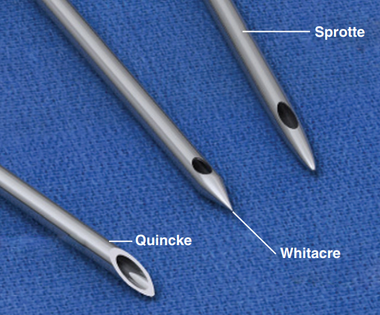
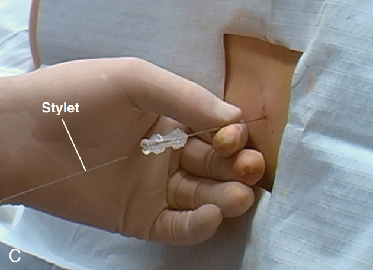
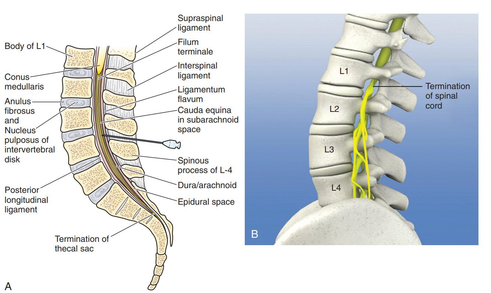
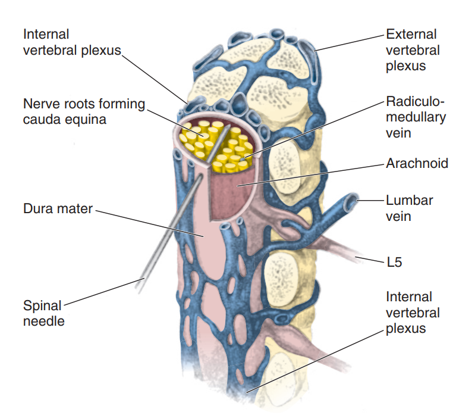

# Kỹ thuật chọc dò thắt lưng 

Trong chọc dò thắt lưng (CDTL), hay còn gọi là chọc dò dịch não tủy (dịch não tủy – DNT), cần quan tâm những vấn đề dưới đây:

**Trước khi chọc dò**

- Chỉ định CDTL 
- Chống chỉ định tuyệt đối/tương đối CDTL 
- Khi nào cần đánh giá hình ảnh học sọ não trước chọc dò
- Đánh giá và xử trí rối loạn đông máu trước chọc dò
- Chuẩn bị bệnh nhân (tư thế, vô khuẩn, giảm đau, tư vấn, đồng thuận).

**Trong khi chọc dò**

- Xác định vị trí chọc dò (khe liên đốt, mốc giải phẫu)
- Kỹ thuật đưa kim đúng chuẩn (góc, hướng, độ sâu)
- Cách xử trí khi không thấy dịch chảy ra hoặc chọc dò thất bại
- Số ống xét nghiệm và số mL DNT cần lấy.

**Sau khi chọc dò**

- Theo dõi và chăm sóc bệnh nhân sau thủ thuật 
- Những biến chứng thường gặp và cách xử trí
- Phiên giải kết quả DNT 
- Hiệu chỉnh kết quả khi có chọc dò chạm mạch (traumatic tap)
- Khi nào cần chọc dò lại và những lưu ý gì khi lặp lại thủ thuật.

## Chỉ định chọc dò thắt lưng

CDTL có ba nhóm chỉ định: *cấp cứu, chẩn đoán không khẩn cấp và điều trị.* Nghi ngờ nhiễm trùng thần kinh trung ương là chỉ định cấp cứu phổ biến nhất, vì không có phương pháp nào khác loại trừ hoàn toàn được viêm màng não. Chỉ định thứ hai là nghi ngờ xuất huyết dưới nhện nhưng chụp cắt lớp vi tính (computed tomography – CT) sọ âm tính hoặc không chẩn đoán được. Ở trẻ em, dấu hiệu lâm sàng càng ít và không điển hình khi trẻ càng nhỏ, nên ngưỡng chỉ định cần rộng hơn và được phân tầng theo tuổi.

### Chỉ định cấp cứu

**Nghi ngờ nhiễm trùng thần kinh trung ương**

Nghi ngờ nhiễm trùng thần kinh trung ương (như viêm não, viêm màng não) là chỉ định cấp cứu chính. Theo Hoen et al. (2019), cần chọc dò *trong vòng một giờ* sau khi vào khoa cấp cứu, trừ khi có chống chỉ định hoặc cần khảo sát hình ảnh học sọ não trước. Chọc dò càng sớm càng tốt để bắt đầu kháng sinh kinh nghiệm ngay sau thủ thuật, xác định căn nguyên để điều chỉnh kháng sinh và loại trừ các chẩn đoán phân biệt.

Cần lưu ý rằng áp xe não hoặc ổ nhiễm trùng cạnh màng não không được xem là chỉ định CDTL cấp cứu; trong đa số trường hợp áp xe não, CDTL còn là chống chỉ định do làm tăng nguy cơ thoát vị não (Euerle, 2010).

??? info "Chỉ định ở trẻ em theo nhóm tuổi"

    **Sơ sinh và trẻ dưới ba tháng**

    Ở nhóm trẻ này, triệu chứng của viêm màng não rất không đặc hiệu, thậm chí vắng mặt hoàn toàn. Theo Hoen et al. (2019), trẻ sơ sinh và nhũ nhi bị viêm màng não do vi khuẩn có thể không sốt. Dấu cứng gáy chỉ gặp ở 9–54% trẻ nhũ nhi (Kaplan & Kim, 2025). Do đó, CDTL là phương pháp duy nhất giúp chẩn đoán chắc chắn viêm màng não (Bonadio, 2014).

    Viêm màng não sơ sinh gặp ở 25% các ca nhiễm khuẩn huyết sơ sinh và 15–20% trẻ nhũ nhi bị viêm màng não có cấy máu âm tính (Euerle, 2010). Vì vậy không thể dựa vào cấy máu để quyết định có chọc dò hay không. *Chọc dò được làm thường quy trong đánh giá nhiễm khuẩn huyết (sepsis workup) ở trẻ sốt dưới tám tuần tuổi (Bonadio, 2014).*

    Hoen et al. (2019) khuyến cáo chọc dò ở trẻ dưới ba tháng nếu có một trong các dấu hiệu sau (khuyến cáo này không áp dụng cho trẻ sơ sinh):

    - Hành vi bất thường: khóc rên, khóc không dỗ được, giảm phản ứng, bứt rứt, kích thích, biểu hiện đau, tăng cảm giác da.
    - Nhịp tim nhanh với huyết áp bình thường, thời gian đổ đầy mao mạch > 3 giây, tím.
    - Bất thường thần kinh: thóp phồng, giảm trương lực cổ, giảm trương lực toàn thân. Dấu Kernig và Brudzinski thường không có.
    - Co giật.
    - Ban xuất huyết.

    **Trẻ ba tháng – hai tuổi**

    Hoen et al. (2019) nhấn mạnh rằng chỉ định chọc dò ở nhóm tuổi này nên được giữ rộng rãi:

    - Bắt buộc chọc dò khi có triệu chứng điển hình của viêm màng não: nôn, thóp phồng, cứng gáy, giảm trương lực, sợ ánh sáng, rối loạn ý thức. 
    - Bắt buộc chọc dò khi trẻ dưới sáu tháng bị co giật kèm sốt; cân nhắc chọc dò ở trẻ 6–12 tháng.

    **Trẻ trên hai tuổi (tương tự người lớn)**

    Theo Hoen et al. (2019):

    - Rất có khả năng viêm màng não khi có sốt + cứng gáy + đau đầu hoặc rối loạn ý thức; hoặc sốt + ban xuất huyết.
    - Cần nghĩ đến viêm màng não khi có sốt kèm dấu thần kinh khu trú hoặc co giật.

**Nghi ngờ xuất huyết dưới nhện**

Trong chẩn đoán xuất huyết dưới nhện, CT sọ não là lựa chọn ưu tiên hàng đầu khi sẵn có; tuy nhiên độ nhạy của CT giảm theo thời gian từ lúc xuất huyết. Sau cơn đau đầu báo động (sentinel headache, gặp ở 20–60% bệnh nhân trước một xuất huyết lớn), CT thường âm tính nên chọc dò đóng vai trò quan trọng trong chẩn đoán nếu lâm sàng vẫn còn nghi ngờ cao (Euerle, 2010; Sternbach, 1985).

Nếu chọc quá sớm sau sự kiện xuất huyết, DNT thắt lưng có thể còn bình thường vì máu chưa kịp xuống túi cùng thắt lưng (trong vòng bốn giờ đầu theo Sternbach, 1985; hoặc "vài giờ" theo Euerle, 2010); khi đó có thể cần chọc dò lại muộn hơn. Ngoài ra, nếu có dấu thần kinh khu trú cần nghĩ đến khối máu tụ nội sọ lớn; đây là chống chỉ định chọc dò cho đến khi CT hoặc chụp mạch xác định được bản chất tổn thương (Euerle, 2010).

**Bảng 1.** Độ nhạy của CT sọ não trong chẩn đoán xuất huyết dưới nhện theo thời gian

| Nguồn | Số liệu về CT | 
|---|---|
| Euerle (2010) | Độ nhạy 95% ngay sau xuất huyết, 76% sau 48 giờ, khoảng 50% sau một tuần. CT thế hệ 5 có độ nhạy gần 100%. CT ban đầu bỏ sót 2–5% xuất huyết dưới nhện cấp | 
| Shahan et al. (2021) | Gần 100% trong sáu giờ đầu sau khởi phát | 
| Srivastava et al. (2008) | Dương tính tới 98% nếu đến trong vòng 12 giờ | 

### Chỉ định chẩn đoán không khẩn cấp

**Bảng 2.** Các chỉ định chẩn đoán không khẩn cấp của chọc dò thắt lưng

| Nhóm | Bệnh lý | Nguồn |
|---|---|---|
| Nhiễm trùng mạn | Giang mai thần kinh | Euerle (2010); Sternbach (1985) |
| Viêm, mất myelin | Hội chứng Guillain-Barré, xơ cứng rải rác, các quá trình viêm/mất myelin thần kinh trung ương khác | Sternbach (1985); Euerle (2010); Bonadio (2014); Shahan et al. (2021) |
| Thần kinh | Co giật không rõ nguyên nhân | Euerle (2010) |
| Ung thư | Viêm màng não do ung thư (khảo sát tế bào học DNT), chèn ép tủy do di căn | Euerle (2010); Shahan et al. (2021) |
| Rối loạn áp lực DNT | Hạ áp lực nội sọ tự phát, tăng áp lực nội sọ vô căn | Shahan et al. (2021) |
| Chuyển hóa bẩm sinh | Một số rối loạn chuyển hóa bẩm sinh, ví dụ lactate DNT cao trong bệnh lý chuỗi hô hấp ty thể dù lactate máu bình thường hoặc chỉ tăng nhẹ | Srivastava et al. (2008) |

### Chỉ định điều trị

**Tăng áp lực nội sọ vô căn (giả u não)**

Chẩn đoán bệnh bắt buộc phải chọc dò và chỉ chọc dò sau khi đã khảo sát hình ảnh học sọ não. Điều trị bằng chọc dò để hạ áp lực: rút từng đợt 5–10 mL, đo lại áp lực sau mỗi lần rút, đến khi còn khoảng 200 mmH₂O. Vì DNT tái tạo nhanh, có thể phải chọc lại vài ngày một lần. Ngoài ra, điều trị bằng thuốc (acetazolamide, glycerol, lợi tiểu, corticosteroid) có thể giúp tránh phải chọc dò lặp lại. Những trường hợp kháng trị có thể cần phẫu thuật dẫn lưu (Euerle, 2010).

**Đưa thuốc vào khoang dưới nhện và các chỉ định khác (Ward & Gushurst, 1992; Euerle, 2010)**

- Kháng sinh nội tủy: chỉ dùng cho tác nhân hiếm gặp hoặc kháng thuốc.
- Hóa trị nội tủy: điều trị bệnh bạch cầu và u lympho xâm lấn màng não, ung thư di căn màng não. Chọc dò cũng dùng để theo dõi lui bệnh và tái phát.
- Thuốc cản quang và gây tê: bơm thuốc cản quang để chụp tủy, gây tê tủy sống.
- Điều trị đau đầu do xuất huyết dưới nhện.

## Chọc dò thắt lưng ở trẻ co giật do sốt

### Vì sao co giật kèm sốt đặt ra câu hỏi có cần chọc dò

Co giật là một biểu hiện thường gặp của viêm màng não ở trẻ em. Theo Kaplan & Kim (2025), khoảng 20% trẻ viêm màng não do vi khuẩn có co giật trước khi nhập viện và khoảng 26% có co giật trong ba ngày đầu nằm viện. 

Tuy nhiên, khi xét trên nhóm trẻ đến khám vì sốt kèm co giật, tỷ lệ viêm màng não thấp hơn nhiều. Ward & Gushurst (1992) tổng hợp tỷ lệ viêm màng não ở trẻ sốt kèm co giật dao động 1–5% và chỉ 0–2% trong các nghiên cứu giới hạn ở co giật do sốt đơn thuần. Dữ liệu gần đây hơn trong Hoen et al. (2019) cho kết quả tương tự: tỷ lệ viêm màng não do vi khuẩn ở trẻ co giật do sốt phức tạp là 0,6%. Vì vậy, lợi ích của chọc dò thường quy sau cơn co giật do sốt lần đầu thấp: số trẻ cần chọc dò để phát hiện một ca viêm màng não (number needed to test – NNT) là 1.109 ở co giật do sốt đơn thuần và 180 ở co giật do sốt phức tạp.

Điểm then chốt giải quyết mâu thuẫn này là: *viêm màng não hiếm khi biểu hiện chỉ bằng co giật đơn độc*. Trong một nghiên cứu hồi cứu được Kaplan & Kim (2025) dẫn lại, 111/410 trẻ (27%) bị viêm màng não do vi khuẩn có co giật trong ba ngày đầu nhập viện. Đáng chú ý, tất cả trẻ có co giật đều kèm theo các dấu hiệu khác của viêm màng não, như rối loạn ý thức, cứng gáy, hoặc co giật phức tạp kèm ban xuất huyết.

### Khuyến cáo chọc dò thắt lưng ở trẻ co giật do sốt

Tuổi là tiêu chí quan trọng nhất trong các khuyến cáo. Trẻ càng nhỏ, biểu hiện lâm sàng càng ít và càng không điển hình (Hoen et al., 2019). 

**Bảng 3.** Khuyến cáo chọc dò thắt lưng ở trẻ co giật do sốt

| Nguồn | Bắt buộc / khuyến cáo mạnh chọc dò | Cân nhắc |
|---|---|---|
| Hoen et al. (2019) | Trẻ < 6 tháng sốt kèm co giật | Trẻ 6–12 tháng  | 
| Ward & Gushurst (1992) | Trẻ < 1 tuổi: "khuyến cáo mạnh cân nhắc" chọc dò | Trẻ có co giật do sốt phức tạp | 

Ward & Gushurst (1992) ghi nhận các tác giả trước đó đã đề xuất nhiều mốc tuổi khác nhau cho chọc dò thường quy: dưới 1 tuổi, dưới 16 tháng, dưới 18 tháng và dưới 2 tuổi. Theo một khảo sát thực hành tại Hoa Kỳ được Ward & Gushurst (1992) dẫn lại, 48% trẻ có cơn co giật do sốt đầu tiên được chọc dò thường quy.

### Yếu tố lâm sàng gợi ý cần chọc dò

Ngoài tuổi, quyết định chọc dò còn dựa vào các dấu hiệu đi kèm. Ward & Gushurst (1992) dẫn lại nghiên cứu của Joffe et al. (1983), trong đó năm yếu tố từ bệnh sử và thăm khám giúp phân biệt có ý nghĩa giữa trẻ có và không có viêm màng não:

1. Đã đi khám bác sĩ trong 48 giờ trước cơn co giật.
2. Còn đang co giật khi đến khoa cấp cứu.
3. Cơn co giật cục bộ (so với toàn thể).
4. Có dấu hiệu nghi ngờ khi thăm khám thực thể.
5. Có bất thường khi thăm khám thần kinh.

<!-- Khi phối hợp năm yếu tố này, công cụ phát hiện được toàn bộ các ca viêm màng não (độ nhạy 100%) và khoảng 60% trẻ không cần chọc dò sẽ tránh được thủ thuật. Tuy vậy, chính các tác giả không đề xuất dùng như một danh sách kiểm tra thường quy. Họ chỉ cho rằng chọc dò thường quy có thể không cần thiết ở mọi trẻ có cơn co giật đầu tiên kèm sốt nếu thiếu các yếu tố nguy cơ này (Ward & Gushurst, 1992). -->

### Phiên giải dịch não tủy sau cơn co giật

Cơn co giật có thể tự gây tăng nhẹ tế bào trong DNT. Euerle (2010) ghi nhận tới 30% bệnh nhân có tăng tế bào DNT sau một cơn co giật toàn thể hoặc cục bộ. Ở trẻ em, Kaplan & Kim (2025) mô tả tình trạng tăng nhẹ tế bào DNT sau co giật, đôi khi với ưu thế bạch cầu đa nhân trung tính. Tuy vậy, cả hai nguồn đều nhấn mạnh rằng không nên quy bất thường DNT cho cơn co giật khi chưa loại trừ các nguyên nhân viêm thần kinh trung ương khác. 

## Chống chỉ định chọc dò thắt lưng

Chống chỉ định CDTL hiếm khi là một quyết định "có hoặc không" đơn giản. Mọi lần chọc dò phải được cân nhắc dựa trên việc kết quả sẽ đóng góp gì cho chẩn đoán và điều trị (Euerle, 2010). Nếu bệnh sử và thăm khám gợi ý một bệnh có thể điều trị được như viêm màng não hoặc xuất huyết dưới nhện, bác sĩ có thể chọc dò sau khi đã cân nhắc toàn bộ bệnh cảnh. Ngược lại, chọc dò khó mang lại lợi ích khi bệnh nhân có u, máu tụ trong sọ, áp xe, nhồi máu não đã hoàn tất hoặc chấn thương sọ.

### Các nhóm chống chỉ định theo Tổ chức Y tế Thế giới (World Health Organization – WHO, 2026)

**Chống chỉ định tuyệt đối** (không thực hiện chọc dò thắt lưng trong mọi trường hợp, cho đến khi tình trạng được giải quyết):

- Huyết động không ổn định (cho đến khi ổn định).
- Suy hô hấp đang diễn tiến (cho đến khi ổn định).
- Rối loạn đông máu nặng.
- Nhiễm trùng da/mô mềm tại vị trí chọc dò hoặc gần đó, hoặc tật nứt đốt sống (spina bifida) ở trẻ sơ sinh.
- Áp xe ngoài màng cứng gần vị trí chọc dò.

**Chống chỉ định tương đối** (là các tiêu chí chỉ định chụp hình ảnh học sọ não trước chọc dò thắt lưng, nhằm loại trừ tổn thương choán chỗ có lệch đường giữa, não úng thủy tắc nghẽn hoặc phù não nặng):

- Điểm hôn mê Glasgow (Glasgow Coma Scale – GCS) < 10.
- Dấu thần kinh khu trú.
- Liệt dây thần kinh sọ.
- Phù gai thị.
- Co giật mới khởi phát (ở người lớn).
- Suy giảm miễn dịch nặng.

### Nhiễm trùng tại hoặc gần vị trí chọc

Kim chọc có thể đưa vi khuẩn từ ổ nhiễm trùng ngoài da vào khoang dưới nhện và gây viêm màng não. Các tình trạng cần lưu ý gồm (Euerle, 2010; WHO, 2026; Bonadio, 2014):

- Viêm mô tế bào, nhọt.
- Nghi áp xe ngoài màng cứng.
- Tổn thương tật nứt đốt sống (spina bifida) ở trẻ sơ sinh.

### Nguy cơ thoát vị não

Rút DNT làm giảm áp lực trong ống sống. Nếu đã có chênh áp lực giữa các khoang nội sọ, việc này có thể gây ra hoặc làm nặng thêm thoát vị qua lều tiểu não hoặc thoát vị hạnh nhân tiểu não. Hậu quả có thể là trụy tim mạch – hô hấp, lơ mơ, co giật và đột tử (Euerle, 2010).

Hoen et al. (2019) xếp dấu thần kinh khu trú trên lều hoặc dưới lều và dấu hiệu thoát vị não là chống chỉ định tuyệt đối khi chưa có hình ảnh học; đặc biệt khi đã có dấu hiệu thoát vị trên lâm sàng, kết quả hình ảnh bình thường cũng không cho phép chọc dò.

Các dấu hiệu thoát vị não gồm rối loạn ý thức kèm ít nhất một trong các dấu hiệu sau (Hoen et al., 2019):

- Bất thường đồng tử: giãn đồng tử cố định một bên hoặc hai bên.
- Rối loạn thần kinh thực vật: rối loạn huyết áp, nhịp tim chậm, bất thường nhịp thở.
- Cơn co cứng tiểu não, không đáp ứng với kích thích, tư thế mất vỏ hoặc mất não.

### Co giật 

Ở trẻ em, co giật cần được diễn giải riêng. Hoen et al. (2019) cho rằng trẻ dưới năm tuổi thường có cơn co giật toàn thể khi sốt, bất kể nguyên nhân, nên cơn co giật toàn thể ở nhóm này không được xem là chống chỉ định. Ngoại lệ là cơn co giật một bên được xem là dấu hiệu khu trú. Trạng thái động kinh hoặc cơn co giật kéo dài khiến không thể làm thủ thuật là chống chỉ định (Bonadio, 2014; Hoen et al., 2019).

### Rối loạn đông máu

Nguy cơ chính của rối loạn đông máu là máu tụ ngoài màng cứng tủy sống. Máu tụ dưới màng cứng tủy sống còn hiếm gặp hơn (Euerle, 2010). Hoen et al. (2019) xếp các tình trạng sau vào chống chỉ định:

- Rối loạn cầm máu đã biết: bệnh hemophilia, bệnh đông máu khác, tiểu cầu < 50.000/mm³.
- Đang dùng thuốc kháng đông liều điều trị: kháng vitamin K, heparin không phân đoạn hoặc heparin trọng lượng phân tử thấp, thuốc kháng đông đường uống trực tiếp ở mọi liều.
- Chảy máu tự phát gợi ý đông máu nội mạch lan tỏa.

Hoen et al. (2019) cũng lưu ý rằng thuốc kháng kết tập tiểu cầu không phải là chống chỉ định. Ở trẻ bạch cầu cấp dòng lympho, một nghiên cứu trên 5.223 lần chọc dò ở 958 trẻ không ghi nhận biến chứng nặng nào. Các tác giả kết luận không cần truyền tiểu cầu dự phòng khi tiểu cầu trên 10 × 10⁹/L (Euerle, 2010).

### Mất ổn định tim mạch – hô hấp

Bệnh nhân có huyết động hoặc hô hấp không ổn định không nên được chọc dò cho đến khi đã ổn định (Hoen et al., 2019; WHO, 2026; Bonadio, 2014). Điều này đặc biệt quan trọng ở trẻ nhỏ vì tư thế chọc dò có thể làm nặng thêm tình trạng suy hô hấp. Theo Euerle (2010), trẻ sơ sinh, trẻ sinh non và trẻ nhũ nhi có thể bị thiếu oxy đáng kể khi chọc dò nếu duy trì tư thế gập cổ quá mức kéo dài gây tắc nghẽn đường thở.

### Bất thường hoặc tổn thương cột sống

Chọc dò không nên thực hiện khi có chấn thương cấp hoặc chèn ép sẵn có ở cột sống (Ward & Gushurst, 1992), hoặc khi có bất thường giải phẫu tủy sống (Bonadio, 2014). Ngoài ra, một số yếu tố kỹ thuật có thể khiến không thể chọc dò thắt lưng: béo phì nặng, u tủy, viêm màng nhện, biến dạng xương hoặc tiền sử phẫu thuật cột sống (hàn đốt sống). 

## Chỉ định chụp hình ảnh học sọ não trước khi chọc dò thắt lưng { #vai-tro-hinh-anh-hoc }

Chọc dò thắt lưng nhìn chung là thủ thuật an toàn, nhưng trong trường hợp hiếm gặp có tổn thương choán chỗ nội sọ hoặc phù não nặng, thủ thuật có thể làm tăng nguy cơ thoát vị não. Để giảm nguy cơ này, hướng dẫn thực hành của WHO khuyến cáo trong các trường hợp sau cần chụp hình ảnh học sọ não trước khi chọc dò thắt lưng (WHO, 2026):

- GCS dưới 10. 
- Dấu thần kinh khu trú. 
- Liệt dây thần kinh sọ. 
- Phù gai thị. 
- Co giật mới khởi phát ở người lớn. 
- Tình trạng suy giảm miễn dịch nặng.

Khảo sát hình ảnh học sọ não trước khi chọc dò thắt lưng nhằm loại trừ tổn thương choán chỗ có đẩy lệch đường giữa, não úng thủy tắc nghẽn hoặc phù não nặng. Cần lưu ý việc thực hiện chụp hình ảnh học sọ não không được làm trì hoãn khởi đầu kháng sinh, vốn cần được thực hiện trong vòng một giờ kể từ khi nhập viện (WHO, 2026). 

??? info "Quan điểm phản biện về vai trò của chụp hình ảnh học sọ não trước chọc dò thắt lưng" 

    Hiệp hội Bệnh Truyền nhiễm Hoa Kỳ (Infectious Diseases Society of America – IDSA) (Tunkel et al., 2004) đề xuất các tiêu chí áp dụng cho người lớn để xác định bệnh nhân cần chụp CT sọ não trước chọc dò thắt lưng:

    **Bảng 4.** Tiêu chí chụp CT sọ não trước chọc dò thắt lưng ở người lớn theo IDSA

    | Tiêu chí | Ghi chú |
    |---|---|
    | Tình trạng suy giảm miễn dịch | Nhiễm HIV/AIDS, đang dùng thuốc ức chế miễn dịch, hoặc sau ghép tạng |
    | Tiền sử bệnh lý thần kinh trung ương | Tổn thương choán chỗ, đột quỵ, hoặc ổ nhiễm khu trú |
    | Co giật mới khởi phát | Trong vòng một tuần trước khi đến khám; một số chuyên gia không thực hiện chọc dò thắt lưng ở bệnh nhân co giật kéo dài, hoặc trì hoãn chọc dò thắt lưng 30 phút ở bệnh nhân co giật ngắn dạng co cứng – co giật (tonic-clonic) |
    | Phù gai thị | Có mạch đập tĩnh mạch gợi ý không có tăng áp lực nội sọ |
    | Rối loạn ý thức | — |
    | Dấu thần kinh khu trú | Bao gồm đồng tử giãn không phản xạ, bất thường vận nhãn, bất thường thị trường, liệt vận nhãn phối hợp, yếu tay/chân |

    <small>*Phỏng theo Tunkel et al. (2004).*</small>

    **Quan điểm phản biện của Hội Bệnh lý Nhiễm trùng Pháp ngữ (Société de Pathologie Infectieuse de Langue Française – SPILF).** Nhiều tiêu chí trên có thể làm trễ kháng sinh mà không mang lại lợi ích tương xứng (Hoen et al., 2019):

    - Một nghiên cứu tại Houston (Texas, Hoa Kỳ, 2005–2010) trên 614 ca nghi viêm màng não cho thấy chụp hình ảnh học sọ não được thực hiện ở 89% các trường hợp, nhưng *2/3 trong số đó không có chỉ định* theo đúng tiêu chí IDSA và chỉ phát hiện được hai bất thường nhỏ không ảnh hưởng xử trí. Thời gian trung vị đến khi thực hiện chọc dò thắt lưng là 5,5 giờ (không chụp hình trước) so với 8,25 giờ (có chụp hình trước) — chênh lệch gần ba giờ, rất đáng kể khi đối chiếu với mục tiêu dùng kháng sinh trong vòng một giờ.
    - Hướng dẫn Thụy Điển năm 2009 đã loại bỏ ba tiêu chí "rối loạn ý thức đơn thuần (khi không có dấu hiệu thoát vị não)", "co giật gần đây" và "suy giảm miễn dịch" khỏi danh sách chỉ định CT. So sánh hồi cứu giữa giai đoạn áp dụng hướng dẫn cũ (2005–2009) và hướng dẫn mới (2010–2012), mỗi giai đoạn hơn 300 bệnh nhân, cho thấy thời gian đến kháng sinh giảm trung bình 1,12 giờ (giảm 1,6 giờ ở nhóm chọc dò thắt lưng ngay), đồng thời *tỷ lệ tử vong giảm từ 11,7% xuống 6,9% và tỷ lệ di chứng giảm từ 49% xuống 38%*. <!-- Cần đối chiếu Hoen et al. (2019): thời gian đến kháng sinh giảm 1,12 giờ (ở đây) hay 1,18 giờ (mục Chỉ định khởi động kháng sinh)? -->
    - Một nghiên cứu trên 94 ca áp xe não ghi nhận 55 ca (59%) đã được chọc dò thắt lưng, trong đó 65% có hiệu ứng choán chỗ trên CT; chỉ một ca tử vong do thoát vị não trong vòng sáu giờ sau chọc dò và các tác giả không khẳng định được vai trò nhân quả của chọc dò thắt lưng trong ca tử vong này — cho thấy nguy cơ thoát vị não sau chọc dò thắt lưng trên thực tế *thấp hơn nhiều* so với lo ngại lý thuyết.

    **Khuyến cáo cụ thể của SPILF.** Chỉ chụp hình ảnh học sọ não trước chọc dò thắt lưng khi có:

    - Dấu hiệu gợi ý tổn thương choán chỗ nội sọ: dấu thần kinh khu trú hoặc co giật cục bộ mới xảy ra (< 4 ngày)
    - Dấu hiệu thoát vị não: rối loạn ý thức kèm theo ít nhất một trong các dấu hiệu sau: bất thường đồng tử (giãn cố định một hoặc hai bên), rối loạn thần kinh thực vật (rối loạn huyết áp, nhịp tim chậm, bất thường nhịp thở), cơn co cứng tiểu não (cerebellar tonic seizures), không đáp ứng kích thích, tư thế mất vỏ hoặc mất não
    - Co giật toàn thể kéo dài không cho phép thực hiện chọc dò thắt lưng.

    SPILF nhấn mạnh: *Rối loạn ý thức đơn thuần KHÔNG được xem là chống chỉ định* thực hiện chọc dò thắt lưng ngay. Ở trẻ dưới năm tuổi, co giật toàn thể do sốt không được xem là chống chỉ định chọc dò thắt lưng; chỉ co giật một bên (gợi ý dấu khu trú) mới cần cân nhắc (Hoen et al., 2019).

## Xử trí khi phải trì hoãn chọc dò thắt lưng

Các bước xử trí gồm:

1. **Đánh giá và ổn định theo trình tự ABCDE (Airway – Breathing – Circulation – Disability – Exposure)**, kiểm tra đường huyết và xử trí các tình trạng nền cấp tính (WHO, 2026).
2. **Cấy máu trước khi dùng kháng sinh.** Hoen et al. (2019) khuyến cáo lấy ít nhất hai mẫu cấy máu khi không thể chọc dò ngay. WHO (2026) yêu cầu tối thiểu một bộ, gồm một chai hiếu khí và một chai kỵ khí. 
3. **Dexamethasone**, dùng trước hoặc cùng lúc với liều kháng sinh đầu tiên (Hoen et al., 2019). WHO (2026) đề xuất liều 0,15 mg/kg mỗi sáu giờ ở trẻ em, có thể bắt đầu trong vòng 12 giờ sau liều kháng sinh đầu nếu không dùng kịp cùng lúc.
4. **Kháng sinh kinh nghiệm đường tĩnh mạch**, lý tưởng trong vòng một giờ sau nhập viện (WHO, 2026; Meyfroidt et al., 2020).
5. **Chụp hình ảnh học sọ não nếu có chỉ định và điều chỉnh các bất thường** như rối loạn đông máu hoặc huyết động (Hoen et al., 2019).
6. **Chọc dò ngay khi chống chỉ định đã được giải quyết.** WHO (2026) khuyến cáo đánh giá lại nhu cầu chọc dò ở từng trường hợp. Bệnh nhân đã dùng một hoặc nhiều liều kháng sinh trước khi nhập viện vẫn nên được chọc dò càng sớm càng tốt.

## Tư vấn và đồng thuận

Hầu hết bệnh nhân đều lo lắng trước chọc dò, một phần do những câu chuyện về biến chứng nặng thường được truyền miệng. Giải thích thủ thuật trước khi làm và trao đổi từng bước trong lúc thực hiện giúp giảm lo âu (Euerle, 2010). Với trẻ sơ sinh và trẻ em, việc giải thích, trả lời câu hỏi và xin đồng thuận được thực hiện với người chăm sóc (WHO, 2026). Trước thủ thuật, cần hỏi tiền sử dị ứng thuốc tê tại chỗ và dung dịch sát khuẩn (Euerle, 2010).

Nên có văn bản đồng thuận bất cứ khi nào có thể. Hồ sơ cần ghi lại quá trình tư vấn cho bệnh nhân hoặc người giám hộ, gồm chỉ định, kỹ thuật, lợi ích, nguy cơ, các lựa chọn thay thế và sự đồng ý của họ. Bước này có thể được rút gọn khi bệnh nhân nguy kịch hoặc bỏ qua khi bệnh nhân mất năng lực nhận thức và không có người giám hộ. Trong lúc làm thủ thuật, nên dặn bệnh nhân báo khi đau và cho họ biết trước rằng sẽ có cảm giác đè ép (Euerle, 2010).

## Giảm đau và an thần

### Gây tê tại chỗ

Gây tê thấm bằng lidocaine 1% là biện pháp cơ bản (Euerle, 2010; Ward & Gushurst, 1992; WHO, 2026). Lidocaine có pha đệm (buffered) hoặc được làm ấm được ưu tiên. Điểm kỹ thuật quan trọng là *phải gây tê cả mô dưới da sâu*, vì chỉ tạo nốt sẩn ngoài da là không đủ. Một số người còn gây tê dây chằng liên gai và gây tê hình quạt ở hai bên mỏm gai, gần cung sau đốt sống, để phong bế các nhánh thần kinh quặt ngược chi phối dây chằng liên gai và cơ cạnh sống (Euerle, 2010).

Ở trẻ lớn, Bonadio (2014) mô tả kỹ thuật gây tê "đường dài": dùng kim 27G (gauge – G) dài 1,5 inch bơm thuốc tê dọc toàn bộ đường đi từ da đến khoang dưới nhện trước khi đưa kim chọc dò. Kỹ thuật này bảo đảm gây tê đủ trên suốt đường kim. Vết kim nhỏ để lại trên da còn là mốc chính xác cho lần đưa kim chọc dò sau đó.

### Giảm đau ở trẻ nhũ nhi và sơ sinh

Quan điểm về giảm đau ở trẻ nhỏ đã thay đổi theo thời gian. Ward & Gushurst (1992) cho rằng gây tê tại chỗ có thể bỏ qua ở trẻ sơ sinh. Tuy nhiên, các nguồn mới hơn khẳng định trẻ sơ sinh vẫn cảm nhận đau. Gây tê tại chỗ không gây mất ổn định sinh lý và không làm thủ thuật khó hơn (Euerle, 2010). Các thử nghiệm ngẫu nhiên ở trẻ sơ sinh cũng cho thấy gây tê thấm và gây tê bề mặt đều làm giảm đau khi chọc dò (Bonadio, 2014).

Các lựa chọn giảm đau ở trẻ nhỏ gồm:

- **Kem EMLA** (lidocaine và prilocaine): giảm đau khi kim xuyên da (Euerle, 2010). Thuốc cần 30–60 phút để có tác dụng và không ngấm đủ sâu, nên vẫn cần gây tê thấm khoang liên gai (Bonadio, 2014).
- **Lidocaine bơm qua da bằng thiết bị phun áp lực CO₂** (ví dụ J-Tip): có tác dụng gần như tức thì (Bonadio, 2014).
- **Sucrose đường uống** trước chọc dò ở nhũ nhi nhỏ (Bonadio, 2014; WHO, 2026). WHO (2026) lưu ý cần đo đường huyết trước nếu dùng sucrose.

### An thần

Ở bệnh nhân lo âu, Euerle (2010) khuyến cáo dùng benzodiazepine đường tiêm, ví dụ midazolam 0,05–0,075 mg/kg tĩnh mạch. Với trẻ lớn, Bonadio (2014) đề xuất một thuốc an thần nhẹ, tác dụng ngắn như midazolam đường uống hoặc tĩnh mạch, để giảm lo âu và tăng hợp tác. An thần được xem là chống chỉ định tương đối ở trẻ nhũ nhi lơ mơ, trẻ chưa được bảo vệ đường thở và trẻ có huyết động không ổn định (Euerle, 2010).

## Tư thế bệnh nhân

### Nguyên tắc chung

Tư thế đúng là điều kiện tiên quyết của một lần chọc dò thành công. Mục tiêu là gập tối đa cột sống để mở rộng khoảng giữa các mỏm gai thắt lưng và kéo căng dây chằng, giúp kim đi qua dễ dàng (Bonadio, 2014). Mặt phẳng lưng phải vuông góc với mặt giường ở cả vai và hông. Nếu lệch khỏi tư thế này, cột sống sẽ bị xoay, kim dễ lệch sang bên và chạm mỏm gai hoặc rễ thần kinh (Bonadio, 2014; Euerle, 2010). Bệnh nhân nên nằm trên mặt phẳng cứng, lưng sát mép giường và thường cần người phụ giữ tư thế (Sternbach, 1985; Euerle, 2010).

### Tư thế nằm nghiêng và tư thế ngồi

**Tư thế nằm nghiêng** là tư thế chuẩn cho trẻ lớn và người lớn. Bệnh nhân co gối sát ngực để lưng cong về phía người làm thủ thuật. Một chiếc gối kê đầu giúp giữ đầu cùng mặt phẳng với trục cột sống. Đây là tư thế bắt buộc nếu cần đo áp lực mở và cũng dễ giữ trẻ hơn (Ward & Gushurst, 1992).

**Tư thế ngồi** có thể dùng cho cả người lớn và nhũ nhi. Tư thế này có một số ưu điểm: đường giữa dễ xác định hơn; áp lực thủy tĩnh của DNT cao hơn giúp dịch chảy ra ở bệnh nhân mất nước (Euerle, 2010); bao màng cứng giãn rộng hơn nên có thể giảm khả năng chọc chạm mạch (Ward & Gushurst, 1992). Nhược điểm chính là không đo được áp lực mở chính xác. Nếu cần, có thể chuyển bệnh nhân sang nằm nghiêng để đo áp lực, thường sau khi đã lấy dịch. Bệnh nhân nên tựa vào bàn có gối và có người phụ đỡ. Gập háng (kê chân lên ghế nhỏ để gối sát ngực) giúp mở rộng khoảng liên gai (Euerle, 2010). 

### Gập cổ

Các nguồn không thống nhất về việc có nên gập cổ hay không; điểm này đặc biệt quan trọng ở trẻ nhỏ:

**Bảng 5.** Quan điểm về gập cổ khi chọc dò thắt lưng ở trẻ nhỏ

| Nguồn | Quan điểm về gập cổ |
|---|---|
| Euerle (2010) | Gập cổ không giúp ích nhiều cho thủ thuật và có thể bỏ qua. Gập cổ quá mức ở nhũ nhi có thể gây tắc nghẽn đường thở nguy hiểm. Cổ gập quá chặt có thể làm không ra dịch |
| Sternbach (1985) | Gập gối, háng và cổ. Tuy nhiên, gập cổ quá mức ở nhũ nhi có thể gây tắc đường thở và cản trở DNT chảy ra |
| Ward & Gushurst (1992) | Thiếu oxy máu hay gặp nhất ở trẻ sơ sinh nằm nghiêng có gập cổ. Nên sửa tư thế nằm nghiêng bằng cách duỗi cổ, hoặc chọc ở tư thế ngồi |
| Bonadio (2014) | Gập tối đa ở thắt lưng và cổ để gối sát cằm, đồng thời chú ý thông khí. Một số tác giả khuyến cáo đo độ bão hòa oxy máu theo mạch đập (SpO₂) liên tục |

Như vậy, xu hướng chung của các nguồn là *không gập cổ quá mức ở trẻ nhỏ*. Bonadio (2014) là nguồn duy nhất vẫn mô tả gập cổ tối đa, nhưng đi kèm khuyến cáo theo dõi thông khí. Euerle (2010) còn lưu ý trẻ sơ sinh và trẻ sinh non có thể bị thiếu oxy đáng kể khi chọc dò. Tư thế ngồi có vẻ phù hợp hơn ở nhóm này.

### Theo dõi trong lúc đặt tư thế ở trẻ nhỏ

Người phụ giữ trẻ phải vừa giữ cột sống gập, vừa bảo đảm đường thở thông thoáng. Nếu trẻ đột ngột ngừng khóc, cần kiểm tra đường thở ngay. Trẻ nhũ nhi có bệnh tim phổi nặng cần được theo dõi chặt trong suốt thủ thuật và có thể cho thở oxy trước, kèm đo SpO₂ (Euerle, 2010; Ward & Gushurst, 1992).

## Vô khuẩn

Dung dịch sát khuẩn được dùng là povidone-iodine kèm cồn (Sternbach, 1985), hoặc povidone-iodine hay chlorhexidine 0,5% trong cồn 70% (WHO, 2026). Sát khuẩn theo vòng tròn đồng tâm rộng dần từ vị trí chọc, ra tới mào chậu và để dung dịch khô hoàn toàn trước khi chọc (Euerle, 2010; Bonadio, 2014; WHO, 2026). Sau đó trải một khăn vô khuẩn giữa hông bệnh nhân và giường và một khăn có lỗ đặt đúng vị trí chọc (Euerle, 2010).

## Chọn kim và kỹ thuật đưa kim trong chọc dò thắt lưng

### Chọn kim

Có hai loại kim chọc dò cơ bản: kim cắt (Quincke) và kim không cắt hay kim đầu bút chì (Sprotte, Whitacre). Kim không cắt có lỗ lấy dịch ở bên thân kim, về lý thuyết tách sợi màng cứng thay vì cắt và ít gây đau đầu sau chọc dò hơn (Euerle, 2010). Tuy vậy, kim không cắt chưa được dùng thường quy. 

Kim phải có thông nòng. Thông nòng vừa khít ngăn việc đưa mảnh biểu bì vào khoang dưới nhện, từ đó giảm nguy cơ u biểu bì trong ống sống về sau (Ward & Gushurst, 1992). Ở nhũ nhi nhỏ, một số tác giả đề xuất dùng kim không có thông nòng hoặc kim bướm để dễ thao tác. Tuy nhiên, kim không có thông nòng có thể là nguyên nhân gây u biểu bì (Euerle, 2010). 

Kim nhỏ tạo lỗ thủng màng cứng nhỏ hơn và giảm rò rỉ DNT (Ward & Gushurst, 1992; Bonadio, 2014). Tuy nhiên, kim phải đủ cứng để dễ thao tác; lòng kim phải đủ rộng để DNT chảy ra kịp thời và đo được áp lực. Kim quá nhỏ như 26G khó đặt đúng vị trí, dễ bị rễ thần kinh làm tắc (Euerle, 2010). Các nguồn đề xuất cỡ kim như sau:

**Bảng 6.** Cỡ và chiều dài kim chọc dò khuyến cáo theo lứa tuổi

| Nguồn | Người lớn | Trẻ em | Nhũ nhi, trẻ nhỏ |
|---|---|---|---|
| Euerle (2010) | 20G, dài 3,5 inch. Kim không cắt 20G là lựa chọn tổng thể tốt nhất cho chọc dò chẩn đoán | 22G, dài 2,5 inch | 22G, dài 1,5 inch |
| Ward & Gushurst (1992) | — | 22G hoặc 25G, có thông nòng, đốc kim trong suốt | (như trẻ em) |
| Bonadio (2014) | — | 22G cho mọi lứa tuổi, dài 3 inch từ ba tuổi trở lên | 22G, dài 1,5 inch cho trẻ dưới ba tuổi |
| WHO (2026) | 20–22G | 22–23G | — |

<figure class="fig-multi" markdown>

<figcaption markdown="span">**Hình 1.** Tên hình. **(A)** Các loại kim được sử dụng trong CDT. **(B)** Kim chọc dò và thông nòng. 
Trích từ "Spinal Puncture and Cerebrospinal Fluid Examination," bởi B. D. Euerle, trong J. R. Roberts & J. R. Hedges (Chủ biên), *Clinical Procedures in Emergency Medicine* (5th ed., tr. 1110, 1113), 2010, Saunders/Elsevier. Bản quyền năm 2010 thuộc Saunders/Elsevier.</figcaption>
</figure>

### Xác định vị trí chọc dò

**Cơ sở giải phẫu.** Khi mới sinh, tủy sống kết thúc ngang đốt L3, vì tủy phát triển chậm hơn ống sống. Ở người lớn, chóp tủy thường kết thúc ngang L1–L2 và ở một số người thấp tới L2–L3. Khoang dưới nhện thì kéo dài xuống tới S2 (Sternbach, 1985; Euerle, 2010; Bonadio, 2014). Vì vậy, kim phải vào khoang dưới nhện ở dưới chóp tủy. Ở vị trí này chỉ có các rễ thần kinh của đuôi ngựa; kim thường đẩy các rễ sang bên khi tiến vào. Không chọc ở các khe cao hơn; ở nhũ nhi nên dùng khe thấp nhất có thể (Sternbach, 1985; Euerle, 2010).

**Khe liên đốt thường dùng:**

- Người lớn và trẻ lớn: khe L3–L4 hoặc L4–L5 (Sternbach, 1985; Ward & Gushurst, 1992; Bonadio, 2014; WHO, 2026). Euerle (2010) cho phép chọc trong khoảng từ khe L2–L3 đến khe L5–S1.
- Nhũ nhi: khe L4–L5 hoặc L5–S1 (Euerle, 2010).

**Mốc giải phẫu.** Sờ hai mào chậu, rồi lần theo đường nối hai mào chậu vào tới đường giữa cột sống. Các nguồn mô tả điểm cắt với đường giữa hơi khác nhau: ngang khe L3–L4 (Bonadio, 2014), ngang mỏm gai L4 (Euerle, 2010) hoặc ngang khe L4–L5 (Sternbach, 1985). Như vậy, đường nối mào chậu chỉ giúp ước lượng vùng L4. Từ đó có thể chọn khe ngay trên hoặc ngay dưới, tùy khe nào sờ thấy rộng nhất (Euerle, 2010; WHO, 2026). 

Nếu lần chọc đầu chạm mạch, nên chọc lại ở khe phía trên (Ward & Gushurst, 1992).

<figure markdown="span">
  
  <figcaption markdown="span">**Hình 2.** Giải phẫu vị trí CDTL. 
  Trích từ "Spinal Puncture and Cerebrospinal Fluid Examination," bởi B. D. Euerle, trong J. R. Roberts & J. R. Hedges (Chủ biên), *Clinical Procedures in Emergency Medicine* (5th ed., tr. 1112), 2010, Saunders/Elsevier. Bản quyền năm 2010 thuộc Saunders/Elsevier.
  </figcaption>
</figure>

### Đường đi của kim

Khi đúng vị trí, kim lần lượt đi qua da, mô dưới da, dây chằng trên gai, dây chằng liên gai, dây chằng vàng, khoang ngoài màng cứng, màng cứng và màng nhện, để vào khoang dưới nhện giữa các rễ thần kinh của đuôi ngựa (Bonadio, 2014). Dây chằng vàng là một màng chắc và đàn hồi, có thể dày tới 1 cm ở vùng thắt lưng. Các dây chằng bị kéo căng ở tư thế gập, nên kim xuyên qua dễ hơn (Euerle, 2010).

<figure markdown="span">
  
  <figcaption markdown="span">**Hình 3.** Cấu trúc trong ống sống ngang mức L4–L5 và vị trí kim chọc dò thắt lưng so với các mạch máu lớn. Tĩnh mạch rễ – tủy lớn đi kèm rễ thần kinh L5 nằm xa về phía ngoài so với kim đặt đúng đường giữa túi màng cứng. Khoang dưới màng cứng không có mạch máu. 
  Trích từ "Spinal Puncture and Cerebrospinal Fluid Examination," bởi B. D. Euerle, trong J. R. Roberts & J. R. Hedges (Chủ biên), *Clinical Procedures in Emergency Medicine* (5th ed., tr. 1114, Hình 61–10), 2010, Saunders/Elsevier. Hình gốc từ "Spinal Subdural Hematomas Complicating Lumbar Puncture," bởi R. N. Edelson, N. L. Chernik và J. B. Posner, 1974, *Archives of Neurology, 31*(2), tr. 134; minh họa: Lynn McDowell. Bản quyền năm 1974 thuộc American Medical Association.</figcaption>
</figure>

### Kỹ thuật đưa kim

Kim được đưa vào da ở đường giữa, giữa hai mỏm gai. Đường giữa phải được xác định bằng cách sờ, không dựa vào quan sát. Ở tư thế nằm nghiêng, kim được giữ song song với mặt giường, cầm giữa ngón cái và ngón trỏ.

Ở người lớn, các nguồn thống nhất rằng sau khi qua mô dưới da, kim được hướng về phía rốn một góc chếch lên đầu 20–30° để kim đi đúng khe liên gai (Euerle, 2010; WHO, 2026; Sternbach, 1985).

Bonadio (2014) đưa ra khuyến cáo khác cho trẻ em. Kim nên được đưa vuông góc với mặt phẳng lưng và không nên chếch lên đầu theo kinh nghiệm như ở người lớn, nhất là ở trẻ nhỏ. Lý do là mỏm gai của trẻ em tương đối phẳng hơn người lớn. Khi chạm xương, cần rút kim ra một chút và đưa lại, sửa lại góc lệch khỏi phương vuông góc, đồng thời kiểm tra trẻ đã được gập tối đa hay chưa.

Ở người có thể trạng bình thường, kim xuyên qua màng cứng khi đã vào khoảng 1/2 đến 3/4 chiều dài. Ở người béo phì, có thể phải đưa gần hết chiều dài kim (Euerle, 2010). Ở trẻ em, độ sâu cần đưa kim tương quan tuyến tính với diện tích bề mặt cơ thể. Bonadio (2014) đưa ra công thức ước tính cho trẻ em mọi lứa tuổi:

> Độ sâu (cm) = 0,77 + 2,56 × diện tích bề mặt cơ thể (m²)

### Nhận biết kim đã vào khoang dưới nhện

Khi kim xuyên qua các dây chằng và màng cứng, người làm thủ thuật thường có cảm giác "sựt" một cái. Tuy nhiên, cảm giác này có thể không có khi dùng kim rất sắc trong bộ dụng cụ dùng một lần (Euerle, 2010). Ở trẻ nhỏ và sơ sinh, cảm giác này thường mờ nhạt hoặc không có vì dây chằng rất mỏng (Bonadio, 2014; Ward & Gushurst, 1992). DNT chảy ra khi rút thông nòng là dấu hiệu xác nhận. 

### Cách dùng thông nòng trong lúc đưa kim

Thông nòng có hai vai trò: ngăn mảnh biểu bì bị đẩy vào khoang dưới nhện (gây u biểu bì trong ống sống về sau) và cho phép kiểm tra dịch khi rút ra. Các nguồn thống nhất rằng thông nòng phải nằm trong kim khi kim xuyên qua da (Euerle, 2010; Ward & Gushurst, 1992; Bonadio, 2014). Sau khi kim đã qua da, có hai cách tiếp cận.

**Rút thông nòng định kỳ.** Đây là cách làm được mô tả trong quy trình chung của Euerle (2010) và WHO (2026) cho mọi lứa tuổi: rút thông nòng định kỳ để xem DNT đã chảy ra chưa và đặt lại thông nòng trước mỗi lần đưa kim tiếp.

**Rút thông nòng ngay sau khi qua da, áp dụng ở nhũ nhi và trẻ nhỏ.** Ở nhóm tuổi này, việc rút ra – đặt lại thông nòng nhiều lần sau khi đã qua da được xem là tùy chọn và có thể tiếp tục đưa kim mà không có thông nòng (Euerle, 2010; Ward & Gushurst, 1992). Bonadio (2014) phát triển cách làm này thành phương pháp Cincinnati:

- Đưa kim có thông nòng khóa chặt cho đến khi qua hết lớp biểu bì và trung bì. Ở đa số trẻ, lớp này dày dưới 1 cm.
- Rút thông nòng, rồi đưa kim tiếp từng chút một, đồng thời quan sát đốc kim. DNT sẽ trào vào đốc kim ngay khi kim vào khoang dưới nhện.

### Xử trí khi chạm xương hoặc không có dịch

Khi chạm xương, rút kim về lớp dưới da, sờ lại lưng để chắc chắn kim đang ở đường giữa, rồi đưa lại kim hướng về phía rốn. Nếu vẫn chạm xương, rút nhẹ kim và tăng góc chếch lên đầu để tránh mỏm gai dưới (Euerle, 2010). Ở trẻ em, Bonadio (2014) khuyên sửa góc về phương vuông góc và kiểm tra lại tư thế gập. Không bao giờ được dùng lực để vượt qua lực cản.

Khi đã đủ độ sâu mà không có dịch, đặt lại thông nòng rồi đưa kim đi tiếp một cách thận trọng, hoặc xoay kim 90°, vì có thể rễ thần kinh đang áp vào lỗ kim. Nếu vẫn không có dịch, rút kim gần ra tới da và đổi hướng. Cần nhớ rằng kim có thể đã đi xuyên qua ống sống, gây ra lần chọc khô hoặc chọc chạm mạch (Sternbach, 1985; Ward & Gushurst, 1992).

### Rút kim

Sau khi lấy đủ dịch, phải đặt lại thông nòng trước khi rút kim (Sternbach, 1985; Ward & Gushurst, 1992; WHO, 2026). Thao tác này cân bằng chênh lệch áp lực giữa khoang dưới nhện và khí quyển. Thao tác này cũng ngăn rễ thần kinh bị hút vào khoang ngoài màng cứng hoặc bị kẹt trong kim (Bonadio, 2014; Sternbach, 1985). 

## Số ống, thể tích dịch não tủy, thứ tự ống và xét nghiệm của từng ống

### Thể tích thường quy

Lượng DNT cần lấy phụ thuộc vào các xét nghiệm dự định làm. Các nguồn đưa ra những con số cụ thể như sau:

**Bảng 7.** Thể tích dịch não tủy khuyến cáo theo các nguồn

| Nguồn | Thể tích khuyến cáo |
|---|---|
| Hoen et al. (2019) | Người lớn: 2–5 mL (40–100 giọt). Trẻ em: lý tưởng là 2 mL (khoảng 40 giọt). Sinh học phân tử: khoảng 0,5 mL (10 giọt) |
| WHO (2026) | Tối thiểu 1 mL, nên lấy 3–5 mL nếu được. Có thể lấy an toàn tới 20 mL |
| Bonadio (2014) | Trẻ em: ít nhất 3–5 mL cho các xét nghiệm thường quy |
| Pacatte (2008) | Sơ sinh: tối thiểu 10 giọt mỗi ống |

Lượng dịch lấy ra được tái tạo nhanh. Theo Euerle (2010), 15–20 mL DNT thường được tái tạo trong khoảng một giờ và toàn bộ thể tích DNT ở trẻ 4–13 tuổi (65–150 mL) được thay mới khoảng mỗi 4–6 giờ (Bonadio, 2014).

### Khi nào cần thể tích lớn hơn

Thể tích càng lớn thì độ nhạy của nhuộm Gram và cấy càng cao (Gaieski et al., 2012). Hoen et al. (2019) cũng cho rằng khả năng phát hiện và phân lập vi khuẩn phụ thuộc vào thể tích dịch được phân tích. Một số tình huống cần lượng dịch lớn hơn hẳn mức thường quy:

- **Nghi lao màng não:** cần khoảng 10 mL để cấy (Euerle, 2010).
- **Nghi viêm màng não do nấm:** hiếm khi cần tới 20–60 mL DNT, lấy qua nhiều lần chọc dò (Ward & Gushurst, 1992).
- **Nghi ung thư di căn màng não:** tế bào học từ một mẫu đơn lẻ có độ nhạy kém. Lấy ba lần chọc dò với thể tích lớn, khoảng 10 mL mỗi lần, giúp tăng độ nhạy lên khoảng 90% (Shahan et al., 2021).

### Số ống và thứ tự ống

Các nguồn đề xuất số lượng ống từ ba đến bốn. Cách phân bổ xét nghiệm cho từng ống khác nhau rõ rệt:

**Bảng 8.** Phân bổ xét nghiệm theo thứ tự ống dịch não tủy

| Nguồn | Ống 1 | Ống 2 | Ống 3 | Ống 4 |
|---|---|---|---|---|
| Euerle (2010) | Protein, glucose, điện di | Vi sinh, tế bào học | Đếm tế bào, huyết thanh giang mai | Bảo quản lạnh cho xét nghiệm bổ sung |
| Gaieski et al. (2012) | Đếm hồng cầu và bạch cầu | Protein, glucose, lactate | Nhuộm Gram, kháng nguyên, cấy (mực tàu nếu nghi nấm) | Đếm hồng cầu và bạch cầu |
| Pacatte (2008), sơ sinh | Cấy, kháng sinh đồ, nhuộm Gram | Glucose, protein | Đếm tế bào và công thức bạch cầu | Giữ lại hoặc xét nghiệm chuyên biệt |
| Hoen et al. (2019) | Không dùng cho xét nghiệm, vì nguy cơ nhiễm bẩn | Sinh hóa, vi sinh, tế bào học, sinh học phân tử (không ghi rõ thứ tự) | | |
| WHO (2026) | Ba ống, mỗi ống ít nhất 1 mL, cho tế bào, sinh hóa, vi sinh (Gram và cấy), sinh học phân tử. Không quy định thứ tự | | | |

### Đếm tế bào ở ống đầu và ống cuối khi dịch não tủy có máu

Khi DNT có máu, cần đếm tế bào ở cả ống đầu và ống cuối để phân biệt chọc chạm mạch với xuất huyết dưới nhện. Euerle (2010) đếm ở ống 1 và ống 3, còn Gaieski et al. (2012) đếm ở ống 1 và ống 4. Nghiên cứu của Zhou et al. (2024) cũng dùng cách lấy bốn ống, với số bạch cầu ở ống 4 làm chuẩn tham chiếu khi hồng cầu đã trở về bình thường. Tuy vậy, Srivastava et al. (2008) lưu ý rằng hồng cầu giảm dần từ ống 1 đến ống 4 không nên được mặc nhiên xem là chọc chạm mạch, vì hiện tượng này cũng có thể gặp trong xuất huyết dưới nhện do vỡ phình mạch.

### Ống dự trữ và các xét nghiệm đặc biệt

Nhiều nguồn khuyến cáo giữ lại một phần DNT cho các xét nghiệm bổ sung. Euerle (2010) đề xuất bảo quản lạnh ống 4 tại phòng xét nghiệm. Meyfroidt et al. (2020) khuyến cáo giữ một phần DNT ở +4 °C, sau đó ở −80 °C nếu được cho các xét nghiệm sinh học bổ sung. 

Khi nghi ngờ xuất huyết dưới nhện, Srivastava et al. (2008) khuyến cáo luôn gửi mẫu DNT cuối cùng để phân tích bilirubin. Mẫu cần được tránh ánh sáng và nên tránh vận chuyển bằng hệ thống ống vận chuyển khí nén nếu có thể.

### Bảo quản và vận chuyển mẫu

Thời gian và điều kiện vận chuyển ảnh hưởng trực tiếp đến kết quả. Theo Bonadio (2014), mẫu DNT nên được nhân viên y tế trực tiếp mang đến phòng xét nghiệm và xử lý ngay, vì số lượng bạch cầu đa nhân trung tính có thể giảm tới 50% trong vòng hai giờ sau khi lấy. Hoen et al. (2019) khuyến cáo phòng xét nghiệm báo kết quả tế bào, sinh hóa, nhuộm Gram và xét nghiệm kháng nguyên (nếu có) cho nhóm điều trị trong vòng một giờ sau chọc dò. Thông tin lâm sàng cũng phải được chuyển đến nhân viên phòng vi sinh.

Mẫu dùng cho vi sinh và sinh học phân tử cần được xử lý theo cách riêng:

- **Mẫu cấy:** não mô cầu rất nhạy cảm với lạnh, nên mẫu phải được vận chuyển ở nhiệt độ phòng. Nếu thời gian vận chuyển kéo dài quá 30 phút, có thể cho 1–5 mL DNT (không phải toàn bộ mẫu) vào chai cấy máu để vi khuẩn dễ sống sót hơn (Süssmuth et al., 2013). Nếu không thể phân tích ngay tại phòng vi sinh, WHO (2026) khuyến cáo dùng môi trường Trans-Isolate để lấy và vận chuyển mẫu.
- **Mẫu sinh học phân tử:** cần trữ đông ở −20 °C hoặc −80 °C nếu vận chuyển chậm (Hoen et al., 2019).

Ống phải được dán nhãn với thông tin định danh, ngày và giờ lấy mẫu trước khi chọc. Đường huyết cần được đo ngay trước khi chọc dò để tính tỷ lệ glucose DNT/máu (WHO, 2026).

## Theo dõi sau chọc dò thắt lưng và các biến chứng

### Thời gian nằm nghỉ

Khuyến cáo của các nguồn về điểm này khác nhau rõ rệt:

**Bảng 9.** Khuyến cáo về thời gian nằm nghỉ sau chọc dò thắt lưng

| Nguồn | Khuyến cáo về nằm nghỉ sau chọc dò |
|---|---|
| Sternbach (1985) | Nằm ít nhất bốn giờ sau thủ thuật. Tuy nhiên, tác giả cũng ghi nhận không có bằng chứng cho thấy tư thế nào tốt hơn để giảm đau đầu sau chọc dò |
| WHO (2026) | Nằm phẳng khoảng 30 phút |
| Euerle (2010) | Các nghiên cứu về nằm nghỉ tại giường cho kết quả mâu thuẫn. Không có bằng chứng cho thấy nằm nghỉ lâu tốt hơn vận động sớm hoặc nằm nghỉ ngắn |

Về dịch truyền, bệnh nhân nên tránh mất nước vì mất nước làm giảm áp lực DNT và có thể làm đau đầu nặng hơn. Tuy nhiên, vai trò của việc bù dịch thêm để phòng đau đầu còn chưa rõ (Euerle, 2010).

### Bệnh nhân có nguy cơ thoát vị não

Thoát vị não là biến chứng nặng nhất của CDTL, thường xảy ra ở bệnh nhân có tổn thương choán chỗ hoặc phù não (Sternbach, 1985; Ward & Gushurst, 1992). Bệnh nhân viêm màng não do vi khuẩn nặng có thể diễn tiến xấu nhanh và thoát vị ngay sau chọc dò, nhưng điều này cũng có thể xảy ra khi không chọc dò. Vì vậy, mối liên quan nhân quả thường khó xác định (Euerle, 2010; Bonadio, 2014). Trong dữ liệu được Hoen et al. (2019) dẫn lại, ca tử vong do thoát vị não sau chọc dò ở bệnh nhân áp xe não xảy ra trong vòng sáu giờ sau thủ thuật.

Do đó, ở nhóm bệnh nhân này, cần theo dõi sát ý thức và các dấu hiệu thần kinh trong những giờ đầu sau chọc dò. Nếu xuất hiện hội chứng thoát vị não, phải xử trí hạ áp lực nội sọ ngay bằng tăng thông khí, mannitol và furosemide tĩnh mạch (Sternbach, 1985).

### Đau đầu sau chọc dò

Đau đầu sau chọc dò được cho là do DNT rò rỉ qua lỗ thủng màng cứng làm giảm thể tích DNT, khiến não bị kéo xuống và kéo căng các cấu trúc nhạy cảm đau như màng não và mạch máu (Euerle, 2010; Sternbach, 1985). Nằm xuống giúp giảm đau vì trọng lượng não được dịch chuyển lên trên. 

Đặc điểm điển hình là đau xuất hiện khi ngồi hoặc đứng và giảm nhanh khi nằm. Vị trí đau thường ở trán, sau hốc mắt, vùng chẩm, vùng cổ và dưới chẩm. Đau có thể kèm buồn nôn, nôn, chóng mặt; hiếm hơn là nhìn mờ, ù tai và cứng gáy (Euerle, 2010; Sternbach, 1985). Theo Euerle (2010), đau đầu bắt đầu trong vòng 48 giờ và thường kéo dài 1–2 ngày, đôi khi tới 14 ngày. Đau đầu gặp nhiều hơn ở người trẻ, ở nữ và ở người có tiền sử đau đầu (Euerle, 2010; Sternbach, 1985). Ở trẻ em, Ward & Gushurst (1992) ghi nhận đau đầu hiếm gặp ở trẻ dưới 10 tuổi, nhưng có thể kéo dài nhiều tuần khi xuất hiện.

Dùng kim nhỏ nhất có thể giúp giảm tỷ lệ đau đầu. Kim không cắt gây đau đầu ít hơn kim cắt; đặt mặt vát kim song song với trục dọc cột sống cũng làm giảm tỷ lệ đau đầu. Ngược lại, kỹ thuật chọc nhìn chung ít liên quan đến đau đầu; các biện pháp sau thủ thuật như nằm nghỉ hầu như không phòng ngừa được biến chứng này (Euerle, 2010). 

Phần lớn trường hợp có thể xử trí bằng nằm nghỉ với đầu ở tư thế ngang, tránh mất nước và dùng thuốc giảm đau. Một lưu ý quan trọng là phải đánh giá lại khi đau đầu kéo dài hoặc đau không có đặc điểm thay đổi theo tư thế để loại trừ nguyên nhân thực thể (Euerle, 2010).

### Nhũ nhi và trẻ có bệnh tim phổi

Ở trẻ nhũ nhi có bệnh tim phổi nền, suy hô hấp là một trong các biến chứng nặng nhất; tình trạng này có thể xảy ra trong hoặc sau chọc dò nếu cổ của trẻ bị gập quá mức kéo dài (Ward & Gushurst, 1992). Trẻ cần được theo dõi chặt trong suốt thủ thuật và sau đó khi đã được đặt lại tư thế bình thường (Euerle, 2010).

### Chọc chạm mạch

Chọc chạm mạch gặp ở 10–30% số lần chọc dò, tùy tiêu chuẩn định nghĩa (Euerle, 2010). Nguyên nhân thường gặp nhất là kim xuyên qua khoang dưới nhện và đi vào đám rối tĩnh mạch dày đặc ở phía trước khoang ngoài màng cứng. Kim cũng có thể vào các tĩnh mạch quanh tủy nếu đi quá sâu về phía trước hoặc lệch sang bên. Ở bệnh nhân có đông máu bình thường, chọc chạm mạch không nguy hiểm và không cần biện pháp đặc biệt. Nếu dịch có máu và không trong dần, nên chọc lại ở khe phía trên bằng một kim mới (Ward & Gushurst, 1992).

### Máu tụ trong ống sống

Máu tụ ngoài màng cứng tủy sống xảy ra chủ yếu ở người có rối loạn đông máu, đang dùng kháng đông hoặc giảm tiểu cầu. Máu tụ dưới màng cứng tủy sống còn hiếm hơn (Euerle, 2010). Bonadio (2014) ghi nhận aspirin và các thuốc kháng kết tập tiểu cầu khác không làm tăng nguy cơ chảy máu. Những biểu hiện cần theo dõi và đánh giá kỹ lưỡng gồm đau lưng tăng dần, yếu hoặc mất cảm giác chi dưới, rối loạn cơ vòng (Euerle, 2010). 

### Biến chứng thần kinh và cột sống khác

**U biểu bì trong ống sống** hình thành do mảnh biểu bì bị đưa vào ống sống khi chọc bằng kim không có thông nòng hoặc thông nòng không khít; biểu hiện là đau lưng và đau chi dưới, xuất hiện nhiều năm sau chọc dò (Euerle, 2010; Ward & Gushurst, 1992). Dùng thông nòng được xem là bắt buộc để phòng ngừa biến chứng này (Sternbach, 1985).

**Tổn thương rễ thần kinh:** không đặt lại thông nòng khi rút kim có thể làm rễ thần kinh bị hút vào khoang ngoài màng cứng hoặc bị kẹt qua lỗ rách màng cứng (Euerle, 2010; Ward & Gushurst, 1992). Triệu chứng cảm giác thoáng qua do kích thích đuôi ngựa cũng thường gặp (Euerle, 2010).

**Song thị** do liệt dây thần kinh VI một bên hoặc hai bên, có thể do dây thần kinh bị kéo căng khi áp lực DNT thấp. Biến chứng này thường đi kèm đau đầu sau chọc dò và tự hết trong vài ngày đến vài tuần (Sternbach, 1985; Euerle, 2010).

**Các biến chứng cột sống khác:** thoát vị đĩa đệm khi kim đi xuyên qua ống sống vào vòng xơ đĩa đệm (Euerle, 2010), tổn thương dây chằng, màng xương hoặc đĩa đệm (Ward & Gushurst, 1992). Tình trạng thần kinh có thể xấu đi ở bệnh nhân có khối choán chỗ trong ống sống và viêm tủy cắt ngang có thể nặng thêm (Sternbach, 1985; Ward & Gushurst, 1992).

## Tài liệu tham khảo

Bonadio, W. (2014). Pediatric lumbar puncture and cerebrospinal fluid analysis. *The Journal of Emergency Medicine, 46*(1), 141–150. https://doi.org/10.1016/j.jemermed.2013.08.056

Euerle, B. D. (2010). Spinal puncture and cerebrospinal fluid examination. In J. R. Roberts & J. R. Hedges (Eds.), *Clinical procedures in emergency medicine* (5th ed., pp. 1107–1127). Saunders/Elsevier.

Gaieski, D. F., Nathan, B. R., Weingart, S. D., & Smith, W. S. (2012). Emergency neurologic life support: Meningitis and encephalitis. *Neurocritical Care, 17*(Suppl. 1), S66–S72. https://doi.org/10.1007/s12028-012-9751-8

Hoen, B., Varon, E., de Debroucker, T., Fantin, B., Grimprel, E., Wolff, M., & Duval, X. (2019). Management of acute community-acquired bacterial meningitis (excluding newborns). Long version with arguments. *Médecine et Maladies Infectieuses, 49*(6), 405–441. https://doi.org/10.1016/j.medmal.2019.03.009

Joffe, A., McCormick, M., & DeAngelis, C. (1983). Which children with febrile seizures need lumbar puncture? *American Journal of Diseases of Children, 137*(12), 1153–1156.

Kaplan, S. L., & Kim, K. S. (2025). Bacterial meningitis beyond the neonatal period. In J. D. Cherry, S. L. Kaplan, G. J. Demmler-Harrison, W. J. Steinbach, P. J. Hotez, & J. V. Williams (Eds.), *Feigin and Cherry's textbook of pediatric infectious diseases* (9th ed., Vol. 1, pp. 314–338.e7). Elsevier. https://doi.org/10.1016/B978-0-323-82763-8.00031-5

Meyfroidt, G., Kurtz, P., & Sonneville, R. (2020). Critical care management of infectious meningitis and encephalitis. *Intensive Care Medicine, 46*(2), 192–201. https://doi.org/10.1007/s00134-019-05901-w

Pacatte, K. (2008). Analysis of cerebrospinal fluid in the neonate. *Neonatal Network, 27*(6), 419–422. https://doi.org/10.1891/0730-0832.27.6.419

Shahan, B., Choi, E. Y., & Nieves, G. (2021). Cerebrospinal fluid analysis. *American Family Physician, 103*(7), 422–428.

Srivastava, R., Murphy, M. J., & Jeffery, J. (2008). Cerebrospinal fluid: The role of biochemical analysis. *British Journal of Hospital Medicine, 69*(4), 218–221. https://doi.org/10.12968/hmed.2008.69.4.28977

Sternbach, G. (1985). Lumbar puncture. *The Journal of Emergency Medicine, 2*(3), 199–203. https://doi.org/10.1016/0736-4679(85)90397-x

Süssmuth, S. D., Brettschneider, J., Spreer, A., Wick, M., Jesse, S., Lewerenz, J., Otto, M., & Tumani, H. (2013). Aktuelle Liquordiagnostik bei erregerbedingten Krankheiten [Current cerebrospinal fluid diagnostics for pathogen-related diseases]. *Der Nervenarzt, 84*(2), 229–244. https://doi.org/10.1007/s00115-012-3701-8

Tunkel, A. R., Hartman, B. J., Kaplan, S. L., Kaufman, B. A., Roos, K. L., Scheld, W. M., & Whitley, R. J. (2004). Practice guidelines for the management of bacterial meningitis. *Clinical Infectious Diseases, 39*(9), 1267–1284. https://doi.org/10.1086/425368

Ward, E., & Gushurst, C. A. (1992). Uses and technique of pediatric lumbar puncture. *American Journal of Diseases of Children, 146*(10), 1160–1165. https://doi.org/10.1001/archpedi.1992.02160220046019

World Health Organization. (2026). *WHO practical manual on meningitis diagnosis, treatment and care*. https://www.who.int/publications/i/item/9789240121027

Zhou, R. W., Sangam, K., & Budhram, A. (2024). Clinical utility of CSF correction factors for traumatic lumbar puncture in adults. *Neurology: Clinical Practice, 14*(6), e200350. https://doi.org/10.1212/CPJ.0000000000200350