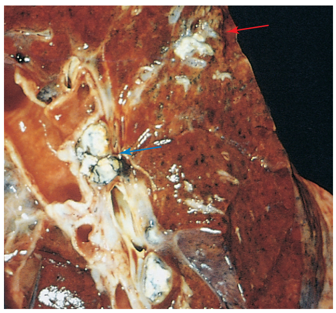
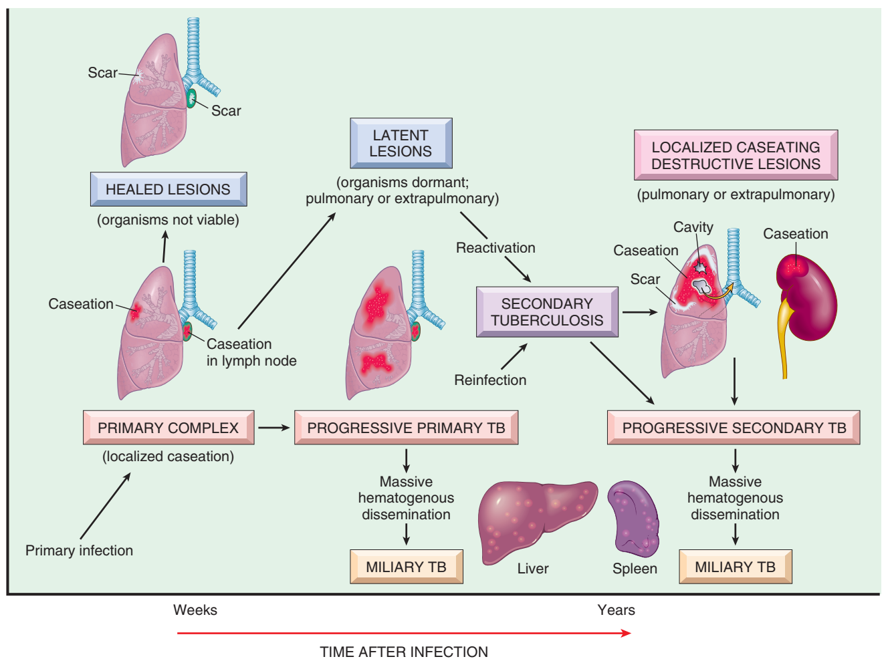
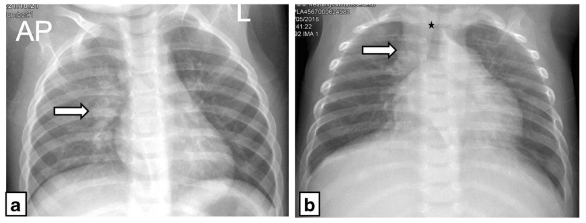
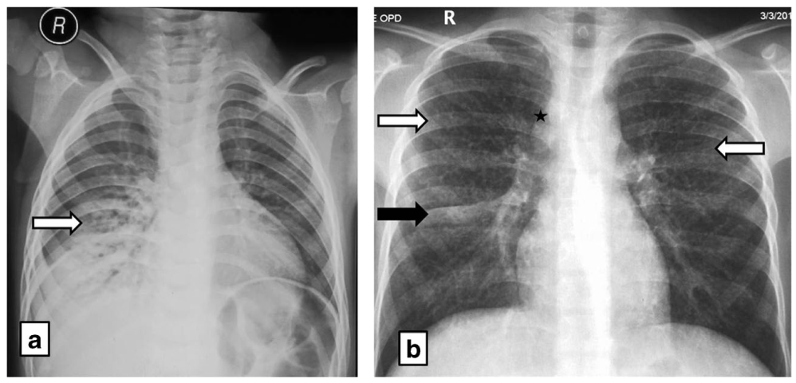

# Chẩn đoán lao phổi ở trẻ em

**ThS. BS. Nguyễn Thành Nam**
Bộ môn Nhi, Trường Đại học Khoa học Sức khỏe, ĐHQG-HCM

## Phân loại lao phổi và lao trong lồng ngực

<!-- LĐ-1 -->
Phân loại theo vị trí giải phẫu (World Health Organization [WHO], 2022b):

- **Lao phổi:** tổn thương ở nhu mô phổi hoặc cây khí phế quản, gồm cả lao kê và lao hạch trung thất hoặc rốn phổi ở trẻ em.
- **Lao ngoài phổi:** gồm cả tràn dịch màng phổi lao mà phim X quang không thấy tổn thương phổi.
- **Có cả hai thể:** xếp vào lao phổi.

<!-- LĐ-2 -->
Lao trong lồng ngực ở trẻ chủ yếu là lao nguyên phát, với biểu hiện thường gặp là bệnh hạch trong lồng ngực có hoặc không kèm tổn thương nhu mô (Nachiappan et al., 2017). 

Phổ bệnh gồm ổ Ghon, bệnh hạch rốn phổi và cạnh khí quản, chèn ép đường thở hoặc hạch vỡ vào phế quản, viêm phổi bã đậu, tràn dịch màng phổi hoặc màng ngoài tim, lao kê và lao kiểu người lớn. *Bệnh hạch không biến chứng là thể hay gặp nhất*, chiếm gần một nửa số ca trong một loạt ca bệnh gồm 307 trẻ (Marais & Schaaf, 2014).

<figure markdown="span">
  { .img-md }
  <figcaption markdown="span">**Hình 1.** Phức hợp Ghon trong lao nguyên phát 
  *Ghi chú.* Ổ tổn thương nhu mô màu trắng xám nằm dưới màng phổi, ở phần dưới của thùy trên (mũi tên đỏ). Bên trái là các hạch rốn phổi có hoại tử bã đậu (mũi tên xanh). 
  Trích từ Kumar et al. (2015), Hình 8-26, tr. 375. Bản quyền © 2015 Elsevier.</figcaption>
</figure>

## Nhiễm lao không triệu chứng và nguy cơ tiến triển

<!-- LĐ-3 -->
Phần lớn trẻ em và vị thành niên nhiễm lao không có triệu chứng (American Academy of Pediatrics, 2024). Thể bệnh và thời điểm khởi phát thay đổi theo tuổi. Ở trẻ tiến triển thành bệnh, hơn 90% khởi phát *trong 12 tháng đầu* sau nhiễm (Marais, 2014; Marais & Schaaf, 2014). Trẻ nhỏ có nguy cơ lao màng não và lao kê cao nhất trong *vài tháng đầu*, rồi đến biến chứng đường thở do hạch ở trẻ dưới 5 tuổi, trong khi vị thành niên hay mắc lao giống người lớn *vài năm sau nhiễm* (Marais & Schaaf, 2014). Vì vậy tuổi giúp định hướng thể bệnh cần tìm và mức khẩn cấp của chẩn đoán. 

<figure markdown="span">
  { .img-lg }
  <figcaption markdown="span">**Hình 2.** Diễn tiến tự nhiên và các phổ bệnh lao 
  Trích từ Kumar et al. (2015), Hình 8-25, tr. 374. Bản quyền © 2015 Elsevier.</figcaption>
</figure>

## Tiếp cận chẩn đoán

### Tầm quan trọng của điều tra nguồn lây

<!-- LĐ-19 -->
Tiền sử tiếp xúc nguồn lây, nhất là trong hộ gia đình, *là manh mối mạnh nhất gợi ý lao ở trẻ.* Trong các yếu tố lâm sàng, tiền sử tiếp xúc (tỉ số chênh [OR] 4,20) là đặc điểm duy nhất tự nó đủ đạt ngưỡng điều trị và là yếu tố dự báo mạnh nhất ở trẻ HIV âm (OR 5,13) (Gunasekera et al., 2021). Vì vậy tiền sử tiếp xúc phải được hỏi chủ động ở mọi trẻ nghi lao (WHO, 2022b).

<!-- LĐ-170, LĐ-171 -->

Tìm ra nguồn lây người lớn giúp ích rất nhiều cho chẩn đoán lao ở trẻ em:

- Điều tra tiếp xúc thường cho hiệu suất cao hơn cấy bệnh phẩm của trẻ (Cruz & Starke, 2025).
- Ngoài ra, kết quả cấy của nguồn lây có thể là kháng sinh đồ duy nhất dùng được cho trẻ (American Academy of Pediatrics, 2024; Cruz & Starke, 2025).

<!-- LĐ-20, LĐ-21, LĐ-22 -->
Khi khai thác và xử lý thông tin về nguồn lây cần lưu ý (WHO, 2022b):

- Nguồn lây có thể ở ngoài hộ như hàng xóm, người trông trẻ, họ hàng. Với trẻ lớn và vị thành niên, nguồn lây thường ở trường học, phương tiện công cộng hay câu lạc bộ. 
- Cần hỏi kiểu kháng thuốc, phác đồ và đáp ứng điều trị của nguồn lây để đánh giá nguy cơ trẻ mắc lao kháng thuốc.

### Phần lớn chẩn đoán mà không có bằng chứng vi khuẩn học

<!-- LĐ-172, LĐ-176 -->
Phần lớn lao trẻ em được chẩn đoán bằng cách tổng hợp tiền sử tiếp xúc, khám lâm sàng kỹ và cận lâm sàng hỗ trợ, vì xét nghiệm vi khuẩn học kém nhạy ở trẻ nhỏ (WHO, 2022b). Trong một phân tích gộp lớn, chỉ 29,9% trẻ lao phổi được xác nhận vi khuẩn học (Gunasekera et al., 2023). 

Theo WHO, các thành phần đánh giá gồm (WHO, 2022b):

- Khai thác tiền sử tiếp xúc nguồn lây (nhất là trong 12 tháng qua) và tiền sử điều trị lao trước đây (nếu có).  
- Xác định các triệu chứng và bệnh cảnh phù hợp.
- Khám lâm sàng có đánh giá tăng trưởng.
- Xét nghiệm HIV thường quy cho mọi trẻ nghi hoặc mắc lao.
- Xét nghiệm vi khuẩn học.
- X quang ngực.
- Xét nghiệm nhiễm lao khi cần (test da tuberculin [TST], xét nghiệm giải phóng interferon-gamma [IGRA]).

<!-- LĐ-173, LĐ-174 -->
Ở nhóm nguy cơ cao, cần nghĩ tới lao sớm (WHO, 2022b):

- Trẻ tiếp xúc gần người lao phổi, nhất là ca đã xác nhận vi khuẩn học.
- Trẻ dưới 5 tuổi.
- Trẻ nhiễm HIV, nhất là khi kiểm soát kém.
- Trẻ suy dinh dưỡng cấp nặng không đáp ứng phục hồi dinh dưỡng.
- Trẻ viêm phổi nhập viện không đáp ứng kháng sinh.

Cách tiếp cận cũng khác theo tuổi. Lao phổi ở trẻ nhỏ thường là bệnh hạch trong lồng ngực, còn vị thành niên thường biểu hiện giống người lớn với tổn thương hang (WHO, 2026b).

<!-- LĐ-178 -->

!!! note "Điều trị sớm khi có bệnh cảnh phù hợp"

    Ở trẻ có bệnh cảnh phù hợp, không nên trì hoãn quyết định điều trị dựa trên lâm sàng dù không làm được xét nghiệm vi khuẩn học, nhất là ở trẻ dưới 2 tuổi, nhiễm HIV, suy dinh dưỡng cấp nặng hoặc viêm phổi nhập viện không đáp ứng điều trị đầu tay (WHO, 2022b). Trẻ có mức nghi ngờ lao cao hoặc bệnh nặng nghi lao cần được điều trị ngay, không chờ kết quả xét nghiệm (Nahid et al., 2016). *Đây là quyết định điều trị, không phải điều trị thử: không dùng thuốc lao như một phương pháp chẩn đoán (WHO, 2022b).*

## Triệu chứng cơ năng

<!-- LĐ-13 -->
Phần lớn trẻ lao có triệu chứng mạn tính **không thuyên giảm kéo dài trên 2 tuần và không cải thiện bền vững** sau các điều trị khác như kháng sinh, thuốc sốt rét hay phục hồi dinh dưỡng. Tính dai dẳng không thuyên giảm có giá trị nhận diện lao hơn từng triệu chứng riêng lẻ (WHO, 2022b).

Ho kéo dài và kém tăng cân là hai biểu hiện thường gặp nhất. Ho dai dẳng không thuyên giảm cần được phân biệt với ho cấp tái diễn và ho cấp hồi phục chậm (WHO, 2022b). Các triệu chứng thường gặp gồm (American Academy of Pediatrics, 2024; WHO, 2022b):

- Ho kéo dài không đỡ.
- Sốt kéo dài, có hoặc không đổ mồ hôi đêm.
- Chán ăn, sụt cân hoặc chậm lớn.
- Mệt bất thường, giảm chơi hoặc giảm hoạt động.

<!-- LĐ-14 -->

!!! info "Nghiên cứu nổi bật: Chẩn đoán lao bằng triệu chứng có giá trị không? (Marais et al., 2006)"

    **Bối cảnh.** Ở vùng lưu hành cao, chỉ dưới 10–15% trẻ lao có soi đàm dương và 30–40% cấy dương. Bộ ba kinh điển (tiếp xúc, TST dương, X quang gợi ý) mất giá trị vì phần lớn trẻ đều đã tiếp xúc hoặc nhiễm lao. Chẩn đoán vì vậy dựa nhiều vào X quang, vốn đọc chủ quan và hiếm có ở tuyến cơ sở. Trong khi đó, giới chuyên môn hoài nghi giá trị của triệu chứng vì các tiêu chí cũ định nghĩa lỏng lẻo và chưa được kiểm chứng.

    **Câu hỏi.** Triệu chứng được định nghĩa chặt chẽ có chẩn đoán được lao phổi trẻ em không?

    **Thiết kế.** Nghiên cứu tiến cứu dựa vào cộng đồng tại Cape Town, Nam Phi (2003–2005), ở vùng lưu hành rất cao, với tỉ suất lao trẻ em 407/100.000. Nghiên cứu gồm 1.024 trẻ dưới 13 tuổi ho trên 2 tuần không đáp ứng kháng sinh. 

    **Kết quả chính**

    - Phần lớn ho kéo dài tự hết: 58,2% trẻ đã cải thiện rõ trước khi được khám. Chỉ 41,8% còn ho dai dẳng không thuyên giảm và 46% trong số này mắc lao phổi.
    - Giá trị chẩn đoán của bộ ba triệu chứng (ho dai dẳng không thuyên giảm trên 2 tuần, sụt cân khách quan trên biểu đồ tăng trưởng trong 3 tháng trước và mệt mỏi [giảm chơi, giảm hoạt động]) được trình bày trong bảng dưới đây.

    **Bảng 1.** Giá trị chẩn đoán lao phổi của bộ ba triệu chứng theo nhóm trẻ

    | Nhóm trẻ | Độ nhạy | Độ đặc hiệu | Giá trị tiên đoán dương |
    |---|---|---|---|
    | HIV âm, từ 3 tuổi (nguy cơ thấp) | 82,3% | 90,2% | 82,3% |
    | HIV âm, dưới 3 tuổi | 51,8% | 92,5% | 90,1% |
    | Nhiễm HIV | 56,2% | 61,8% | 61,9% |

    - Theo dõi lâm sàng là một công cụ chẩn đoán an toàn ở trẻ nguy cơ thấp. Với trẻ chưa đủ tiêu chí chẩn đoán ở lần khám đầu, hẹn khám lại giúp chẩn đoán chính xác hơn: nếu ho vẫn dai dẳng sau hơn 2 tuần theo dõi, độ đặc hiệu ở trẻ HIV âm từ 3 tuổi tăng lên 98,9%. Việc chờ này cũng không gây hại, không trẻ nào được hẹn theo dõi tiến triển thành lao kê, lao màng não hay hang lao trong thời gian giám sát. 
    - Ở trẻ dưới 3 tuổi, tiêu chí ho dai dẳng kèm sụt cân có ghi nhận cho độ nhạy 68,3% và độ đặc hiệu 80,1%. Điều này cho thấy giá trị của việc theo dõi cân nặng đều đặn.

    **Góc nhìn mới cho thực hành lâm sàng**

    1. *Triệu chứng chỉ có giá trị khi được định nghĩa chặt.* Mấu chốt là tính chất "dai dẳng, không thuyên giảm" và sụt cân "khách quan" trên biểu đồ, không chỉ là có ho hay có sốt.
    2. *Thời gian cũng là một xét nghiệm.* Ở trẻ nguy cơ thấp, hẹn khám lại an toàn và giúp tách lao khỏi các bệnh tự hết.
    3. *Phải phân tầng nguy cơ trước khi dùng triệu chứng.* 11 trên 12 trẻ bệnh nặng không đạt tiêu chí triệu chứng đều dưới 3 tuổi hoặc nhiễm HIV. Ở các nhóm này, bệnh có thể khởi phát cấp, nên không thể chờ triệu chứng kéo dài.

    **Thông điệp.** Nghiên cứu kết luận lao phổi ở trẻ HIV âm có thể chẩn đoán với độ chính xác hợp lý bằng một cách tiếp cận dựa trên triệu chứng đơn giản. Điều này mở ra triển vọng cải thiện tiếp cận điều trị cho trẻ ở nơi nguồn lực hạn chế. Cách tiếp cận này dùng cho trẻ nguy cơ thấp. Trẻ dưới 3 tuổi và trẻ nhiễm HIV vẫn cần đánh giá chủ động và điều trị dự phòng sau phơi nhiễm.

## Khám thực thể

<!-- LĐ-23, LĐ-24, LĐ-25, LĐ-26, LĐ-27 -->
Không có dấu hiệu thực thể nào khẳng định được lao, nhưng nhiều dấu hiệu không đặc hiệu vẫn là lý do để đánh giá lao (WHO, 2022b). Các điểm cần chú ý khi khám:

- **Nghe gõ phổi:** thường bình thường. Có thể thấy ran, tiếng thở phế quản, khò khè khu trú cố định hoặc dấu hiệu tràn dịch.
- **Cân nặng:** cân trẻ và so với cân nặng trong 3 tháng trước vì chiều hướng cân nặng gần đây là thông tin quan trọng nhất. Kém tăng cân gồm sụt cân rõ theo lời kể, cân nặng theo tuổi dưới −2 hoặc −3 Z-score, sụt trên 5% so với lần khám trước hoặc đường tăng trưởng đi ngang. Trẻ đi đều trên một đường bách phân vị nhiều năm thì không đáng lo về lao dù dưới −2 Z-score.
- **Bệnh cảnh không đáp ứng điều trị:** nghĩ lao phổi khi suy dinh dưỡng cấp nặng không đáp ứng điều trị dinh dưỡng, viêm phổi không đáp ứng kháng sinh đủ liệu trình hoặc khò khè dai dẳng không đáp ứng thuốc giãn phế quản, nhất là khò khè cố định và không đối xứng.
- **Dấu hiệu gợi ý bệnh khác hoặc bệnh kèm:** hạch toàn thân, nấm miệng hay sưng tuyến mang tai gợi ý HIV, ngón tay dùi trống gợi ý viêm phổi kẽ lympho bào (LIP) hoặc giãn phế quản, ho và khò khè tái diễn có thể đáp ứng với thuốc giãn phế quản, tiếng tim mờ xa hoặc suy tim mới gợi ý lao màng ngoài tim.

**Những biểu hiện không điển hình**

<!-- LĐ-28 -->
Lao phổi có thể biểu hiện như viêm phổi cấp nặng, hay gặp hơn ở trẻ dưới 2 tuổi và trẻ nhiễm HIV. Viêm phổi nặng khi có một trong các dấu hiệu sau:

- SpO2 dưới 90%, tím trung ương. 
- Suy hô hấp nặng. 
- Có dấu hiệu nguy hiểm như không bú uống được, nôn liên tục, li bì, co giật, thở rít khi nằm yên hay suy dinh dưỡng nặng. 

Viêm phổi đáp ứng kém với kháng sinh cần nghĩ tới lao phổi, nhất là khi có tiền sử tiếp xúc (WHO, 2022b). Ngoài ra, lao phổi có thể biểu hiện bằng khò khè dai dẳng. Khò khè do hạch lao chèn ép khác với khò khè do hen (WHO, 2022b):
<!-- LĐ-29 -->

**Bảng 2.** Phân biệt khò khè do hạch lao chèn ép với khò khè do hen

| Đặc điểm | Hạch lao chèn ép | Hen |
|---|---|---|
| Tính chất | Không đối xứng, dai dẳng, đơn âm | Thường đối xứng, tái diễn, âm sắc thay đổi |
| Đáp ứng thuốc giãn phế quản | Không đáp ứng | Đáp ứng |
| Dấu hiệu kèm | Đặc điểm lao khác | Không |

??? info "Lao phổi tiến triển và hang lao"

    <!-- LĐ-30, LĐ-31, LĐ-32 -->
    Lao phổi tiến triển xảy ra khi ổ nguyên phát to dần, bã đậu hóa rồi hóa lỏng đổ vào phế quản, tạo hang nguyên phát chứa rất nhiều vi khuẩn (Cruz & Starke, 2025). Đặc điểm chính:

    - **Biểu hiện:** sốt, ho, mệt mỏi, sụt cân và dấu hiệu hang. Có thể biến chứng tràn khí màng phổi hoặc rò phế quản màng phổi (Cruz & Starke, 2025).
    - **Chẩn đoán phân biệt:** khó phân biệt với áp xe phổi do *Staphylococcus*, *Klebsiella* hoặc vi khuẩn kỵ khí, và có thể cần thêm kháng sinh nhắm các tác nhân này (Cruz & Starke, 2025).
    - **Đối tượng:** hang lao điển hình ở người lớn, đôi khi ở vị thành niên, ít gặp ở trẻ nhỏ, nhưng vẫn có thể xảy ra ở trẻ rất nhỏ, trẻ suy giảm miễn dịch hoặc trẻ có tổn thương hạch phế quản (American Academy of Pediatrics, 2024).

## Lao hạch trong lồng ngực và các biến chứng

### Triệu chứng lâm sàng

<!-- LĐ-7 -->

Trẻ em thường nhiễm lao nguyên phát với bệnh hạch trong lồng ngực đơn độc. Hạch to có thể chèn ép đường thở, vỡ vào lòng phế quản, gây ứ khí tắc nghẽn hoặc xẹp phổi, hiếm khi gây tử vong đột ngột do ngạt (Cruz & Starke, 2025; Goussard & Gie, 2014). Các vị trí đường thở hay bị hạch chèn ép là phế quản trung gian, phế quản gốc trái và khí quản (Goussard & Gie, 2014).

<!-- LĐ-8, LĐ-9, LĐ-10 -->

- **Ứ khí tắc nghẽn:** nên chụp X quang thì thở ra và luôn phải phân biệt với dị vật đường thở (Cruz & Starke, 2025).
- **Xẹp đông đặc phân thùy:** thường xuất hiện trong 3 đến 6 tháng đầu sau nhiễm với triệu chứng thực thể nghèo nàn. Khi bội nhiễm, trẻ có thể sốt cao, có ran và đáp ứng với kháng sinh, nhưng tổn thương X quang không hết vì lao nền vẫn còn. Khoảng 60% tổn thương để lại di chứng như xơ co hoặc giãn phế quản (Cruz & Starke, 2025). *Đông đặc không ưu thế thùy nào và thường giống viêm phổi vi khuẩn.* Có hạch kèm theo là gợi ý lao. Tổn thương có thể tan chậm tới 2 năm (Nachiappan et al., 2017).
- **Chèn ép cơ quan lân cận:** thở rít, nuốt khó, rò phế quản thực quản, viêm màng ngoài tim kế cận, phù tay do chèn tĩnh mạch dưới đòn hoặc liệt cơ hoành trái (Cruz & Starke, 2025).

### Đặc điểm hình ảnh học

<!-- LĐ-11 -->
X quang ngực trong lao trẻ em hiếm khi đặc hiệu (American Academy of Pediatrics, 2024). Các hình ảnh có thể gặp:

- **Hạch rốn phổi, dưới carina, cạnh khí quản hoặc trung thất:** dấu hiệu đặc trưng của nhiễm nguyên phát, gặp ở 83 đến 96% ca lao nguyên phát trẻ em so với 10 đến 43% ở người lớn. Gần 50% trẻ 0 đến 3 tuổi chỉ có hạch đơn độc (Nachiappan et al., 2017).
- **Xẹp hoặc thâm nhiễm phân thùy hay thùy, tràn dịch màng phổi, hình kê** (American Academy of Pediatrics, 2024).
- **Vôi hóa hạch:** xuất hiện chậm nên là dấu hiệu muộn (Cruz & Starke, 2025).

<!-- LĐ-12 -->
Chụp cắt lớp vi tính (CT) có thể thấy hạch to ở tới 60% trẻ lao có X quang bình thường (Pillay et al., 2020), nhưng ý nghĩa lâm sàng của hạch chỉ thấy trên CT ở trẻ không triệu chứng chưa rõ. Vì vậy CT không dùng thường quy, chỉ cân nhắc khi phim thường không đặc hiệu hoặc tổn thương kín đáo (American Academy of Pediatrics, 2024; Cruz & Starke, 2025).

## Xét nghiệm nhiễm lao: TST, IGRA 

### Nguyên lý và giới hạn chung

<!-- LĐ-73 -->
TST và IGRA là hai xét nghiệm xác định tình trạng nhiễm lao dựa vào đáp ứng miễn dịch của tế bào lympho T; kết quả dương tính cho thấy trẻ đã từng hoặc đang nhiễm lao.

**Bảng 3.** So sánh đặc điểm của TST và IGRA

| Đặc điểm | TST | IGRA |
|---|---|---|
| Nguyên lý | Phản ứng quá mẫn muộn với kháng nguyên tiêm trong da (Thillai et al., 2014; WHO, 2026a) | Đo interferon-gamma do tế bào lympho T tiết ra khi ủ máu với kháng nguyên đặc hiệu (American Academy of Pediatrics, 2024; WHO, 2026a) |
| Kháng nguyên | Hỗn hợp hơn 200 protein (Thillai et al., 2014) | ESAT-6, CFP-10, gần như chỉ có ở phức hợp *Mycobacterium tuberculosis* (Chiappini et al., 2016; Tebruegge et al., 2015) |
| Phản ứng chéo với BCG | Có (WHO, 2026a) | Không (American Academy of Pediatrics, 2024; WHO, 2026a) |
| Phản ứng chéo với mycobacteria không lao (NTM) | Có (WHO, 2026a) | Chỉ vài loài như *M. kansasii*, *M. marinum*, *M. szulgai* (American Academy of Pediatrics, 2024) |

<!-- LĐ-74 -->
TST và IGRA phát hiện đáp ứng của tế bào lympho T đã mẫn cảm sau nhiễm lao và không có tiêu chuẩn vàng để đối chiếu (WHO, 2022a, 2026a). Vì vậy cần thận trọng khi phiên giải kết quả TST/IGRA dương tính:

- Chỉ gợi ý trẻ có thể đã nhiễm lao (American Academy of Pediatrics, 2024).
- Không phân biệt được nhiễm lao với bệnh lao (Lewinsohn et al., 2017; WHO, 2022b). Nồng độ interferon-gamma cũng không phân biệt được (Bianchi et al., 2009).
- Không tiên đoán được một cách tin cậy trẻ nào sẽ tiến triển thành bệnh (WHO, 2022b).

<!-- LĐ-75 -->
Ở chiều ngược lại, **TST hay IGRA âm tính không loại trừ nhiễm hoặc bệnh lao khi lâm sàng gợi ý và không được dùng để trì hoãn đánh giá** (Chiappini et al., 2016; WHO, 2022b). Các yếu tố gây âm tính giả gồm (American Academy of Pediatrics, 2024; Chiappini et al., 2016; Jamil et al., 2017; WHO, 2022b):

- Tuổi nhỏ.
- Suy dinh dưỡng, suy giảm miễn dịch hoặc HIV.
- Nhiễm virus như sởi, dùng corticosteroid.
- Lao lan tỏa, lao màng não.
- Giai đoạn sớm sau nhiễm, dưới 6 đến 8 tuần.
- Giảm số lượng hoặc chức năng tế bào lympho.

!!! note "Độ nhạy suy giảm trong các thể lao nặng"

    Ở thể nặng, độ nhạy có xu hướng thấp hơn: ở trẻ lao kê hoặc lao thần kinh trung ương, TST chỉ dương ở 43,5% và IGRA ở 63,6–73,1% (Buonsenso et al., 2023).

<!-- LĐ-76 -->
Đáp ứng quá mẫn thường kéo dài nhiều năm kể cả sau điều trị hiệu quả; do đó không dùng TST hay IGRA để theo dõi điều trị, đánh giá khỏi bệnh hay chẩn đoán tái nhiễm (American Academy of Pediatrics, 2024; Chiappini et al., 2016). 

### Đặc điểm xét nghiệm IGRA

**Cơ chế**

<!-- LĐ-99 -->
IGRA đo lượng interferon-gamma do tế bào lympho T tiết ra ngoài cơ thể (ex vivo) khi được kích thích bằng các peptide mô phỏng kháng nguyên đặc hiệu của phức hợp *M. tuberculosis*. Hiện có 2 loại IGRA (American Academy of Pediatrics, 2024):

- QuantiFERON-TB Gold Plus: đo nồng độ interferon-gamma trong máu toàn phần.
- T-SPOT.TB: đếm số tế bào đơn nhân tiết interferon-gamma.

Khi làm đồng thời ở trẻ, QuantiFERON-TB Gold In-Tube cho tỉ lệ dương cao hơn T-SPOT.TB (10,1% so với 7,4%) (Gaensbauer et al., 2025).

**Độ nhạy**

<!-- LĐ-100 -->
Ở trẻ, độ nhạy của IGRA với bệnh lao dao động rộng, từ 53 đến 100% với lao xác nhận vi khuẩn học, một phần vì bệnh lao tự gây ức chế miễn dịch (Cruz & Starke, 2025). Nhìn chung IGRA không nhạy hơn TST (American Academy of Pediatrics, 2024). 

- Độ nhạy với lao xác nhận vi khuẩn học là 75–85% cho TST và 80–85% cho IGRA (Starke & Committee on Infectious Diseases, 2014). 
- Trong một đoàn hệ lớn ở châu Âu, độ nhạy là 83,8% với QuantiFERON-TB Gold Plus so với 83,3% với TST (Buonsenso et al., 2023). 

<!-- Kết quả không nhất quán ở trẻ nhỏ:

- Có nghiên cứu thấy IGRA nhạy hơn TST, như ELISpot (kỹ thuật của T-SPOT.TB) 42% so với TST 20% ở trẻ từ 5 tuổi trở xuống (Shaikh et al., 2017).
- Có nghiên cứu thấy TST nhạy hơn, như 60% so với 36% ở trẻ dưới 5 tuổi tiếp xúc hộ gia đình (Gutierrez et al., 2025).
- Gộp nhiều nghiên cứu ở trẻ dưới 5 tuổi, IGRA có độ nhạy chỉ 0,45 (Ontario Health, 2024).
- Ở trẻ có TST âm, độ nhạy của QuantiFERON-TB Gold Plus chỉ 44,0%, nên IGRA không dùng để loại trừ lao ở trẻ (Soler-Garcia et al., 2020). -->

**Độ đặc hiệu**

<!-- LĐ-101 -->
IGRA đặc hiệu hơn TST vì ít phản ứng chéo với BCG và NTM. IGRA cũng tương quan với mức phơi nhiễm tốt hơn ở vùng lưu hành thấp (WHO, 2022b). Ở trẻ đã tiêm BCG, độ đặc hiệu ước tính là 89 đến 100% với IGRA so với 49 đến 65% với TST (Starke & Committee on Infectious Diseases, 2014). 

**Kiểu hình TST dương, IGRA âm**

<!-- LĐ-102 -->
Kiểu TST dương, IGRA âm gặp ở 10 đến 40% trẻ trong các nghiên cứu nhi khoa (Tebruegge et al., 2015). Cách xử trí tùy nguy cơ:

- Trẻ không triệu chứng, không có phơi nhiễm đã biết, nhất là đã tiêm BCG: TST dương mà IGRA âm thì ít khả năng nhiễm lao (American Academy of Pediatrics, 2024).
- Trẻ nguy cơ tiến triển cao như trẻ tiếp xúc với người lớn mắc lao đang lây hoặc sắp dùng thuốc ức chế TNF-α: bất kỳ xét nghiệm nào dương cũng nên điều trị (Cruz & Starke, 2016).

**Giá trị tiên đoán âm của IGRA**

IGRA âm có tiên đoán trẻ sẽ không tiến triển thành bệnh không? Dữ liệu theo dõi dọc ở trẻ khá trấn an:

- Gộp 4 đoàn hệ trẻ dưới 2 tuổi nguy cơ cao không điều trị, không trẻ nào trong 575 trẻ IGRA âm tiến triển thành bệnh, kể cả 70 trẻ có TST dương (Turner et al., 2023). Riêng đoàn hệ California, 0 trong 425 trẻ IGRA âm mắc lao sau 3 năm theo dõi (Turner et al., 2023).
- Ở nhũ nhi Nam Phi, vùng lây truyền cao, giá trị tiên đoán âm của QuantiFERON với bệnh lao về sau là 99% ở ngưỡng 0,35 IU/mL (Andrews et al., 2017).
- Ở các nước lưu hành thấp, giá trị tiên đoán âm của IGRA với tiến triển thành bệnh khoảng 98% (Buonsenso et al., 2020).

Tuy vậy, giá trị này không tuyệt đối. Ở người tiếp xúc hộ gia đình tại Ấn Độ, vùng gánh nặng lao cao, một số người âm tính với cả TST và IGRA vẫn mắc lao trong 2 năm theo dõi (Sharma et al., 2017).

IGRA âm có loại trừ được bệnh lao đang có không? Không. IGRA âm không được dùng để loại trừ lao ở trẻ có biểu hiện gợi ý (American Academy of Pediatrics, 2024). Ở trẻ nhiễm HIV nghi lao, giá trị tiên đoán âm của ELISpot (kỹ thuật dùng trong T-SPOT.TB) với bệnh lao chỉ 87% (Davies et al., 2009).

**Kết quả không xác định**

<!-- LĐ-103 -->
Kết quả IGRA không xác định phần lớn do ống chứng dương (mitogen) không đạt (Velasco-Arnaiz et al., 2018). Nguyên nhân có thể từ người bệnh, bộ xét nghiệm hoặc kỹ thuật như lắc ống chưa đủ (American Academy of Pediatrics, 2024; Starke & Committee on Infectious Diseases, 2014). Nguyên tắc xử trí:

- Kết quả này không loại trừ nhiễm và không được dùng để ra quyết định lâm sàng (American Academy of Pediatrics, 2024).
- Làm lại IGRA hoặc làm TST (Starke & Committee on Infectious Diseases, 2014). Trong phân tích hơn 2 triệu mẫu QuantiFERON ở Mỹ (mọi lứa tuổi), làm lại trong 30 ngày cho kết quả xác định ở khoảng 64% ca (Bi et al., 2021).
- Ở trẻ có triệu chứng thần kinh, IGRA không xác định không được coi là bằng chứng chống lại lao (Kay et al., 2018).

## Lấy mẫu và xác nhận vi khuẩn học

### Lựa chọn loại bệnh phẩm ở trẻ

<!-- LĐ-124, LĐ-125, LĐ-127, LĐ-129 -->

**Bảng 4.** Các loại bệnh phẩm tìm vi khuẩn lao ở trẻ: đối tượng, ưu điểm và hạn chế

| Bệnh phẩm | Đối tượng | Ưu điểm | Hạn chế |
|---|---|---|---|
| Đàm khạc | Trẻ lớn, thường từ khoảng 8 tuổi | Rẻ, không xâm lấn | Không làm được ở trẻ nhỏ |
| Đàm kích thích | Mọi tuổi, kể cả nhũ nhi | Hiệu suất cao | Cần thiết bị, nhân lực, nguy cơ lây qua khí dung |
| Dịch dạ dày | Trẻ không khạc, không kích thích được đàm | Hiệu suất tốt | Xâm lấn, khó chịu, thường cần nhập viện |
| Dịch hút mũi họng | Trẻ nhỏ, tuyến cơ sở | Ít xâm lấn, ít nguy cơ lây qua khí dung | Hiệu suất thấp hơn |
| Phân | Mọi trẻ, tuyến cơ sở | Không xâm lấn, dễ lấy, được chấp nhận cao | Cần xử lý thêm ở phòng xét nghiệm |

*Ghi chú.* Tổng hợp từ American Academy of Pediatrics (2024) và WHO (2022b, 2026a).

Một số số liệu về hiệu suất:

- **Đàm kích thích:** một mẫu cho hiệu suất tương đương ba mẫu dịch dạ dày (Wattal & Raveendran, 2019) và làm được an toàn ở bệnh viện tuyến tỉnh (Joel et al., 2014).
- **Dịch dạ dày:** ba mẫu sáng sớm phân lập được vi khuẩn ở 30 đến 40% trẻ và 70% nhũ nhi lao phổi (Cruz & Starke, 2025). Độ nhạy theo mẫu của cấy dịch dạ dày là 71% so với 31% của dịch hút mũi họng (Wolf et al., 2008). <!-- LĐ-126 -->
Số mẫu dịch dạ dày cần lấy chưa thống nhất. Các hướng dẫn dùng 3 mẫu của 3 buổi sáng khác nhau (Cruz & Starke, 2025; WHO, 2022b), trong khi một nghiên cứu thấy mẫu thứ hai chỉ dương thêm ở 2,5% trẻ có mẫu đầu âm, mẫu thứ ba không phát hiện thêm ca dương nào, và nhóm tác giả kết luận 2 mẫu là đủ (Pierre-Louis et al., 2021).
- **Dịch hút mũi họng:** Xpert trên 1 mẫu có độ nhạy 47,6%, trên 2 mẫu là 65,1% (Zar et al., 2012), nên cần lấy nhiều mẫu hoặc kèm bệnh phẩm khác (WHO, 2022b).

<!-- LĐ-130, LĐ-131, LĐ-132 -->
Vai trò của nội soi phế quản:

- Mẫu dịch rửa phế quản phế nang (BAL) *không cho hiệu suất cao hơn các mẫu khác lấy đúng cách*, với cấy dương 2,4 đến 44% từ BAL so với 14 đến 47% từ dịch dạ dày. Chỉ cân nhắc khi mẫu ít xâm lấn không xác nhận được lao (Goussard, Croucamp, et al., 2021; Goussard, Retief, et al., 2021).
- Nội soi là chuẩn vàng đánh giá mức chèn ép và tắc đường thở, đồng thời cho phép lấy BAL, mô nội phế quản hoặc chọc hút hạch trung thất qua siêu âm nội soi (Goussard & Gie, 2014; Goussard, Retief, et al., 2021). Chọc hút hạch qua siêu âm nội soi cho hiệu suất chẩn đoán 61% (Goussard, Retief, et al., 2021).
- Ở trẻ lao phổi biến chứng được nội soi, tỉ lệ xác nhận vi khuẩn học chung là 78,7%. Xpert Ultra trên BAL có độ nhạy 70% và độ đặc hiệu 98% (Sun et al., 2019).

<!-- LĐ-133 -->
Các bệnh phẩm cho hiệu suất thấp ở trẻ không nhiễm HIV:

- Máu: cấy máu dương chỉ 0,4% ở trẻ và 13,5% ở người lớn (Pavlinac et al., 2016).
- Nước tiểu: Xpert trên nước tiểu không giúp thêm cho chẩn đoán lao phổi ở trẻ ngoại trú (Lopez et al., 2019).
- Phết miệng và phết lưỡi: PCR (phản ứng chuỗi polymerase) trên phết miệng chỉ nhạy 43% (Nicol et al., 2019). Phết lưỡi chưa được khuyến cáo cho trẻ em do thiếu dữ liệu (WHO, 2026a).

### Kỹ thuật lấy và bảo quản bệnh phẩm

<!-- LĐ-134 -->
**Đàm** (WHO, 2022b):

- Đàm khạc: lấy sáng sớm, ít nhất 3 mL, lấy nhiều hơn càng tốt.
- Đàm kích thích: làm ngoại trú được. Nhịn ăn 3 giờ, xịt salbutamol 200 μg qua buồng đệm, chờ 15 phút, khí dung 10 mL NaCl 5% trong 15 phút, rồi hút dịch hầu họng khi trẻ ho. Trẻ dưới 5 tuổi không khạc ra được thì chuyển sang hút mũi họng.
- Chống chỉ định: SpO2 thấp, suy hô hấp nặng.

<!-- LĐ-135 -->
**Hút dịch dạ dày** (Cruz & Starke, 2025; WHO, 2022b):

- Đối tượng và thể tích: trẻ dưới 7 tuổi, tối thiểu 5 mL.
- Thời điểm: sáng sớm khi trẻ vừa thức, trước khi ngồi dậy, đi lại hay ăn, sau nhịn ăn qua đêm.
- Kỹ thuật: ống thông 6 đến 10 Fr, kiểm tra vị trí bằng giấy quỳ, hút ở 3 tư thế.
- Xử lý mẫu: trung hòa acid ngay để không diệt vi khuẩn lao, rồi chuyển đến phòng xét nghiệm trong 4 giờ.
- Chống chỉ định: giảm tiểu cầu, rối loạn đông máu, tắc nghẽn mũi họng.

<!-- LĐ-136 -->
**Hút mũi họng** (WHO, 2022b):

- Đối tượng và thể tích: chủ yếu trẻ dưới 7 tuổi, tối thiểu 2 mL.
- Chuẩn bị: nhịn ăn 2 giờ, trẻ nằm ngửa.
- Kỹ thuật: ống thông vô khuẩn, đo độ dài ống từ lỗ mũi đến bình tai, áp lực hút phù hợp tuổi.
- An toàn: dừng ngay khi trẻ suy hô hấp hoặc có dấu hiệu bất thường. Chống chỉ định khi chưa nhịn đủ 2 giờ, giảm tiểu cầu hay rối loạn đông máu.

<!-- LĐ-137 -->
**Phân** (Klinkenberg et al., 2025; WHO, 2022b):

- Đối tượng và lượng mẫu: mọi lứa tuổi, lấy lúc nào cũng được nhưng không lẫn nước tiểu. Lượng phân đưa vào xử lý lý tưởng là 0,3 đến 0,8 g, lấy nhiều hơn làm tăng tỉ lệ lỗi xét nghiệm.
- Xử lý: phương pháp đơn giản như Simple One-Step (SOS) không cần thêm thiết bị và được chấp nhận tốt, nhưng vẫn cần nhân viên phòng xét nghiệm và khoảng 2 đến 3 tháng để thành thạo.
- Hiệu suất thực tế: khi triển khai ở 9 nước, xét nghiệm phân dương ở 4,1% trong hơn 71 nghìn trẻ được xét nghiệm, dao động từ 1,1 đến 17,3% giữa các nước (Klinkenberg et al., 2025). Đây là tỉ lệ dương trên toàn bộ trẻ nghi lao được xét nghiệm, không phải độ nhạy, nên phụ thuộc nhiều vào nhóm trẻ được xét nghiệm. Theo nhóm tác giả, tỉ lệ dương có thể thay đổi theo gánh nặng lao trẻ em của từng nước, theo tuyến xét nghiệm và theo tuổi (Klinkenberg et al., 2025):
    - Giai đoạn thí điểm thường triển khai ở bệnh viện tuyến trên, nơi trẻ bệnh nặng hơn và có nhiều vi khuẩn hơn, nên tỉ lệ dương cao hơn (6,2 đến 17,3%) so với nơi triển khai thường quy ở tuyến cơ sở (1,1 đến 5,7%).
    - Xét nghiệm phân thường dành cho trẻ nhỏ không khạc được đàm, mà trẻ nhỏ hay có bệnh ít vi khuẩn, nên tỉ lệ dương thấp hơn.

<!-- LĐ-138 -->
Dịch não tủy, dịch màng phổi và dịch khớp nên lấy càng nhiều càng tốt rồi ly tâm lấy cặn để soi và cấy. Mô sinh thiết cho hiệu suất cao hơn dịch. Dịch hút hạch và mô sinh thiết có thể cấy thẳng vào môi trường lỏng (WHO, 2022b).

!!! info "An toàn sinh học khi lấy mẫu bệnh phẩm"
    <!-- LĐ-139 --> 
    Hút dạ dày, hút mũi họng và kích thích đàm là thủ thuật tạo khí dung. Ở trẻ có dấu hiệu lây như ho trên 3 tuần hoặc có hang, cần làm trong phòng riêng có thông khí 6 đến 12 lần trao đổi khí mỗi giờ, với nhân viên đeo khẩu trang N95 hoặc FFP2 (WHO, 2022b).

## Soi đàm và nuôi cấy

<!-- LĐ-140 -->
Soi trực tiếp có hiệu suất rất thấp ở trẻ vì cần lượng vi khuẩn cao (WHO, 2026a). Tỉ lệ soi đàm dương là 6,8% ở trẻ so với 52,0% ở người lớn và chỉ 0,5% ở trẻ 0 đến 4 tuổi (Kunkel et al., 2016). Soi còn không phân biệt được *M. tuberculosis* với mycobacteria không lao và không cho thông tin kháng thuốc. WHO khuyến cáo mạnh thay soi bằng xét nghiệm phân tử nhanh làm xét nghiệm chẩn đoán ban đầu (WHO, 2026a).

<!-- LĐ-141, LĐ-142 -->
Nuôi cấy có hai giới hạn lớn ở trẻ:

- Hiệu suất thấp dù lấy mẫu tối ưu: cấy dương ở dưới 50% trẻ lớn mắc lao phổi (American Academy of Pediatrics, 2024). Hiệu suất cấy chung chỉ 24,4% ở trẻ được chẩn đoán lao (DiNardo et al., 2016). Hiệu suất cấy cao nhất ở sơ sinh, vị thành niên có hang và mẫu chọc hút hạch (Cruz & Starke, 2010).
- Môi trường lỏng thường cho kết quả trong khoảng 3 tuần, môi trường đặc có thể mất đến 10 tuần (American Academy of Pediatrics, 2024).

Vai trò của cấy khi đã có xét nghiệm phân tử còn có quan điểm khác nhau. WHO khuyến cáo xét nghiệm phân tử làm xét nghiệm ban đầu thay cho cấy (WHO, 2022a, 2026a). Ngược lại, cấy vẫn được coi là rất quan trọng dù đã có kết quả phân tử dương, vì cần để làm kháng sinh đồ kiểu hình, xác định kiểu gen và định danh loài (American Academy of Pediatrics, 2024). Hai xét nghiệm cũng không trùng khớp: cấy âm ở 44,7% ca Xpert dương và Xpert âm ở 25,4% ca cấy dương, nên làm cả hai khi có thể (Rebecca et al., 2018).

## Xpert MTB/RIF và Xpert Ultra

<!-- LĐ-143, LĐ-144 -->
WHO khuyến cáo mạnh dùng Xpert Ultra hoặc Xpert MTB/RIF làm xét nghiệm ban đầu chẩn đoán lao và kháng rifampicin ở trẻ có triệu chứng và dấu hiệu lao phổi, trên đàm, dịch hút mũi họng, dịch dạ dày hoặc phân; thay cho soi, cấy và kháng sinh đồ kiểu hình (WHO, 2022a). Đặc điểm của hai xét nghiệm (WHO, 2022b, 2026a):

- **Xpert MTB/RIF:** PCR thời gian thực tự động, phát hiện phức hợp *M. tuberculosis* và đột biến kháng rifampicin trong dưới 2 giờ.
- **Xpert Ultra:** ngưỡng phát hiện thấp hơn, có thêm mức kết quả "trace" (vết) cho mẫu rất ít vi khuẩn.

<!-- LĐ-145 -->
Ở trẻ, cả hai xét nghiệm có độ đặc hiệu cao nhưng độ nhạy chỉ ở mức trung bình và khác nhau theo bệnh phẩm. Độ nhạy thấp nhất với dịch hút mũi họng (Kay et al., 2025; WHO, 2022b):

**Bảng 5.** Độ nhạy và độ đặc hiệu của Xpert MTB/RIF và Xpert Ultra theo loại bệnh phẩm ở trẻ

| Bệnh phẩm | Xpert MTB/RIF: độ nhạy | Xpert MTB/RIF: độ đặc hiệu | Xpert Ultra: độ nhạy | Xpert Ultra: độ đặc hiệu |
|---|---|---|---|---|
| Đàm | 65% | 99% | 75,3% | 95,9% |
| Dịch dạ dày | 73% | 98% | 69,6% | 91,0% |
| Phân | 61% | 98% | 68,0% | 98,2% |
| Dịch hút mũi họng | 46% | 100% | 46,2% | 97,5% |

*Ghi chú.* Chuẩn đối chiếu là cấy bệnh phẩm. Số liệu Xpert MTB/RIF theo WHO (2022b), Xpert Ultra theo Kay et al. (2025).

## Xét nghiệm đồng thời nhiều loại mẫu ở trẻ

<!-- LĐ-148, LĐ-149 -->
Ở trẻ, lượng vi khuẩn trong mẫu thấp và dao động, trẻ thường không khạc được đàm và có thể bị lao lan tỏa, nên ngay cả xét nghiệm phân tử cũng có thể bỏ sót (WHO, 2026a). Vì vậy ở trẻ dưới 10 tuổi HIV âm hoặc chưa rõ HIV, WHO khuyến cáo làm đồng thời xét nghiệm phân tử trên mẫu hô hấp và phân làm chiến lược ban đầu (WHO, 2026a). Nguyên tắc đề xuất là:

- Lấy các mẫu cùng lúc, chỉ cần một mẫu dương là xác nhận lao.
- Thiếu một loại mẫu không được làm chậm xét nghiệm mẫu đang có.
- Lợi ích: lấy mẫu phối hợp nhạy hơn mẫu hô hấp đơn lẻ khoảng 7 điểm phần trăm và hơn phân đơn lẻ khoảng 22 điểm phần trăm, đổi lại độ đặc hiệu giảm 2 đến 4 điểm phần trăm (WHO, 2026a). Thêm một mẫu đàm kích thích vào 2 mẫu dịch hút mũi họng nâng độ nhạy của Xpert Ultra từ 54,2% lên 87,5% (Zar et al., 2019).

Ngay cả khi phối hợp nhiều mẫu và xét nghiệm, đa số lao trẻ em vẫn không được xác nhận vi khuẩn học. Tỉ lệ xác nhận vi khuẩn học ở các nghiên cứu trước chỉ 5,2 đến 35,6% (Olbrich et al., 2023) và 48% trẻ không xếp được chẩn đoán chắc chắn theo định nghĩa ca lâm sàng (Schumacher et al., 2016).

## Chẩn đoán hình ảnh

### Vai trò của chẩn đoán hình ảnh

<!-- LĐ-162, LĐ-163 -->
X quang ngực giữ vai trò quan trọng trong chẩn đoán lao phổi ở trẻ có bệnh cảnh phù hợp nhưng xét nghiệm vi khuẩn học âm tính hoặc không làm được (WHO, 2022b). Trên thực tế, có đến 50% trẻ được chẩn đoán lao phổi trên lâm sàng nhưng không thể xác nhận bằng các phương pháp xét nghiệm phân tử có độ nhạy cao; do đó, X quang vẫn là một công cụ then chốt (Miranda-Schaeubinger et al., 2023). 

Phần lớn trẻ lao phổi có thay đổi gợi ý lao trên phim. *Hạch trong lồng ngực (OR 4,32) và hình kê (OR 3,56) liên quan mạnh với lao phổi* (Gunasekera et al., 2023; WHO, 2022b). Tuy vậy, hình ảnh thường không đặc hiệu, nên không quyết định điều trị chỉ dựa vào phim mà dùng phim để hỗ trợ chẩn đoán lâm sàng (WHO, 2022b). *Phim âm tính cũng không loại trừ lao* (Pillay et al., 2020).

<!-- LĐ-161 -->
Các phương tiện hình ảnh khác:

**Bảng 6.** Ưu điểm và hạn chế của CT, MRI và siêu âm ngực trong chẩn đoán lao phổi trẻ em

| Phương tiện | Ưu điểm | Hạn chế |
|---|---|---|
| CT có cản quang | CT hữu ích nhất ở trẻ dưới 5 tuổi, nhất là dưới 2 tuổi (Chiappini et al., 2016). CT thấy hạch ở tới 60% trẻ lao có X quang bình thường (Pillay et al., 2020). CT tái tạo 3D phát hiện chèn ép đường thở với độ nhạy 92% khi đối chiếu với nội soi (Pillay et al., 2020). Trên CT, hạch có trung tâm giảm đậm độ và viền bắt thuốc gợi ý mạnh lao (Jain et al., 2020; Pillay et al., 2020) | Chiếu xạ (Pillay et al., 2020; Sodhi et al., 2017), ý nghĩa của hạch chỉ thấy trên CT ở trẻ không triệu chứng chưa rõ (Cruz & Starke, 2025) |
| Cộng hưởng từ (MRI) | Tương đương với CT trong xác định hạch, tràn dịch và hang (Pillay et al., 2020; Sodhi et al., 2017), không chiếu xạ (Jain et al., 2020; Pillay et al., 2020) | Đắt, ít sẵn có (Pillay et al., 2020), thường cần an thần ở trẻ nhỏ (Jain et al., 2020; Pillay et al., 2020) |
| Siêu âm ngực | Phát hiện hạch trung thất và tràn dịch nhạy hơn X quang (Heuvelings et al., 2019; Jain et al., 2020), không chiếu xạ, làm tại giường (Heuvelings et al., 2019; Pillay et al., 2020) | Phụ thuộc người làm (Jain et al., 2020; Pillay et al., 2020) |

### Hình ảnh gợi ý lao phổi trên phim

<!-- LĐ-165 -->

Hình ảnh gợi ý lao trên phim:

- **Hạch rốn phổi:** mất góc rốn phổi (bình thường có hình chữ U mở ra ngoài), tăng đậm độ rốn phổi, bờ đa cung, chèn ép phế quản trung gian khi kèm hạch dưới carina (Naranje et al., 2019; Pillay et al., 2020).
- **Hạch cạnh khí quản:** khối mô mềm bờ đa cung vượt ra ngoài bờ tuyến ức hoặc bờ tim, đẩy hoặc chèn ép khí quản. Chẩn đoán phân biệt chính là tuyến ức to, nhưng tuyến ức to không đẩy hay chèn ép khí quản (Naranje et al., 2019).
- **Tổn thương đám mờ dạng phế nang** ở trẻ không có biểu hiện bệnh cấp tính (WHO, 2022b).
- **Hình kê** (WHO, 2022b).
- **Hang** thường gặp hơn ở vị thành niên (WHO, 2022b).
- **Tràn dịch màng phổi hoặc màng ngoài tim** ở trẻ không có biểu hiện bệnh cấp tính (WHO, 2022b). Tràn dịch màng phổi chỉ gặp ở 6 đến 11% trẻ và tăng theo tuổi (Nachiappan et al., 2017).

<!-- LĐ-166 -->
Ở vị thành niên hay gặp thâm nhiễm vùng đỉnh, có thể kèm hang hoặc tràn dịch màng phổi nhiều một bên. Tuy vậy, nhóm này vẫn có thể có hạch rốn phổi như trẻ nhỏ (Pillay et al., 2020; WHO, 2022b).

<figure markdown="span">
  { .img-lg }
  <figcaption markdown="span">**Hình 3.** Nhận diện bệnh hạch trên X quang ngực thẳng ở trẻ em 
  *Ghi chú.* (a) Phim X quang ngực của một bé gái 1 tuổi cho thấy hạch rốn phổi phải to (mũi tên), có bờ lồi và mất hình lõm bình thường của rốn phổi. (b) Một trẻ 7 tháng tuổi đến khám vì sốt và gan lách to. Phim X quang ngực cho thấy hạch cạnh khí quản phải có bờ đa cung (mũi tên), vượt ra ngoài bờ tuyến ức. Ngoài ra còn thấy khí quản bị chèn ép (dấu sao). 
  Trích từ Naranje et al. (2019).</figcaption>
</figure>

<figure markdown="span">
    { .img-lg }
  <figcaption markdown="span">**Hình 4.** Hình ảnh X quang ngực thẳng gợi ý nhiều đến lao phổi 
  *Ghi chú.* (a) Phim cho thấy đông đặc ở vùng giữa và vùng dưới phổi phải (mũi tên), có các vùng tạo hang. (b) Một trẻ khác có tiền sử sốt và sụt cân, phim cho thấy nhiều nốt kê (mũi tên trắng) ở cả hai phế trường, đông đặc ở vùng giữa phổi phải (mũi tên đen) và hạch to ở vùng cạnh khí quản phải (dấu sao). 
  Trích từ Naranje et al. (2019).</figcaption>
</figure>

### Chất lượng phim và người đọc

<!-- LĐ-167 -->
Phim cần đạt chất lượng tốt và nên kèm phim nghiêng khi có thể. Phim nên do người được đào tạo đọc X quang nhi khoa phiên giải (WHO, 2022b). Tuy vậy, ngay cả khi người đọc có kinh nghiệm thì mức đồng thuận vẫn thấp:

- Phát hiện hạch có hệ số kappa (κ) chỉ khoảng 0,3 (Miranda-Schaeubinger et al., 2023), dao động từ −0,03 đến 0,52 giữa các nghiên cứu (Naidoo et al., 2023).
- Đồng thuận về chèn ép đường thở rất kém, κ 0,0 đến 0,4 (Richter-Joubert et al., 2017).
- Ngay giữa các chuyên gia, đồng thuận khi phân loại phim là nặng hay không nặng chỉ ở mức khá (κ 0,38) (Palmer et al., 2024).

Vai trò của phim nghiêng chưa thống nhất: có tác giả cho rằng phim nghiêng giúp nhận diện hạch rốn phổi và hạch dưới carina (Chiappini et al., 2016; Jain et al., 2020; Naranje et al., 2019), số khác thấy giá trị cộng thêm còn hạn chế (Naidoo et al., 2023; Pillay et al., 2020).

### X quang theo dõi điều trị

<!-- LĐ-169 -->
Diễn tiến hình ảnh sau điều trị (American Academy of Pediatrics, 2024):

- Thời điểm chụp lại thường sau 2 tháng điều trị để đánh giá đáp ứng.
- Các tổn thương dạng thâm nhiễm có thể bắt đầu thuyên giảm sau 1 đến 2 tuần nhưng cần lâu hơn nhiều mới hết hoàn toàn.
- Tràn dịch màng phổi tan chậm, dịch tái tích tụ một phần không phải là dấu hiệu thất bại điều trị.
- Hạch rốn phổi có thể tồn tại 2 đến 3 năm dù đã điều trị thành công. Phim chưa về bình thường không đồng nghĩa bệnh còn hoạt động.

Việc chụp phim sau khi kết thúc điều trị chưa thống nhất. Thường không cần nếu lâm sàng diễn tiến tốt (American Academy of Pediatrics, 2024), nhưng một số tác giả khuyên chụp phim cuối điều trị để có phim nền đối chiếu cho quá trình theo dõi về sau (Nachiappan et al., 2017). 

## Phân loại mức độ nặng

<!-- LĐ-190, LĐ-191, LĐ-192 -->
Phân loại mức độ nặng ở trẻ dưới 15 tuổi (Miranda-Schaeubinger et al., 2023; WHO, 2022a, 2026b):

**Bảng 7.** Phân loại lao không nặng và lao nặng ở trẻ dưới 15 tuổi

| | Lao không nặng | Lao nặng |
|---|---|---|
| Lao trong lồng ngực | Hạch trong lồng ngực không tắc đường thở. Tràn dịch màng phổi không biến chứng (không mủ, không tràn khí). Bệnh ít vi khuẩn khu trú trong 1 thùy, không hang, không hình kê | Chèn ép đường thở. Tràn dịch màng phổi biến chứng. Tổn thương hơn 1 thùy. Hang. Hình kê. Tổn thương hai bên |
| Lao ngoài phổi | Lao hạch ngoại biên. Khối hạch trung thất đơn độc không chèn ép | Mọi thể lao ngoài phổi khác |

<!-- LĐ-193, LĐ-196 -->
Đánh giá mức độ nặng là bước bắt buộc sau khi quyết định điều trị, vì nó quyết định phác đồ (WHO, 2026b). Trẻ 3 tháng đến 16 tuổi bị lao không nặng, không nghi lao đa kháng thuốc hay kháng rifampicin, nên dùng phác đồ 4 tháng (WHO, 2026b). Tuy vậy, việc đánh giá mức độ nặng không được làm chậm khởi trị, vì chỉ ảnh hưởng đến độ dài giai đoạn duy trì (WHO, 2022b). Một số trẻ không dùng phác đồ 4 tháng dù lao không nặng (WHO, 2022b):

- Suy dinh dưỡng cấp nặng, vì được coi là có dấu hiệu nguy hiểm.
- Trẻ dưới 3 tháng tuổi.
- Trẻ đã điều trị lao trong 2 năm gần đây.

<!-- LĐ-195, LĐ-197 -->
Hai điểm cần lưu ý khi phân loại:

- *Xác nhận vi khuẩn học không tự động là lao nặng.* Trẻ có kết quả Xpert mức "trace" (vết), rất thấp hoặc thấp mà đạt tiêu chí X quang hay lâm sàng của lao không nặng vẫn là lao không nặng và đủ điều kiện dùng phác đồ 4 tháng (WHO, 2026b). Trong thử nghiệm SHINE, nền tảng của khuyến cáo, chỉ 14% trẻ lao không nặng được xác nhận vi khuẩn học, nghĩa là đa số được chẩn đoán lâm sàng (WHO, 2026b).
- *Nhiễm lao, lao không nặng và lao nặng là một dải liên tục.* Nhầm nhiễm lao thành lao không nặng ít gây hậu quả nghiêm trọng vì phác đồ 4 tháng gần giống phác đồ dự phòng 3 tháng isoniazid và rifampicin (3HR) (WHO, 2026b).

## Chẩn đoán phân biệt và tránh sai sót

### Bệnh giả lao

<!-- LĐ-201, LĐ-202 -->
Trước khi kết luận lao cần cân nhắc các bệnh có biểu hiện giống lao:

- **Mycobacteria không lao:** chiếm 3,4% ca soi đàm dương ở mọi lứa tuổi tại một vùng lưu hành cao, nhất là ở người đã điều trị lao (Cisse et al., 2024).
- **Bệnh ác tính:** ở một loạt 35 người nhập cư mắc lao (2 đến 59 tuổi, chủ yếu người lớn, phần lớn là lao ngoài phổi), nghi ngờ ban đầu thường là bệnh ác tính (48,6%) và chỉ 5 trên 35 ca được nghi lao ngay (Singh et al., 2011).
- **Viêm phổi kéo dài:** procalcitonin (PCT) và protein phản ứng C (CRP) cao hơn ở viêm phổi cộng đồng so với lao nhưng chưa có ngưỡng cắt (Fusani et al., 2021).
- **Dị vật đường thở:** cần phân biệt với ứ khí do hạch chèn ép (xem mục Lao hạch trong lồng ngực và các biến chứng).

Ngược lại, khối trung thất hoặc rốn phổi ở trẻ nhỏ có tiếp xúc lao vẫn rất đáng nghi lao bất kể TST, IGRA hay triệu chứng, trừ khi xác lập rõ chẩn đoán khác. Nhận định này chủ yếu dựa trên báo cáo ca (Krüger et al., 2021).

### Chẩn đoán quá mức và bỏ sót

<!-- LĐ-203 -->
Chẩn đoán quá mức và bỏ sót đều gây hại và đều phổ biến ở lao trẻ em:

- **Bỏ sót:** chương trình chống lao phát hiện chưa tới một nửa số ca lao trẻ em, với khoảng trống phát hiện lớn nhất ở trẻ dưới 5 tuổi (WHO, 2022b). Ở trẻ lao có soi đàm âm, chỉ 5,3% được điều trị trong vòng 1 tháng (Kizito et al., 2022).
- **Chẩn đoán quá mức:** ở trẻ nhập viện nghi lao, 46% trẻ không mắc lao vẫn được điều trị lao (Schumacher et al., 2016). Ở một số nơi, tỉ lệ lao ngoài phổi được thông báo lên tới 87%, cao hơn nhiều so với mức toàn cầu 20 đến 30% (Frieze et al., 2017).

<!-- LĐ-204 -->
Sai sót hay xảy ra ở ba khâu:

- **Không nghĩ đến lao:** trẻ thường được điều trị bệnh khác trước khi được chẩn đoán lao. Ở một trung tâm nhi tại Brazil, 46% trẻ có triệu chứng được điều trị bệnh khác như viêm phổi hay hen trước khi chẩn đoán lao, và 35% trẻ lao vẫn cải thiện lâm sàng với điều trị ban đầu này (Rossoni et al., 2022). Trước nội soi, chỉ 10,2% trẻ lao nội phế quản được nghi ngờ cao và 20,4% bị chẩn đoán nhầm là viêm phổi hoặc dị vật đường thở (Jiao et al., 2017).
- **Không lấy mẫu:** nhiều trẻ được điều trị mà không được lấy bệnh phẩm để tìm vi khuẩn. Ở Campuchia, chỉ 5% bác sĩ có dụng cụ hút dịch dạ dày và 27,5% có máy Xpert tại cơ sở (Frieze et al., 2017). Ngay ở nơi đủ điều kiện, trong một loạt trẻ không triệu chứng có TST hoặc IGRA dương tại Úc, 6 trẻ có X quang gợi ý bệnh lao nhưng chỉ 1 trẻ được hút dịch dạ dày. Ngoài ra, 8 trên 9 trẻ được điều trị bệnh lao có tiền sử tiếp xúc hộ gia đình (Gwee et al., 2013).
- **Phiên giải xét nghiệm không thống nhất:** ngay giữa 13 phòng khám lao nhi chuyên sâu ở Anh, cách dùng IGRA theo nhóm tuổi và ngưỡng đọc TST ở một số nhóm nguy cơ vẫn khác nhau, do y văn còn mâu thuẫn và các hướng dẫn khuyến cáo khác nhau (Turkova et al., 2014).

## Tài liệu tham khảo

American Academy of Pediatrics. (2024). Tuberculosis. In D. W. Kimberlin, R. Banerjee, E. D. Barnett, R. Lynfield, & M. H. Sawyer (Eds.), *Red Book: 2024–2027 report of the Committee on Infectious Diseases* (33rd ed., pp. 888–919). American Academy of Pediatrics.

Andrews, J. R., Nemes, E., Tameris, M., Landry, B. S., Mahomed, H., McClain, J. B., Fletcher, H. A., Hanekom, W. A., Wood, R., McShane, H., Scriba, T. J., & Hatherill, M. (2017). Serial QuantiFERON testing and tuberculosis disease risk among young children: An observational cohort study. *The Lancet Respiratory Medicine, 5*(4), 282–290. https://doi.org/10.1016/s2213-2600(17)30060-7

Bi, C., Clark, R. B., Master, R., Kapoor, H., Kroll, M. H., Salm, A. E., & Meyer, W. A. (2021). Retrospective performance analyses of over two million U.S. QuantiFERON blood sample results. *Microbiology Spectrum, 9*(1), e0009621. https://doi.org/10.1128/spectrum.00096-21

Bianchi, L., Galli, L., Moriondo, M., Veneruso, G., Becciolini, L., Azzari, C., Chiappini, E., & de Martino, M. (2009). Interferon-gamma release assay improves the diagnosis of tuberculosis in children. *The Pediatric Infectious Disease Journal, 28*(6), 510–514. https://doi.org/10.1097/inf.0b013e31819abf6b

Buonsenso, D., Delogu, G., Perricone, C., Grossi, R., Careddu, A., De Maio, F., Palucci, I., Sanguinetti, M., Valentini, P., & Sali, M. (2020). Accuracy of QuantiFERON-TB Gold Plus test for diagnosis of *Mycobacterium tuberculosis* infection in children. *Journal of Clinical Microbiology, 58*(6), e00272-20. https://doi.org/10.1128/jcm.00272-20

Buonsenso, D., Noguera-Julian, A., Moroni, R., Hernández-Bartolomé, A., Fritschi, N., Lancella, L., Cursi, L., Soler-Garcia, A., Krüger, R., Feiterna-Sperling, C., Sali, M., Lo Vecchio, A., Scarano, S., Hernanz Lobo, A., Espiau, M., Soriano-Arandes, A., Cetin, B. S., Brinkmann, F., Ozere, I., . . . ptbnet QFT-Plus study group. (2023). Performance of QuantiFERON-TB Gold Plus assays in paediatric tuberculosis: A multicentre PTBNET study. *Thorax, 78*(3), 288–296. https://doi.org/10.1136/thorax-2022-218929

Chiappini, E., Lo Vecchio, A., Garazzino, S., Marseglia, G. L., Bernardi, F., Castagnola, E., Tomà, P., Cirillo, D., Russo, C., Gabiano, C., Ciofi, D., Losurdo, G., Bocchino, M., Tortoli, E., Tadolini, M., Villani, A., Guarino, A., Esposito, S., & Italian Pediatric TB Study Group. (2016). Recommendations for the diagnosis of pediatric tuberculosis. *European Journal of Clinical Microbiology & Infectious Diseases, 35*(1), 1–18. https://doi.org/10.1007/s10096-015-2507-6

Cisse, A. B., Dean, A. S., Van Deun, A., Keysers, J., De Rijk, W. B., Gumusboga, M., Samake, H., Arama, S., Diarra, B., Djilla, I., Coulibaly, F. N., Simpara, H., Berthe, M., Ouattara, K., Toloba, Y., Guindo, I., de Jong, B., & Rigouts, L. (2024). Prevalence of non-tuberculous mycobacteria among people with acid-fast positive presumptive tuberculosis in Mali. *PloS One, 19*(12), e0301731. https://doi.org/10.1371/journal.pone.0301731

Cruz, A. T., & Starke, J. R. (2010). Pediatric tuberculosis. *Pediatrics in Review, 31*(1), 13–25. https://doi.org/10.1542/pir.31-1-13

Cruz, A. T., & Starke, J. R. (2016). Managing tuberculosis infection in children in the USA: An update. *Future Microbiology, 11*, 669–684. https://doi.org/10.2217/fmb-2016-0027

Cruz, A. T., & Starke, J. R. (2025). Tuberculosis. In J. D. Cherry, S. L. Kaplan, G. J. Demmler-Harrison, W. J. Steinbach, P. J. Hotez, & J. V. Williams (Eds.), *Feigin and Cherry's textbook of pediatric infectious diseases* (9th ed., pp. 975–1008). Elsevier.

Davies, M. A., Connell, T., Johannisen, C., Wood, K., Pienaar, S., Wilkinson, K. A., Wilkinson, R. J., Zar, H. J., Eley, B., Beatty, D., Curtis, N., & Nicol, M. P. (2009). Detection of tuberculosis in HIV-infected children using an enzyme-linked immunospot assay. *AIDS, 23*(8), 961–969. https://doi.org/10.1097/qad.0b013e32832956ad

DiNardo, A. R., Detjen, A., Ustero, P., Ngo, K., Bacha, J., & Mandalakas, A. M. (2016). Culture is an imperfect and heterogeneous reference standard in pediatric tuberculosis. *Tuberculosis, 101S*, S105–S108. https://doi.org/10.1016/j.tube.2016.09.021

Frieze, J. B., Yadav, R. P., Sokhan, K., Ngak, S., & Khim, T. B. (2017). Examining the quality of childhood tuberculosis diagnosis in Cambodia: A cross-sectional study. *BMC Public Health, 17*(1), 232. https://doi.org/10.1186/s12889-017-4084-3

Fusani, L., Tersigni, C., Chiappini, E., Venturini, E., & Galli, L. (2021). Old biomarkers in tuberculosis management: Are they still useful? A systematic review. *Expert Review of Anti-infective Therapy, 19*(10), 1191–1203. https://doi.org/10.1080/14787210.2021.1898945

Gaensbauer, J. T., Reves, R. R., Katz, D., Ahmed, A., & Venkatappa, T. (2025). Comparison of two interferon-gamma release assays for pediatric tuberculosis infection. *Journal of the Pediatric Infectious Diseases Society, 14*(1), piae135. https://doi.org/10.1093/jpids/piae135

Goussard, P., Croucamp, R., Bosch, C., Demers, A. M., Morrison, J., Mfingwana, L., Palmer, M., van der Zalm, M. M., Friedrich, S. O., Janson, J. T., Whitelaw, A. C., Andronikou, S., Hesseling, A. C., Walters, E., & Lopez-Varela, E. (2021). Diagnostic utility of bronchoalveolar lavage in children with complicated intrathoracic tuberculosis. *Pediatric Pulmonology, 56*(7), 2186–2194. https://doi.org/10.1002/ppul.25405

Goussard, P., & Gie, R. (2014). The role of bronchoscopy in the diagnosis and management of pediatric pulmonary tuberculosis. *Expert Review of Respiratory Medicine, 8*(1), 101–109. https://doi.org/10.1586/17476348.2013.863712

Goussard, P., Retief, F., Burke, J., Malherbe, A., & Janson, J. (2021). The role of bronchoscopy in the diagnosis and management of pediatric pulmonary tuberculosis. *Therapeutic Advances in Infectious Disease, 8*, 20499361211037168. https://doi.org/10.1177/20499361211037168

Gunasekera, K. S., Marcy, O., Muñoz, J., Lopez-Varela, E., Sekadde, M. P., Franke, M. F., Bonnet, M., Ahmed, S., Amanullah, F., Anwar, A., Augusto, O., Aurilio, R. B., Banu, S., Batool, I., Brands, A., Cain, K. P., Carratalá-Castro, L., Caws, M., Click, E. S., . . . Seddon, J. A. (2023). Development of treatment-decision algorithms for children evaluated for pulmonary tuberculosis: An individual participant data meta-analysis. *The Lancet Child & Adolescent Health, 7*(5), 336–346. https://doi.org/10.1016/s2352-4642(23)00004-4

Gunasekera, K. S., Walters, E., van der Zalm, M. M., Palmer, M., Warren, J. L., Hesseling, A. C., Cohen, T., & Seddon, J. A. (2021). Development of a treatment-decision algorithm for human immunodeficiency virus-uninfected children evaluated for pulmonary tuberculosis. *Clinical Infectious Diseases, 73*(4), e904–e912. https://doi.org/10.1093/cid/ciab018

Gwee, A., Pantazidou, A., Ritz, N., Tebruegge, M., Connell, T. G., Cain, T., & Curtis, N. (2013). To x-ray or not to x-ray? Screening asymptomatic children for pulmonary TB: A retrospective audit. *Archives of Disease in Childhood, 98*(6), 401–404. https://doi.org/10.1136/archdischild-2013-303672

Heuvelings, C. C., Bélard, S., Andronikou, S., Lederman, H., Moodley, H., Grobusch, M. P., & Zar, H. J. (2019). Chest ultrasound compared to chest X-ray for pediatric pulmonary tuberculosis. *Pediatric Pulmonology, 54*(12), 1914–1920. https://doi.org/10.1002/ppul.24500

Jain, S. K., Andronikou, S., Goussard, P., Antani, S., Gomez-Pastrana, D., Delacourt, C., Starke, J. R., Ordonez, A. A., Jean-Philippe, P., Browning, R. S., & Perez-Velez, C. M. (2020). Advanced imaging tools for childhood tuberculosis: Potential applications and research needs. *The Lancet Infectious Diseases, 20*(11), e289–e297. https://doi.org/10.1016/s1473-3099(20)30177-8

Jamil, S. M., Oren, E., Garrison, G. W., Srikanth, S., Lewinsohn, D. M., Wilson, K. C., & Thomson, C. C. (2017). Diagnosis of tuberculosis in adults and children. *Annals of the American Thoracic Society, 14*(2), 275–278. https://doi.org/10.1513/annalsats.201608-636cme

Jiao, A. X., Sun, L., Liu, F., Rao, X. C., Ma, Y. Y., Liu, X. C., Shen, C., Xu, B. P., Shen, A. D., & Shen, K. L. (2017). Characteristics and clinical role of bronchoscopy in diagnosis of childhood endobronchial tuberculosis. *World Journal of Pediatrics, 13*(6), 599–603. https://doi.org/10.1007/s12519-017-0046-1

Joel, D. R., Steenhoff, A. P., Mullan, P. C., Phelps, B. R., Tolle, M. A., Ho-Foster, A., Mabikwa, V., Kgathi, B. G., Ncube, R., & Anabwani, G. M. (2014). Diagnosis of paediatric tuberculosis using sputum induction in Botswana: Programme description and findings. *The International Journal of Tuberculosis and Lung Disease, 18*(3), 328–334. https://doi.org/10.5588/ijtld.13.0243

Kay, A. W., Islam, S. M., Wendorf, K., Westenhouse, J., & Barry, P. M. (2018). Interferon-γ release assay performance for tuberculosis in childhood. *Pediatrics, 141*(6), e20173918. https://doi.org/10.1542/peds.2017-3918

Kay, A. W., Madison, M., Scandrett, K., Ness, T., Amuge, P., Inbaraj, L. R., Sathya Narayanan, M. K., González Fernández, L., Eisenhut, M., Ismail, N., Korobitsyn, A., Verkuijl, S. E., Brands, A., Viney, K., Masini, T., Mandalakas, A. M., Steingart, K. R., & Takwoingi, Y. (2025). Xpert MTB/RIF Ultra assay for tuberculosis disease and rifampicin resistance in children. *The Cochrane Database of Systematic Reviews, 10*, CD013359. https://doi.org/10.1002/14651858.cd013359.pub4

Kizito, S., Nakalega, R., Nampijja, D., Atuheire, C., Amanya, G., Kibuuka, E., Nansumba, H., Obuku, E., Kalyango, J., & Karamagi, C. (2022). High burden of pulmonary tuberculosis and missed opportunity to initiate treatment among children in Kampala, Uganda. *African Health Sciences, 22*(4), 607–618. https://doi.org/10.4314/ahs.v22i4.66

Klinkenberg, E., de Haas, P., Manyonge, C., Namutebi, J., Mujangi, B., Mutunzi, H., Kingalu, A., Nwokoye, N., Mbendera, K., Babo, Y. D., Kalmambetova, G., Dravniece, G., Mwanza, W., Bedru, A., Jerene, D. D., Adams, L. V., Mwansasu, A., & Colvin, C. (2025). Lessons learned from early implementation and scale-up of stool-based Xpert testing to diagnose tuberculosis in children. *Emerging Infectious Diseases, 31*(3), 1–9. https://doi.org/10.3201/eid3103.241580

Krüger, R., Potratz, C., Hernáiz-Driever, P., Lala, B., & Feiterna-Sperling, C. (2021). Mediastinal mass in an tuberculosis-exposed 2-year old child with neurofibromatosis type 1 - TB or not TB? *Respiratory Medicine Case Reports, 32*, 101324. https://doi.org/10.1016/j.rmcr.2020.101324

Kumar, V., Abbas, A. K., & Aster, J. C. (Eds.). (2015). *Robbins and Cotran pathologic basis of disease* (9th ed.). Elsevier Saunders.

Kunkel, A., Abel Zur Wiesch, P., Nathavitharana, R. R., Marx, F. M., Jenkins, H. E., & Cohen, T. (2016). Smear positivity in paediatric and adult tuberculosis: Systematic review and meta-analysis. *BMC Infectious Diseases, 16*, 282. https://doi.org/10.1186/s12879-016-1617-9

Lewinsohn, D. M., Leonard, M. K., LoBue, P. A., Cohn, D. L., Daley, C. L., Desmond, E., Keane, J., Lewinsohn, D. A., Loeffler, A. M., Mazurek, G. H., O'Brien, R. J., Pai, M., Richeldi, L., Salfinger, M., Shinnick, T. M., Sterling, T. R., Warshauer, D. M., & Woods, G. L. (2017). Official American Thoracic Society/Infectious Diseases Society of America/Centers for Disease Control and Prevention clinical practice guidelines: Diagnosis of tuberculosis in adults and children. *Clinical Infectious Diseases, 64*(2), 111–115. https://doi.org/10.1093/cid/ciw778

Lopez, A. L., Aldaba, J. G., Morales-Dizon, M., Sarol, J. N., Daag, J. V., Ama, M. C., Sylim, P., Salonga, A., & Nielsen-Saines, K. (2019). Urine Xpert MTB/RIF for the diagnosis of childhood tuberculosis. *International Journal of Infectious Diseases, 79*, 44–46. https://doi.org/10.1016/j.ijid.2018.11.013

Marais, B. J. (2014). Tuberculosis in children. *Journal of Paediatrics and Child Health, 50*(10), 759–767. https://doi.org/10.1111/jpc.12503

Marais, B. J., Gie, R. P., Hesseling, A. C., Schaaf, H. S., Lombard, C., Enarson, D. A., & Beyers, N. (2006). A refined symptom-based approach to diagnose pulmonary tuberculosis in children. *Pediatrics, 118*(5), e1350–e1359. https://doi.org/10.1542/peds.2006-0519

Marais, B. J., & Schaaf, H. S. (2014). Tuberculosis in children. *Cold Spring Harbor Perspectives in Medicine, 4*(9), a017855. https://doi.org/10.1101/cshperspect.a017855

Miranda-Schaeubinger, M., Venkatakrishna, S. S. B., Otero, H. J., Marais, B. J., Goussard, P., Frigati, L. J., Zar, H. J., & Andronikou, S. (2023). Evolving role of chest radiographs for diagnosis of pediatric pulmonary tuberculosis. *Pediatric Radiology, 53*(9), 1753–1764. https://doi.org/10.1007/s00247-023-05652-3

Nachiappan, A. C., Rahbar, K., Shi, X., Guy, E. S., Mortani Barbosa, E. J., Shroff, G. S., Ocazionez, D., Schlesinger, A. E., Katz, S. I., & Hammer, M. M. (2017). Pulmonary tuberculosis: Role of radiology in diagnosis and management. *Radiographics, 37*(1), 52–72. https://doi.org/10.1148/rg.2017160032

Nahid, P., Dorman, S. E., Alipanah, N., Barry, P. M., Brozek, J. L., Cattamanchi, A., Chaisson, L. H., Chaisson, R. E., Daley, C. L., Grzemska, M., Higashi, J. M., Ho, C. S., Hopewell, P. C., Keshavjee, S. A., Lienhardt, C., Menzies, R., Merrifield, C., Narita, M., O'Brien, R., . . . Vernon, A. (2016). Official American Thoracic Society/Centers for Disease Control and Prevention/Infectious Diseases Society of America clinical practice guidelines: Treatment of drug-susceptible tuberculosis. *Clinical Infectious Diseases, 63*(7), e147–e195. https://doi.org/10.1093/cid/ciw376

Naidoo, J., Shelmerdine, S. C., Ugas-Charcape, C. F., & Sodhi, A. S. (2023). Artificial intelligence in paediatric tuberculosis. *Pediatric Radiology, 53*(9), 1733–1745. https://doi.org/10.1007/s00247-023-05606-9

Naranje, P., Bhalla, A. S., & Sherwani, P. (2019). Chest tuberculosis in children. *Indian Journal of Pediatrics, 86*(5), 448–458. https://doi.org/10.1007/s12098-018-02847-7

Nicol, M. P., Wood, R. C., Workman, L., Prins, M., Whitman, C., Ghebrekristos, Y., Mbhele, S., Olson, A., Jones-Engel, L. E., Zar, H. J., & Cangelosi, G. A. (2019). Microbiological diagnosis of pulmonary tuberculosis in children by oral swab polymerase chain reaction. *Scientific Reports, 9*(1), 10789. https://doi.org/10.1038/s41598-019-47302-5

Olbrich, L., Nliwasa, M., Sabi, I., Ntinginya, N. E., Khosa, C., Banze, D., Corbett, E. L., Corbett, E. L., Semphere, R., Verghese, V. P., Michael, J. S., Graham, S. M., Egere, U., Schaaf, H. S., Morrison, J., McHugh, T. D., Song, R., Nabeta, P., Trollip, A., . . . RaPaed-AIDA-TB Consortium. (2023). Rapid and accurate diagnosis of pediatric tuberculosis disease: A diagnostic accuracy study for pediatric tuberculosis. *The Pediatric Infectious Disease Journal, 42*(5), 353–360. https://doi.org/10.1097/inf.0000000000003853

Palmer, M., van der Zalm, M. M., Schaaf, H. S., Goussard, P., Morrison, J., Seddon, J. A., Hissar, S., Baskaran, D., Kinikar, A., Raichur, P., Wobudeya, E., Chabala, C., Lebeau, K., Crook, A. M., Turkova, A., Gibb, D., & Hesseling, A. C. (2024). Approaches and processes for paediatric chest X-ray classification used in the SHINE TB treatment-shortening trial. *The International Journal of Tuberculosis and Lung Disease, 28*(11), 547–553. https://doi.org/10.5588/ijtld.24.0076

Pavlinac, P. B., Lokken, E. M., Walson, J. L., Richardson, B. A., Crump, J. A., & John-Stewart, G. C. (2016). *Mycobacterium tuberculosis* bacteremia in adults and children: A systematic review and meta-analysis. *The International Journal of Tuberculosis and Lung Disease, 20*(7), 895–902. https://doi.org/10.5588/ijtld.15.0773

Pierre-Louis, M. H., Rouzier, V., Rivera, V., Systrom, H. K., Julma, P., Jean, E., Francois, L. C., Pape, J. W., Ocheretina, O., & Wright, P. F. (2021). Diagnosis of tuberculosis using gastric aspirates in pediatric patients in Haiti. *Journal of the Pediatric Infectious Diseases Society, 10*(1), 22–26. https://doi.org/10.1093/jpids/piaa012

Pillay, T., Andronikou, S., & Zar, H. J. (2020). Chest imaging in paediatric pulmonary TB. *Paediatric Respiratory Reviews, 36*, 65–72. https://doi.org/10.1016/j.prrv.2020.10.002

Rebecca, B., Chacko, A., Verghese, V., & Rose, W. (2018). Spectrum of pediatric tuberculosis in a tertiary care setting in South India. *Journal of Tropical Pediatrics, 64*(6), 544–547. https://doi.org/10.1093/tropej/fmy007

Richter-Joubert, L., Andronikou, S., Workman, L., & Zar, H. J. (2017). Assessment of airway compression on chest radiographs in children with pulmonary tuberculosis. *Pediatric Radiology, 47*(10), 1283–1291. https://doi.org/10.1007/s00247-017-3887-9

Rossoni, A. M. O., Lovero, K. L., Tahan, T. T., Netto, A. R., Rossoni, M. D., Almeida, I. N., Lizzi, E. A. S., Kritski, A., & Rodrigues, C. O. (2022). Evaluation of pulmonary tuberculosis diagnostic tests in children and adolescents at a pediatric reference center. *Pulmonology, 28*(2), 83–89. https://doi.org/10.1016/j.pulmoe.2020.01.001

Schumacher, S. G., van Smeden, M., Dendukuri, N., Joseph, L., Nicol, M. P., Pai, M., & Zar, H. J. (2016). Diagnostic test accuracy in childhood pulmonary tuberculosis: A Bayesian latent class analysis. *American Journal of Epidemiology, 184*(9), 690–700. https://doi.org/10.1093/aje/kww094

Sharma, S. K., Vashishtha, R., Chauhan, L. S., Sreenivas, V., & Seth, D. (2017). Comparison of TST and IGRA in diagnosis of latent tuberculosis infection in a high TB-burden setting. *PloS One, 12*(1), e0169539. https://doi.org/10.1371/journal.pone.0169539

Singh, D. D., Vogel, M., Müller-Stöver, I., El Scheich, T., Winzer, M., Göbels, S., Hüttig, F., Heinrich, S., Mackenzie, C., Jensen, B., Reuter, S., Häussinger, D., & Richter, J. (2011). TB or not TB? Difficulties in the diagnosis of tuberculosis in HIV-negative immigrants to Germany. *European Journal of Medical Research, 16*(9), 381–384. https://doi.org/10.1186/2047-783x-16-9-381

Sodhi, K. S., Sharma, M., Saxena, A. K., Mathew, J. L., Singh, M., & Khandelwal, N. (2017). MRI in thoracic tuberculosis of children. *Indian Journal of Pediatrics, 84*(9), 670–676. https://doi.org/10.1007/s12098-017-2392-3

Starke, J. R., & Committee on Infectious Diseases. (2014). Interferon-γ release assays for diagnosis of tuberculosis infection and disease in children. *Pediatrics, 134*(6), e1763–e1773. https://doi.org/10.1542/peds.2014-2983

Sun, L., Qi, X., Liu, F., Wu, X., Yin, Q., Guo, Y., Xu, B., Jiao, A., Guo, Y., Jiao, W., Shen, C., Xiao, J., & Shen, A. (2019). A test for more accurate diagnosis of pulmonary tuberculosis. *Pediatrics, 144*(5), e20190262. https://doi.org/10.1542/peds.2019-0262

Tebruegge, M., Ritz, N., Curtis, N., & Shingadia, D. (2015). Diagnostic tests for childhood tuberculosis: Past imperfect, present tense and future perfect? *The Pediatric Infectious Disease Journal, 34*(9), 1014–1019. https://doi.org/10.1097/inf.0000000000000796

Thillai, M., Pollock, K., Pareek, M., & Lalvani, A. (2014). Interferon-gamma release assays for tuberculosis: Current and future applications. *Expert Review of Respiratory Medicine, 8*(1), 67–78. https://doi.org/10.1586/17476348.2014.852471

Turkova, A., Welch, S. B., Paton, J. Y., Riordan, A., Williams, B., Patel, S. V., Clark, J. E., Bernatoniene, J., Doerholt, K., Child, F., Walters, S., Riddell, A., Shingadia, D., Liebeschuetz, S., & Kampmann, B. (2014). Management of paediatric tuberculosis in leading UK centres: Unveiling consensus and discrepancies. *The International Journal of Tuberculosis and Lung Disease, 18*(9), 1047–1056. https://doi.org/10.5588/ijtld.14.0094

Turner, N. A., Ahmed, A., Haley, C. A., Starke, J. R., & Stout, J. E. (2023). Use of interferon-gamma release assays in children <2 years old. *Journal of the Pediatric Infectious Diseases Society, 12*(8), 481–485. https://doi.org/10.1093/jpids/piad053

Velasco-Arnaiz, E., Soriano-Arandes, A., Latorre, I., Altet, N., Domínguez, J., Fortuny, C., Monsonís, M., Tebruegge, M., & Noguera-Julian, A. (2018). Performance of tuberculin skin tests and interferon-γ release assays in children younger than 5 years. *The Pediatric Infectious Disease Journal, 37*(12), 1235–1241. https://doi.org/10.1097/inf.0000000000002015

Wattal, C., & Raveendran, R. (2019). Newer diagnostic tests and their application in pediatric TB. *Indian Journal of Pediatrics, 86*(5), 441–447. https://doi.org/10.1007/s12098-018-2811-0

Wolf, H., Mendez, M., Gilman, R. H., Sheen, P., Soto, G., Velarde, A. K., Zimic, M., Escombe, A. R., Montenegro, S., Oberhelman, R. A., & Evans, C. A. (2008). Diagnosis of pediatric pulmonary tuberculosis by stool PCR. *The American Journal of Tropical Medicine and Hygiene, 79*(6), 893–898. https://doi.org/10.4269/ajtmh.2008.79.893

World Health Organization. (2022a). *WHO consolidated guidelines on tuberculosis: Module 5: Management of tuberculosis in children and adolescents*.

World Health Organization. (2022b). *WHO operational handbook on tuberculosis: Module 5: Management of tuberculosis in children and adolescents*.

World Health Organization. (2026a). *WHO consolidated guidelines on tuberculosis: Module 3: Diagnosis* (2nd ed.).

World Health Organization. (2026b). *WHO consolidated guidelines on tuberculosis: Module 4: Treatment and care* (2nd ed.).

Zar, H. J., Workman, L., Isaacs, W., Munro, J., Black, F., Eley, B., Allen, V., Boehme, C. C., Zemanay, W., & Nicol, M. P. (2012). Rapid molecular diagnosis of pulmonary tuberculosis in children using nasopharyngeal specimens. *Clinical Infectious Diseases, 55*(8), 1088–1095. https://doi.org/10.1093/cid/cis598

Zar, H. J., Workman, L. J., Prins, M., Bateman, L. J., Mbhele, S. P., Whitman, C. B., Denkinger, C. M., & Nicol, M. P. (2019). Tuberculosis diagnosis in children using Xpert Ultra on different respiratory specimens. *American Journal of Respiratory and Critical Care Medicine, 200*(12), 1531–1538. https://doi.org/10.1164/rccm.201904-0772oc
