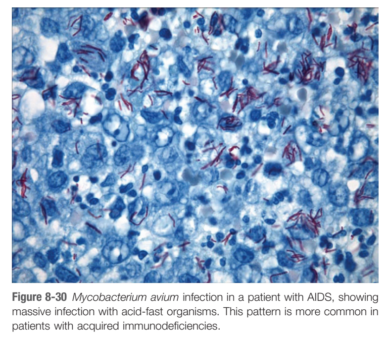
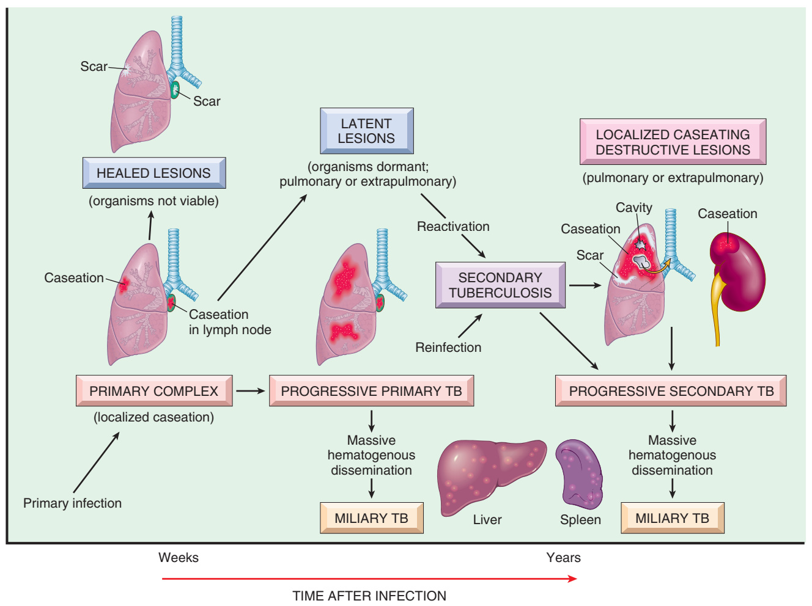

# Giới thiệu về lao ở trẻ em

**ThS. BS. Nguyễn Thành Nam**
Bộ môn Nhi, Trường Đại học Khoa học Sức khỏe, ĐHQG-HCM

Trẻ dưới 15 tuổi chiếm khoảng 11% số ca lao trên thế giới, nhưng phần lớn không được phát hiện và báo cáo. Khoảng 80% ca tử vong do lao ở trẻ em xảy ra ở nhóm trẻ dưới 5 tuổi và đa số chưa từng được điều trị. Bệnh lao do các vi khuẩn thuộc phức hợp *Mycobacterium tuberculosis* (*Mycobacterium tuberculosis*  complex) gây ra, chủ yếu là loài *M. tuberculosis*. Đây là những trực khuẩn kháng acid, hiếu khí bắt buộc và mọc chậm, nên cấy cần nhiều tuần. Trẻ bị nhiễm qua đường hô hấp từ người lớn hoặc vị thành niên có lao phổi, nguy cơ nhiễm cao nhất khi tiếp xúc gần trong hộ gia đình với ca nguồn có soi đàm tìm trực khuẩn kháng acid (AFB) dương tính. Ngược lại, trẻ nhỏ mắc lao ít vi khuẩn, hiếm khi lây và vi khuẩn học thường âm tính. Phần lớn trẻ phát bệnh trong 12 tháng đầu sau nhiễm, theo trình tự thời gian tương đối dự đoán được, từ lao kê và lao màng não trong vài tháng đầu đến lao xương khớp sau khoảng 1 năm. Trên thực hành, lao được chia thành phơi nhiễm, nhiễm và bệnh. 

## Dịch tễ học và gánh nặng bệnh tật

### Gánh nặng và khoảng trống phát hiện ca

<!-- LĐ-1 -->
Trẻ dưới 15 tuổi chiếm khoảng 11% số người mắc lao trên thế giới, tương đương khoảng 1,1 triệu ca mỗi năm, trong đó gần một nửa là trẻ dưới 5 tuổi (World Health Organization [WHO], 2022a). Ngoài ra, mỗi năm có thêm hơn nửa triệu vị thành niên 15–19 tuổi mắc lao (WHO, 2022a, 2022b). 

Gánh nặng tử vong lớn hơn gánh nặng mắc bệnh. Năm 2019, trẻ dưới 15 tuổi chiếm khoảng 12% số ca mới nhưng chiếm 16% số ca tử vong do lao (WHO, 2021). Năm 2020 ước tính 226 000 trẻ dưới 15 tuổi tử vong do lao và khoảng 80% số ca tử vong là ở trẻ dưới 5 tuổi (WHO, 2022a, 2022b).

<!-- LĐ-2 -->
Phần lớn trẻ mắc lao không được chương trình chống lao quốc gia phát hiện và báo cáo. Năm 2020 chỉ 399 000 trong khoảng 1,1 triệu trẻ mắc lao (36,5%) được báo cáo và nhóm dưới 5 tuổi bị bỏ sót nhiều nhất với chỉ 27,5% được báo cáo (WHO, 2022a). Hậu quả là 96% trẻ tử vong do lao chưa từng được điều trị (WHO, 2022a) và đa số trẻ tử vong do lao chưa từng được chẩn đoán (WHO, 2021). 

<!-- LĐ-3, LĐ-4 -->
Trẻ bị bỏ sót chẩn đoán vì cả đặc điểm của bệnh lẫn hạn chế của hệ thống y tế:

- **Đặc điểm bệnh:** trẻ nhỏ thường mang quá ít vi khuẩn để xét nghiệm phát hiện, khó lấy bệnh phẩm hô hấp và triệu chứng không đặc hiệu, trùng với các bệnh trẻ em thường gặp nên dễ chẩn đoán nhầm (WHO, 2022a, 2022b). Lao ở trẻ nhiễm HIV càng dễ bị bỏ sót vì bệnh cảnh giống bệnh phổi cơ hội (Cruz & Starke, 2025).
- **Xét nghiệm:** thiếu xét nghiệm nhạy dùng được ngay tại nơi khám (WHO, 2022a). Ở nhiều nước thu nhập thấp và trung bình, xét nghiệm sẵn có thường chỉ là soi đàm hoặc Xpert MTB/RIF, hai xét nghiệm thường âm tính ở trẻ và nhiều nơi không có X quang (Cruz & Starke, 2025; WHO, 2022a).
- **Hệ thống y tế:** tuyến cơ sở là nơi đa số trẻ đến khám đầu tiên nhưng thiếu năng lực lấy mẫu, xét nghiệm vi khuẩn học và X quang, còn nhân viên y tế thiếu tự tin khi chẩn đoán lâm sàng. Năng lực chẩn đoán lao trẻ em tập trung ở tuyến trên, nơi trẻ thường đến muộn khi đã nặng (WHO, 2022a, 2026b).
- **Thiếu lồng ghép:** sàng lọc lao ít được đưa vào các phác đồ chăm sóc trẻ như chiến lược Lồng ghép xử trí trẻ bệnh (IMCI) hay Xử trí ca bệnh lồng ghép tại cộng đồng (iCCM), nên bỏ lỡ cơ hội điều tra tiếp xúc và phát hiện bệnh (WHO, 2026b).

<!-- LĐ-5 -->
Chăm sóc lao trẻ em được xem là một chuỗi liên tục: phơi nhiễm, nhiễm, phát bệnh, được chẩn đoán và được điều trị. Trẻ có thể rơi khỏi chuỗi ở mỗi bước (WHO, 2022b). Ngay ở bước đầu tiên đã có khoảng hở lớn: năm 2017 ước tính 1,27 triệu trẻ dưới 5 tuổi tiếp xúc hộ gia đình đủ điều kiện điều trị dự phòng, nhưng độ bao phủ toàn cầu, ước tính ở mức cao nhất, cũng chỉ khoảng 23% (Hamada et al., 2019). Ở Ấn Độ, quốc gia chiếm khoảng 31% gánh nặng lao trẻ em, trong số trẻ dưới 5 tuổi đủ điều kiện, chỉ 58% được điều trị dự phòng (Mane & Shrotriya, 2024).

### Phân bố theo tuổi và thể bệnh

<!-- LĐ-6, LĐ-7, LĐ-8 -->
Tuổi là yếu tố chi phối cả tỉ suất mắc lẫn thể bệnh lao ở trẻ:

- Ở trẻ em, tỉ suất mắc lao thay đổi theo tuổi, cao nhất ở khoảng 1–4 tuổi ở vùng gánh nặng cao (WHO, 2022b). Trong một đoàn hệ sơ sinh ở vùng lưu hành cao, tỉ suất mới mắc cao nhất trong năm đầu đời rồi giảm dần qua tuổi thơ (da Costa et al., 2024). Nhóm 5–14 tuổi có tỉ suất mắc thấp nhất trong mọi nhóm tuổi (Cruz & Starke, 2025).
- Trẻ càng nhỏ tuổi, nhất là dưới 2 tuổi, càng có nguy cơ cao mắc các thể lao nặng như lao lan tỏa, lao kê, lao màng não (WHO, 2022b; Erkens et al., 2010; Nachiappan et al., 2017). Lao thần kinh trung ương gây tử vong hoặc di chứng nặng ở khoảng 50% ca (Thomas, 2017). Tại Mỹ giai đoạn 2013–2017, lao màng não chiếm 11,2% ca lao ở trẻ dưới 1 tuổi nhưng chỉ 2,6% ở trẻ 10–14 tuổi (Cruz & Starke, 2025). 
- Bên cạnh đó, lao ngoài phổi chiếm tỉ trọng ở trẻ em cao hơn người lớn, khoảng 25% ca lao trẻ em so với 15% ở người lớn trước khi đại dịch HIV lan rộng (Cruz & Starke, 2025). <!-- LĐ-10 -->
- Ngược với trẻ nhỏ, vị thành niên thường mắc lao kiểu người lớn, với hang trên X quang ngực và thường được xác nhận vi khuẩn học qua soi hoặc cấy đàm (WHO, 2022b). 

## Đặc điểm vi sinh

<!-- LĐ-11 -->
Bệnh lao do các vi khuẩn thuộc phức hợp *M. tuberculosis* gây ra. Đây là nhóm trực khuẩn kháng acid có quan hệ di truyền rất gần, gồm *M. tuberculosis*, *M. bovis*, *M. africanum* và một số loài ít khi gây bệnh ở người như *M. canetti*, *M. microti*, *M. caprae*, *M. pinnipedii* (American Academy of Pediatrics [AAP], 2024; Cruz & Starke, 2025). Trên thực hành, phòng xét nghiệm lâm sàng thường không định danh riêng từng loài (AAP, 2024).

<!-- LĐ-12, LĐ-13 -->
Các đặc điểm vi khuẩn học chính của *M. tuberculosis* gồm (Cruz & Starke, 2025):

- **Hình thái:** trực khuẩn không di động, không sinh nha bào, đa hình, bắt màu Gram dương yếu, dài 1–5 μm, thường mảnh và hơi cong, có khi xếp chuỗi hạt hoặc thành đám.
- **Vách tế bào:** chứa 20–60% lipid theo trọng lượng khô. Lớp vách này giúp vi khuẩn đề kháng ánh sáng, kiềm, acid và tác dụng diệt khuẩn của kháng thể tốt hơn hầu hết vi khuẩn khác.
- **Tính kháng acid:** là đặc điểm dùng để nhận diện vi khuẩn. Vi khuẩn bắt màu đỏ khi nhuộm Ziehl-Neelsen hoặc Kinyoun và phát huỳnh quang vàng lục khi nhuộm auramine-rhodamine.
- **Chuyển hóa và tốc độ mọc:** vi khuẩn hiếu khí bắt buộc, mọc trên môi trường trứng (Löwenstein-Jensen) hoặc môi trường tổng hợp (Middlebrook 7H9). Vi khuẩn mọc chậm, thời gian thế hệ 14–24 giờ, có thể do trao đổi chất qua lớp vỏ sáp diễn ra chậm.
- **Hệ quả:** cấy trên môi trường đặc cần 3–6 tuần, kháng sinh đồ cần thêm 2–4 tuần. Cấy trên môi trường lỏng như hệ thống MGIT (Mycobacteria Growth Indicator Tube) rút ngắn thời gian định danh và kháng sinh đồ xuống 1–3 tuần, tùy lượng vi khuẩn trong mẫu.

<figure markdown="span">
  { .img-md }
  <figcaption markdown="span">**Hình 1.** Trực khuẩn kháng acid trên mô nhuộm kháng acid. Vô số trực khuẩn mảnh, hơi cong, bắt màu đỏ, đứng riêng lẻ hoặc thành đám trên nền tế bào bắt màu xanh. Mẫu từ bệnh nhân AIDS nhiễm *Mycobacterium avium*, minh họa hình thái và tính kháng acid chung của vi khuẩn chi *Mycobacterium*; mật độ vi khuẩn dày đặc như vậy thường gặp ở người suy giảm miễn dịch mắc phải. 
  Trích từ Kumar et al. (2015), Hình 8-30, tr. 377. Bản quyền © 2015 Elsevier.</figcaption>
</figure>

## Lây truyền và sinh bệnh học

### Nguồn lây và đường lây

<!-- LĐ-14 -->
Lao lây qua không khí, nguồn lây thường là người lớn hoặc vị thành niên mắc lao phổi, lao nội phế quản hay lao thanh quản (AAP, 2024). Khả năng trẻ bị nhiễm phụ thuộc vào mức độ lây của ca nguồn và độ gần của tiếp xúc:

- **Ca nguồn:** soi đàm AFB dương tính, tải lượng vi khuẩn cao, tổn thương phổi rộng hoặc có hang và ho kéo dài làm tăng khả năng lây (AAP, 2024; Mane & Shrotriya, 2024). Mức tăng nguy cơ nhiễm do tiếp xúc hộ gia đình rõ hơn nhiều khi ca nguồn có soi đàm AFB dương tính (Martinez et al., 2017).
- **Độ gần tiếp xúc:** nguy cơ cao nhất khi trẻ ngủ chung giường với ca nguồn, sau đó là ngủ cùng phòng và ở khác phòng trong cùng nhà (Martinez et al., 2017; Seddon & Shingadia, 2014).

<!-- LĐ-15 -->
Trẻ thường bị nhiễm lao ở đâu vẫn còn tranh cãi. Quan điểm kinh điển cho rằng trẻ thường nhiễm từ người lớn hoặc vị thành niên trong hộ gia đình, như cha mẹ, ông bà hay anh chị lớn, còn tiếp xúc thoáng qua ngoài gia đình ít khi là nguồn lây (Cruz & Starke, 2025; Mane & Shrotriya, 2024). Ngược lại, một phân tích gộp ước tính phơi nhiễm hộ gia đình chỉ giải thích dưới 20% số ca lây truyền ở trẻ trong cộng đồng, gợi ý phần lớn trẻ bị nhiễm từ nguồn lây ngoài hộ gia đình (Martinez et al., 2017).

<!-- LĐ-16, LĐ-17, LĐ-18 -->
<!-- Các yếu tố làm tăng nguy cơ trẻ bị nhiễm lao gồm:

- **Tiếp xúc hộ gia đình:** trẻ 0–14 tuổi tiếp xúc hộ gia đình có odds nhiễm lao gấp 3,79 lần trẻ trong cộng đồng, cao nhất ở trẻ 0–4 tuổi (OR 5,39) (Martinez et al., 2017). Ở nước gánh nặng thấp, khoảng 27,9% trẻ dưới 5 tuổi tiếp xúc hộ gia đình bị nhiễm (Hamada et al., 2019). Trung bình 30–50% trẻ tiếp xúc trong hộ gia đình với ca nguồn có xét nghiệm nhiễm lao dương tính (Lamb & Starke, 2017).
- **Sống ở vùng lưu hành cao:** trẻ bị nhiễm liên tục qua các năm nên tỉ lệ đã nhiễm tăng dần theo tuổi. Dữ liệu còn hạn chế, chủ yếu từ một đoàn hệ sơ sinh ở Nam Phi, với nguy cơ chuyển dương TST hằng năm 6,6 trên 100 người-năm và nguy cơ cộng dồn 36% lúc 8 tuổi (da Costa et al., 2024).
- **Môi trường sống:** có người hút thuốc trong nhà và nhà đông người làm tăng nguy cơ chuyển dương TST (da Costa et al., 2024). Khói nhiên liệu rắn cũng được xem là yếu tố làm tăng nguy cơ nhiễm (Mane & Shrotriya, 2024). -->

<!-- LĐ-19, LĐ-20 -->
Một ca lao ở trẻ nhỏ là dấu hiệu cảnh báo có lây truyền mới trong cộng đồng, vì trẻ thường phát bệnh sớm sau nhiễm. Lao trẻ em vì vậy phản ánh lây truyền đang diễn ra từ người lớn và vị thành niên (WHO, 2022b; AAP, 2024; Marais, 2011). Lây truyền lao trong bệnh viện nhi hầu như luôn bắt nguồn từ người lớn chưa được chẩn đoán. Vì vậy, người lớn đi cùng trẻ nghi lao nên được sàng lọc lao phổi sớm bằng hỏi triệu chứng và X quang ngực (Cruz & Starke, 2025).

### Khả năng lây và lượng vi khuẩn ở trẻ

<!-- LĐ-21, LĐ-22 -->
Trẻ nhỏ mắc lao hiếm khi lây cho người khác. Lao ở trẻ là thể ít vi khuẩn: dịch tiết phế quản chứa ít vi khuẩn, ho không phải triệu chứng điển hình của lao trong lồng ngực hay lao kê, và khi ho trẻ không đủ lực để phát tán vi khuẩn (Cruz & Starke, 2025; WHO, 2022b). Trẻ dưới 10 tuổi chỉ có hạch trong lồng ngực hoặc tổn thương phổi nhỏ kèm ho khan được xem là không lây. Ngoại lệ hiếm là trẻ có hang, soi đàm AFB dương tính hoặc nhũ nhi mắc lao bẩm sinh (AAP, 2024).

Tính chất ít vi khuẩn này cũng giải thích vì sao vi khuẩn học ở trẻ thường âm tính. Dịch rửa phế quản phế nang hoặc dịch dạ dày buổi sáng của trẻ nghi lao hiếm khi thấy AFB khi soi và chỉ khoảng 40% cuối cùng cấy mọc *M. tuberculosis*. Ngược lại, nhũ nhi mắc lao bẩm sinh hoặc lao phổi nặng mắc phải sau sinh có tỉ lệ soi hoặc cấy dương tính khoảng 80% (Cruz & Starke, 2025).

<!-- LĐ-23 -->
Khác với trẻ nhỏ, vị thành niên thường có lao phổi có hang hoặc soi đàm AFB dương tính, lây bệnh như người lớn và là nguồn lây quan trọng (WHO, 2022b; Marais, 2011).

### Đường vào

<!-- LĐ-24, LĐ-25, LĐ-26 -->
Hít phải các hạt nhân giọt (droplet nuclei) chứa *M. tuberculosis* là đường vào chủ yếu. Vi khuẩn định cư trong tế bào ở phổi và mô lympho đi kèm. Trong 2114 ca tử thiết trẻ em, khoảng 96% có ổ nguyên phát ở phổi (Cruz & Starke, 2025). Các đường vào khác ít gặp:

- **Tiêu hóa:** qua sữa hoặc sản phẩm từ sữa chưa thanh trùng nhiễm *M. bovis*. *M. bovis* rất ít khi lây giữa người với người qua không khí (AAP, 2024; Cruz & Starke, 2025).
- **Qua da, niêm mạc bị trầy xước hoặc qua ghép tạng** (Cruz & Starke, 2025).
- **Lao bẩm sinh thật sự:** rất hiếm, xảy ra khi mẹ có lao lan theo đường bạch huyết – máu lúc mang thai hoặc bị viêm nội mạc tử cung do lao (Cruz & Starke, 2025). Trẻ thường khởi bệnh lúc 2–4 tuần tuổi (AAP, 2024).

### Thời gian ủ bệnh

<!-- LĐ-27, LĐ-28 -->
Thời gian từ lúc nhiễm đến khi xuất hiện quá mẫn với tuberculin, tức test da tuberculin (TST) hoặc xét nghiệm giải phóng interferon-gamma (IGRA) chuyển dương, kéo dài vài tuần đến khoảng 3 tháng. Các nguồn nêu mốc khác nhau: 2–10 tuần (trung vị 3–4 tuần) hoặc 3 tuần – 3 tháng (AAP, 2024; Cruz & Starke, 2025; Milburn, 2001). Lượng vi khuẩn nhiễm càng lớn thì thời gian ủ bệnh càng ngắn và bệnh càng nặng. Ví dụ, nhũ nhi nhiễm từ mẹ thường bệnh nặng hơn nhũ nhi nhiễm từ khách đến nhà (Cruz & Starke, 2025).

### Hình thành phức hợp nguyên phát

<!-- LĐ-29, LĐ-30 -->
Ổ nguyên phát bắt đầu bằng phản ứng viêm cấp quanh vi khuẩn trong phế nang. Đại thực bào xuất hiện trong vài giờ rồi chuyển thành đám tế bào dạng biểu mô tạo củ lao. Củ lao có thể thoái lui hoặc hoại tử bã đậu ở trung tâm (Cruz & Starke, 2025). Tổn thương bã đậu chứa nhiều vi khuẩn đang nhân lên và vi khuẩn nhanh chóng lan theo bạch mạch tới hạch vùng. Ổ nguyên phát, viêm mạch bạch huyết và viêm hạch vùng hợp thành phức hợp nguyên phát Ghon, gặp ở mọi ca nhiễm nguyên phát bất kể đường vào (Cruz & Starke, 2025; Marais, 2011; Milburn, 2001). Một số đặc điểm của phức hợp này ở phổi:

- Ổ nguyên phát có thể ở bất kỳ thùy phổi nào và 70–85% ca nhiễm nguyên phát chỉ có 1 ổ (Cruz & Starke, 2025).
- Ít nhất 70% ổ nguyên phát nằm dưới màng phổi, nên viêm màng phổi gần như là một thành phần thường quy của phức hợp (Cruz & Starke, 2025).

<!-- LĐ-31, LĐ-32, LĐ-33 -->
Nét đặc trưng của nhiễm lao nguyên phát ở trẻ là hạch vùng to nổi bật so với ổ nguyên phát nhỏ ở phổi (Cruz & Starke, 2025). Hạch trung thất và rốn phổi gặp ở 83–96% ca lao nguyên phát ở trẻ, so với 10–43% ở người lớn (Nachiappan et al., 2017). Hạch rốn phổi thoáng qua gặp ở 50–60% trẻ mới nhiễm, nhưng chỉ ít trẻ trong số này tiến triển thành bệnh (Marais, 2011).

Hạch to nhanh khi quá mẫn tuberculin hình thành, khoảng 3–12 tuần sau nhiễm. Lúc này phản ứng tế bào tăng lên trong toàn phức hợp, rõ nhất ở ổ nguyên phát và hạch vùng. Nhiễm có thể lan theo chuỗi bạch huyết tới hạch xa hơn. Hạch rốn phổi có ổ bã đậu nhưng chứa ít vi khuẩn (Cruz & Starke, 2025). Vị trí hạch bị tổn thương phụ thuộc hướng dẫn lưu bạch huyết của phổi (Cruz & Starke, 2025):

- Bạch huyết dẫn lưu chủ yếu từ trái sang phải, nên hạch cạnh khí quản phải bị nhiều nhất.
- Bạch huyết vùng màng phổi đỉnh dẫn lưu về hạch cổ. Chuỗi hạch cạnh khí quản thông với hạch cổ sâu và hạch ổ bụng.

<!-- LĐ-34 -->
Vôi hóa phức hợp nguyên phát luôn là hậu quả của bã đậu hóa và là dấu hiệu muộn, xuất hiện sớm nhất khoảng 6 tháng sau nhiễm. Tỉ lệ vôi hóa tăng dần theo thời gian, khoảng 13% sau 12 tháng, 55% sau 24 tháng và 100% sau 4 năm (Cruz & Starke, 2025). Phức hợp đã lành bằng xơ hóa và vôi hóa vẫn có thể tái hoạt sau nhiều năm (Marais, 2011; Milburn, 2001).

### Lan tràn theo đường bạch huyết – máu

<!-- LĐ-35, LĐ-36 -->
Trong thời kỳ ủ bệnh, vi khuẩn lan theo đường bạch huyết – máu ở mọi ca nhiễm, thường trước khi miễn dịch qua trung gian tế bào được hoạt hóa đầy đủ. Bằng chứng là sinh thiết gan ở trẻ vừa chuyển dương TST luôn thấy tổn thương (Cruz & Starke, 2025; Marais, 2011; Milburn, 2001). Lan tràn này có ba thể (Cruz & Starke, 2025):

- Lan tràn ẩn: không gây triệu chứng nhưng để lại các ổ vi khuẩn có thể gây lao ngoài phổi về sau, như lao thận.
- Lao lan tràn đường máu kéo dài.
- Lao kê.

### Diễn tiến tự nhiên sau nhiễm

<!-- LĐ-41 -->
Phần lớn nhiễm lao ở trẻ em không có triệu chứng (AAP, 2024). Nhiễm nguyên phát thường kín đáo, đôi khi chỉ có triệu chứng hô hấp nhẹ, tự giới hạn và phản ứng quá mẫn như sốt, hồng ban nút hoặc viêm kết mạc bọng (phlyctenular conjunctivitis) (Thomas, 2017). Trên thực hành, nhiễm và bệnh được tách thành hai trạng thái, nhưng thực chất đây là một phổ liên tục, đi từ thải trừ vi khuẩn, nhiễm ở trạng thái ngủ, bệnh cận lâm sàng đến bệnh không nặng và bệnh nặng (Shah & Dorman, 2021; Thomas, 2017). 

<!-- LĐ-42 -->
Lao cận lâm sàng, tức bệnh có bằng chứng vi khuẩn học hoặc hình ảnh nhưng không có triệu chứng gợi ý, chiếm một phần đáng kể số ca lao:

- **Ở trẻ nhỏ:** trong một nghiên cứu trên trẻ 2–60 tháng tiếp xúc hộ gia đình, 35,7% ca lao không có triệu chứng và nhóm này chiếm 81,0% số ca được xác nhận vi khuẩn học (Mulenga et al., 2026).
- **Ở vị thành niên:** trong một loạt ca, vị thành niên có tỉ lệ lao cận lâm sàng cao hơn người lớn (23,8% so với 8,3%) và ít biểu hiện điển hình hơn (Shen et al., 2024).
- **Ở người từ 15 tuổi:** trong các điều tra cộng đồng, 59,1% ca lao không ho kéo dài và 20,3% không có bất kỳ triệu chứng nào (Stuck et al., 2024). Ở người tiếp xúc trên 15 tuổi, người không có triệu chứng nhưng X quang ngực bất thường có nguy cơ phát bệnh lao về sau cao hơn rõ rệt (Tan et al., 2024).

<!-- LĐ-43 -->
Trẻ thường phát bệnh sớm sau nhiễm (WHO, 2022a). Nguy cơ cao nhất trong 12 tháng đầu và còn cao trong khoảng 2 năm, dù bệnh vẫn có thể xuất hiện sau nhiều năm (AAP, 2024). Ở trẻ nhỏ, hơn 90% ca bệnh (một số nguồn ghi hơn 95%) xuất hiện trong 12 tháng đầu sau nhiễm (Marais, 2011; Marais & Schaaf, 2014). <!-- LĐ-44, LĐ-45 --> Các thể bệnh xuất hiện theo trình tự thời gian tương đối dự đoán được sau nhiễm nguyên phát. Trình tự này giúp dự đoán biến chứng nào có thể xuất hiện vào lúc nào và định hướng truy tìm nguồn lây (Cruz & Starke, 2025).

**Bảng 1.** Trình tự xuất hiện các thể bệnh theo thời gian sau nhiễm lao nguyên phát

| Thời gian sau nhiễm | Biểu hiện thường gặp |
|---|---|
| 3–8 tuần | Sốt kéo dài, chuyển dương TST, phức hợp nguyên phát, phản ứng quá mẫn như hồng ban nút |
| 1–3 tháng (có nguồn ghi 2–6 tháng) | Lao kê và lao màng não, nguy cơ cao nhất ở trẻ nhỏ, gặp ở 0,5–3% trẻ nhiễm |
| 3–9 tháng | Biến chứng hạch và đường thở ở trẻ dưới 5 tuổi, tràn dịch màng phổi ở trẻ lớn |
| Từ khoảng 1 năm | Lao xương khớp, gặp ở khoảng 5% trẻ nhiễm không điều trị |
| 1–3 năm | Lao phổi kiểu người lớn ở vị thành niên |
| 5–25 năm | Lao thận |

<small>Nguồn: Marais & Schaaf (2014), Marais (2011), Starke (2004), Cruz & Starke (2025).</small>

<figure markdown="span">
  { .img-lg }
  <figcaption markdown="span">**Hình 2.** Diễn tiến tự nhiên của lao phổi theo thời gian sau nhiễm. Nhiễm nguyên phát tạo phức hợp nguyên phát với bã đậu khu trú ở phổi và hạch vùng. Phần lớn tổn thương lành thành sẹo (vi khuẩn không còn sống) hoặc trở thành tổn thương tiềm ẩn (vi khuẩn ở trạng thái ngủ, trong hoặc ngoài phổi). Một số ít tiến triển thành lao nguyên phát tiến triển, có thể lan tràn ồ ạt theo đường máu gây lao kê (gan, lách). Sau nhiều năm, tái hoạt tổn thương tiềm ẩn hoặc tái nhiễm gây lao thứ phát với tổn thương bã đậu hủy hoại khu trú, tạo hang ở phổi hoặc tổn thương ngoài phổi (ví dụ thận); lao thứ phát tiến triển cũng có thể lan tràn đường máu gây lao kê. 
  Trích từ Kumar et al. (2015), Hình 8-25, tr. 374. Bản quyền © 2015 Elsevier.</figcaption>
</figure>

### Yếu tố nguy cơ tiến triển từ nhiễm sang bệnh

<!-- LĐ-46 -->
Tuổi lúc nhiễm là yếu tố quyết định quan trọng nhất của nguy cơ tiến triển thành bệnh. Nguy cơ cao nhất ở nhũ nhi, khoảng 40–50% (Cruz & Starke, 2025; Mane & Shrotriya, 2024). Nguy cơ giảm còn 20–30% ở trẻ 1–2 tuổi và thấp nhất ở trẻ 5–10 tuổi, khoảng 2–5% (Mane & Shrotriya, 2024; Cruz & Starke, 2025). Các con số trên là nguy cơ suốt đời. Nếu tính nguy cơ trong 2 năm khi không điều trị dự phòng, mức này là khoảng 18% ở nhũ nhi theo số liệu được trích lại (WHO, 2022b) và 19% ở trẻ dưới 5 tuổi (Martinez et al., 2020).

<!-- LĐ-47 -->
Trẻ nhiễm lao khi còn nhỏ không chỉ dễ phát bệnh hơn mà còn dễ mắc thể nặng. Có tới 40% nhũ nhi có miễn dịch bình thường, bị nhiễm mà không được điều trị, tiến triển thành thể bệnh nặng đe dọa tính mạng trong vòng 1 năm (Cruz & Starke, 2025). Ở nhũ nhi, nguy cơ lao phổi hoặc lao hạch trung thất có thể tới 30–40% và nguy cơ lao màng não hoặc lao lan tỏa 10–20% (Erkens et al., 2010). Nguy cơ mắc thể nặng giảm rõ theo tuổi lúc nhiễm:

**Bảng 2.** Nguy cơ phát bệnh và thể bệnh theo tuổi lúc nhiễm lao ở trẻ có miễn dịch bình thường

| Tuổi lúc nhiễm | Không phát bệnh | Lao phổi | Lao màng não hoặc lao kê |
|---|---|---|---|
| Dưới 2 tuổi | 50–70% | 10–30% | 2–10% |
| 2–10 tuổi | 95–98% | 2–5% | Dưới 0,5% |
| Trên 10 tuổi | 80–90% | 10–20% | Dưới 0,5% |

<small>Nguồn: Marais (2011), số liệu thời kỳ trước khi có thuốc kháng lao, ở trẻ có miễn dịch bình thường.</small>

<!-- LĐ-48 -->
Suy giảm miễn dịch là yếu tố nguy cơ mạnh của tiến triển thành bệnh. HIV là yếu tố mạnh nhất, nhất là khi HIV chưa được kiểm soát (AAP, 2024; Martinez et al., 2020). Nhũ nhi và trẻ nhiễm HIV chưa điều trị thuốc kháng retrovirus (ARV) có nguy cơ lao gấp khoảng 20 lần (Mane & Shrotriya, 2024). Các nguyên nhân suy giảm miễn dịch khác gồm corticoid kéo dài hoặc liều cao, hóa trị, thuốc chống thải ghép và thuốc ức chế yếu tố hoại tử khối u alpha (TNF-α) (AAP, 2024). Thuốc kháng TNF-α, nhất là infliximab, làm nguy cơ bệnh lao tăng tới 25 lần (Cruz & Starke, 2025).

<!-- LĐ-49 -->
Nhiều yếu tố khác cũng làm tăng nguy cơ tiến triển thành bệnh:

- Suy dinh dưỡng và nghèo đói: nghèo đói ảnh hưởng mọi giai đoạn từ phơi nhiễm đến bệnh (Mane & Shrotriya, 2024; AAP, 2024).
- Đái tháo đường: nhất là khi kiểm soát kém (Cruz & Starke, 2025). Đái tháo đường làm tăng nguy cơ bệnh lao khoảng 1,9 lần, nhưng dữ liệu chủ yếu ở người lớn và mức độ chắc chắn của bằng chứng thấp (Franco et al., 2024).
- Bệnh nền khác: bệnh Hodgkin, u lympho, suy thận mạn (AAP, 2024), sởi và có thể cả cúm (Cruz & Starke, 2025).
- Khói thuốc lá: hút thuốc lá thụ động làm trẻ nhiễm lao dễ chuyển thành bệnh hơn (AAP, 2024). Ở người tiếp xúc hộ gia đình mọi lứa tuổi, chỉ số khối cơ thể thấp, hút thuốc và nhà thông khí kém có liên quan với việc phát bệnh lao (Sharma et al., 2017).

## Định nghĩa và phân loại

### Các giai đoạn và phơi nhiễm

<!-- LĐ-51, LĐ-52 -->
Trên thực hành, lao ở trẻ được chia thành 3 giai đoạn: phơi nhiễm, nhiễm và bệnh (Cruz & Starke, 2025; AAP, 2024; Lamb & Starke, 2017).

**Bảng 3.** Đặc điểm lâm sàng, xét nghiệm và X quang ngực của ba giai đoạn phơi nhiễm, nhiễm và bệnh lao

| Giai đoạn | Triệu chứng | TST hoặc IGRA | X quang ngực |
|---|---|---|---|
| Phơi nhiễm | Không | Âm tính | Bình thường |
| Nhiễm | Không | Dương tính | Bình thường, hoặc chỉ có u hạt hay nốt vôi hóa ở nhu mô hoặc hạch vùng nhỏ trong lồng ngực |
| Bệnh | Có triệu chứng, dấu hiệu thực thể hoặc tổn thương hình ảnh | Dương tính hoặc âm tính | Bình thường hoặc bất thường |

Phơi nhiễm là tình trạng trẻ đã tiếp xúc gần với một ca lao có khả năng lây, dù nghi ngờ hoặc xác định, như lao phổi, lao thanh quản, lao khí quản hay lao nội phế quản (AAP, 2024). Phơi nhiễm hay xảy ra nhất trong hộ gia đình, ngoài ra có thể ở trường học, nhà trẻ hay nơi đông người khép kín. Ở giai đoạn này trẻ không có triệu chứng, TST hoặc IGRA âm tính và X quang ngực bình thường (Cruz & Starke, 2025). Lúc này chưa thể biết trẻ nào sẽ bị nhiễm (AAP, 2024).

<!-- LĐ-53, LĐ-54 -->
Hai lưu ý khi đánh giá trẻ phơi nhiễm:

- **Xét nghiệm phát hiện nhiễm lao âm tính ngay sau phơi nhiễm chưa loại trừ được nhiễm:** quá mẫn với tuberculin cần vài tuần đến khoảng 3 tháng để hình thành. TST thường dương tính sau 2–10 tuần nên người mới phơi nhiễm dưới 3 tháng có thể còn TST hoặc IGRA âm tính (AAP, 2024; Cruz & Starke, 2025; Thomas, 2017).
- **Định nghĩa tiếp xúc hộ gia đình:** người ở chung một không gian kín với ca nguồn ít nhất 1 đêm hoặc ở cùng thường xuyên hay kéo dài vào ban ngày, trong 3 tháng trước khi ca nguồn bắt đầu điều trị (WHO, 2022a). Nguồn lây là người đã truyền vi khuẩn sang người khác và người này sau đó bị nhiễm hoặc mắc bệnh (AAP, 2024).

### Nhiễm lao

<!-- LĐ-55, LĐ-56 -->
Nhiễm lao là trạng thái đáp ứng miễn dịch kéo dài với kháng nguyên *M. tuberculosis* mà chưa có bệnh lao biểu hiện lâm sàng (WHO, 2022a). Trẻ nhiễm lao được nhận diện khi:

- Không có triệu chứng và dấu hiệu thực thể.
- TST hoặc IGRA dương tính.
- X quang ngực bình thường hoặc chỉ có u hạt, nốt vôi hóa ở nhu mô hoặc hạch vùng nhỏ (dưới 2,5 cm) trong lồng ngực (Cruz & Starke, 2025; AAP, 2024). Một số hướng dẫn không nêu ngưỡng kích thước hạch (AAP, 2024).

WHO đã thay thuật ngữ "nhiễm lao tiềm ẩn" bằng "nhiễm lao" để tách bạch rõ với bệnh lao (WHO, 2021, 2022a). Một số hướng dẫn khác vẫn chấp nhận tên gọi nhiễm lao tiềm ẩn (AAP, 2024).

### Bệnh lao và người nghi lao

<!-- LĐ-57, LĐ-58 -->
Bệnh lao là tình trạng có triệu chứng, dấu hiệu thực thể hoặc tổn thương X quang do *M. tuberculosis* gây ra. Bệnh có thể ở phổi, ngoài phổi hoặc cả hai (AAP, 2024; WHO, 2021). Người nghi lao (presumptive TB) là người có triệu chứng hoặc dấu hiệu gợi ý lao, tức đối tượng cần được đánh giá chẩn đoán (WHO, 2022a).

### Phân loại theo vị trí giải phẫu

<!-- LĐ-59, LĐ-60, LĐ-61 -->
Phân loại theo vị trí giải phẫu dựa trên việc nhu mô phổi hoặc cây khí phế quản có bị tổn thương hay không (WHO, 2022a, 2026b):

- **Lao phổi:** bệnh ở nhu mô phổi hoặc cây khí phế quản. Lao kê được xếp vào lao phổi và người vừa có lao phổi vừa có lao ngoài phổi được ghi nhận là lao phổi (WHO, 2022a, 2026b).
- **Hạch lao trong lồng ngực:** hạch trung thất hoặc rốn phổi được xếp vào lao phổi ở trẻ em kể cả khi nhu mô phổi trên X quang ngực bình thường (WHO, 2022a).
- **Lao ngoài phổi:** bệnh ở cơ quan ngoài nhu mô phổi và cây khí phế quản, như màng phổi, hạch ngoại biên, ổ bụng hoặc đường tiêu hóa, tiết niệu sinh dục, da, xương khớp và màng não (WHO, 2022a, 2026b).

### Phân loại theo bằng chứng chẩn đoán

<!-- LĐ-62, LĐ-63 -->
Theo bằng chứng chẩn đoán, ca lao được chia thành 2 loại (WHO, 2022a, 2026b):

- **Ca xác nhận vi khuẩn học:** có bệnh phẩm dương tính bằng xét nghiệm chẩn đoán nhanh được WHO khuyến cáo như Xpert MTB/RIF hoặc xét nghiệm LAM nước tiểu (LF-LAM), bằng nuôi cấy hoặc soi trực tiếp.
- **Ca chẩn đoán lâm sàng:** không đủ tiêu chuẩn xác nhận vi khuẩn học nhưng được bác sĩ quyết định điều trị đủ một liệu trình kháng lao. Nhóm này gồm lao phổi chẩn đoán dựa vào bất thường X quang và lao ngoài phổi chẩn đoán dựa vào lâm sàng gợi ý hoặc mô bệnh học. Nếu về sau có kết quả vi khuẩn học dương tính, ca này được chuyển thành ca xác nhận vi khuẩn học (WHO, 2026b).

### Phân loại theo tiền sử điều trị và tính nhạy thuốc

<!-- LĐ-64, LĐ-65, LĐ-66 -->
Các định nghĩa theo tiền sử điều trị và tính nhạy thuốc gồm:

- Ca mới: người chưa từng điều trị lao hoặc đã dùng thuốc kháng lao tổng cộng dưới 1 tháng (WHO, 2026b).
- Lao nhạy thuốc: gồm cả người chưa làm kháng sinh đồ, miễn là không có bằng chứng kháng rifampicin hay isoniazid (WHO, 2026b).
- Lao đa kháng (MDR, multidrug-resistant): kháng ít nhất isoniazid và rifampicin (AAP, 2024).
- Lao tiền siêu kháng (pre-XDR, pre-extensively drug-resistant): lao đa kháng kèm kháng một fluoroquinolone bất kỳ (AAP, 2024).
- Lao siêu kháng (XDR, extensively drug-resistant): kháng isoniazid, rifampicin, một fluoroquinolone cùng bedaquiline và/hoặc linezolid (AAP, 2024).

### Phân nhóm tuổi

<!-- LĐ-67 -->
Hướng dẫn WHO định nghĩa trẻ em là người dưới 10 tuổi và vị thành niên là người 10–19 tuổi, các quốc gia có thể dùng định nghĩa khác (WHO, 2022b, 2026a). Hướng dẫn WHO về lao trẻ em còn chia nhỏ hơn thành nhũ nhi dưới 1 tuổi, trẻ nhỏ dưới 5 tuổi, vị thành niên nhỏ 10–14 tuổi và vị thành niên lớn 15–19 tuổi (WHO, 2022a). Hệ quả là khuyến cáo WHO ghi "người lớn và vị thành niên" áp dụng cho người từ 10 tuổi, còn khuyến cáo ghi "trẻ em" chỉ áp dụng cho nhóm dưới 10 tuổi (WHO, 2026a).

## Tài liệu tham khảo

American Academy of Pediatrics. (2024). Tuberculosis. In D. W. Kimberlin, R. Banerjee, E. D. Barnett, R. Lynfield, & M. H. Sawyer (Eds.), *Red Book: 2024–2027 report of the Committee on Infectious Diseases* (33rd ed., pp. 888–919). American Academy of Pediatrics.

Cruz, A. T., & Starke, J. R. (2025). Tuberculosis. In J. D. Cherry, S. L. Kaplan, G. J. Demmler-Harrison, W. J. Steinbach, P. J. Hotez, & J. V. Williams (Eds.), *Feigin and Cherry's textbook of pediatric infectious diseases* (9th ed., pp. 975–1008). Elsevier.

da Costa, F. B. P., Nicol, M. P., Botha, M., Workman, L., Arcêncio, R. A., Zar, H. J., & Martinez, L. (2024). *Mycobacterium tuberculosis* infection and tuberculosis disease in the first decade of life: A South African birth cohort study. *The Lancet Child & Adolescent Health, 8*(12), 891–899. https://doi.org/10.1016/s2352-4642(24)00256-6

Erkens, C. G., Kamphorst, M., Abubakar, I., Bothamley, G. H., Chemtob, D., Haas, W., Migliori, G. B., Rieder, H. L., Zellweger, J. P., & Lange, C. (2010). Tuberculosis contact investigation in low prevalence countries: A European consensus. *The European Respiratory Journal, 36*(4), 925–949. https://doi.org/10.1183/09031936.00201609

Franco, J. V., Bongaerts, B., Metzendorf, M. I., Risso, A., Guo, Y., Peña Silva, L., Boeckmann, M., Schlesinger, S., Damen, J. A., Richter, B., Baddeley, A., Bastard, M., Carlqvist, A., Garcia-Casal, M. N., Hemmingsen, B., Mavhunga, F., Manne-Goehler, J., & Viney, K. (2024). Diabetes as a risk factor for tuberculosis disease. *The Cochrane Database of Systematic Reviews, 8*, CD016013. https://doi.org/10.1002/14651858.cd016013.pub2

Hamada, Y., Glaziou, P., Sismanidis, C., & Getahun, H. (2019). Prevention of tuberculosis in household members: Estimates of children eligible for treatment. *Bulletin of the World Health Organization, 97*(8), 534–547D. https://doi.org/10.2471/blt.18.218651

Kumar, V., Abbas, A. K., & Aster, J. C. (Eds.). (2015). *Robbins and Cotran pathologic basis of disease* (9th ed.). Elsevier Saunders.

Lamb, G. S., & Starke, J. R. (2017). Tuberculosis in infants and children. *Microbiology Spectrum, 5*(2). https://doi.org/10.1128/microbiolspec.tnmi7-0037-2016

Mane, S. S., & Shrotriya, P. (2024). Current epidemiology of pediatric tuberculosis. *Indian Journal of Pediatrics, 91*(7), 711–716. https://doi.org/10.1007/s12098-023-04910-4

Marais, B. J. (2011). Childhood tuberculosis: Epidemiology and natural history of disease. *Indian Journal of Pediatrics, 78*(3), 321–327. https://doi.org/10.1007/s12098-010-0353-1

Marais, B. J., & Schaaf, H. S. (2014). Tuberculosis in children. *Cold Spring Harbor Perspectives in Medicine, 4*(9), a017855. https://doi.org/10.1101/cshperspect.a017855

Martinez, L., Cords, O., Horsburgh, C. R., Andrews, J. R., & Pediatric TB Contact Studies Consortium. (2020). The risk of tuberculosis in children after close exposure: A systematic review and individual-participant meta-analysis. *Lancet, 395*(10228), 973–984. https://doi.org/10.1016/s0140-6736(20)30166-5

Martinez, L., Shen, Y., Mupere, E., Kizza, A., Hill, P. C., & Whalen, C. C. (2017). Transmission of *Mycobacterium tuberculosis* in households and the community: A systematic review and meta-analysis. *American Journal of Epidemiology, 185*(12), 1327–1339. https://doi.org/10.1093/aje/kwx025

Milburn, H. J. (2001). Primary tuberculosis. *Current Opinion in Pulmonary Medicine, 7*(3), 133–141. https://doi.org/10.1097/00063198-200105000-00004

Mulenga, H., Shenje, J., Mendelsohn, S. C., Luabeya, A. K. K., Tameris, M., Tredoux, E. N., Nemes, E., Bilek, N., Beyers, E., Ivacik-Goncalves, D., Andrews, J. R., Hawn, T. R., Dobos, K. M., Altin, J. A., Musvosvi, M., Scriba, T. J., & Hatherill, M. (2026). Asymptomatic tuberculosis in children with household exposure to *Mycobacterium tuberculosis*. *Clinical Infectious Diseases, 82*(5), e1005–e1013. https://doi.org/10.1093/cid/ciaf562

Nachiappan, A. C., Rahbar, K., Shi, X., Guy, E. S., Mortani Barbosa, E. J., Shroff, G. S., Ocazionez, D., Schlesinger, A. E., Katz, S. I., & Hammer, M. M. (2017). Pulmonary tuberculosis: Role of radiology in diagnosis and management. *Radiographics, 37*(1), 52–72. https://doi.org/10.1148/rg.2017160032

Seddon, J. A., & Shingadia, D. (2014). Epidemiology and disease burden of tuberculosis in children: A global perspective. *Infection and Drug Resistance, 7*, 153–165. https://doi.org/10.2147/idr.s45090

Shah, M., & Dorman, S. E. (2021). Latent tuberculosis infection. *The New England Journal of Medicine, 385*(24), 2271–2280. https://doi.org/10.1056/nejmcp2108501

Sharma, S. K., Vashishtha, R., Chauhan, L. S., Sreenivas, V., & Seth, D. (2017). Comparison of TST and IGRA in diagnosis of latent tuberculosis infection in a high TB-burden setting. *PloS One, 12*(1), e0169539. https://doi.org/10.1371/journal.pone.0169539

Shen, M., Luo, W., Luobu, B., Chen, Y., Zhang, P., Qiu, R., Chen, X., Guo, W., & Chen, P. (2024). Clinical features of Tibetan adolescent tuberculosis at high altitudes: A retrospective study. *BMC Pulmonary Medicine, 24*(1), 611. https://doi.org/10.1186/s12890-024-03427-6

Starke, J. R. (2004). Tuberculosis in children. *Seminars in Respiratory and Critical Care Medicine, 25*(3), 353–364. https://doi.org/10.1055/s-2004-829507

Stuck, L., Klinkenberg, E., Abdelgadir Ali, N., Basheir Abukaraig, E. A., Adusi-Poku, Y., Alebachew Wagaw, Z., Fatima, R., Kapata, N., Kapata-Chanda, P., Kirenga, B., Maama-Maime, L. B., Mfinanga, S. G., Moyo, S., Mvusi, L., Nandjebo, N., Nguyen, H. V., Nguyen, H. B., Obasanya, J., Adedapo Olufemi, B., . . . scTB Meta Investigator Group. (2024). Prevalence of subclinical pulmonary tuberculosis in adults in community settings: An individual participant data meta-analysis. *The Lancet Infectious Diseases, 24*(7), 726–736. https://doi.org/10.1016/s1473-3099(24)00011-2

Tan, Q., Huang, C. C., Becerra, M. C., Calderon, R., Contreras, C., Lecca, L., Jimenez, J., Yataco, R., Galea, J. T., Feng, J. Y., Pan, S. W., Tseng, Y. H., Huang, J. R., Zhang, Z., & Murray, M. B. (2024). Chest radiograph screening for detecting subclinical tuberculosis in asymptomatic household contacts, Peru. *Emerging Infectious Diseases, 30*(6), 1115–1124. https://doi.org/10.3201/eid3006.231699

Thomas, T. A. (2017). Tuberculosis in children. *Pediatric Clinics of North America, 64*(4), 893–909. https://doi.org/10.1016/j.pcl.2017.03.010

World Health Organization. (2021). *WHO consolidated guidelines on tuberculosis: Module 2: Screening: Systematic screening for tuberculosis disease*.

World Health Organization. (2022a). *WHO consolidated guidelines on tuberculosis: Module 5: Management of tuberculosis in children and adolescents*.

World Health Organization. (2022b). *WHO operational handbook on tuberculosis: Module 5: Management of tuberculosis in children and adolescents*.

World Health Organization. (2026a). *WHO consolidated guidelines on tuberculosis: Module 3: Diagnosis* (2nd ed.).

World Health Organization. (2026b). *WHO consolidated guidelines on tuberculosis: Module 4: Treatment and care* (2nd ed.).
