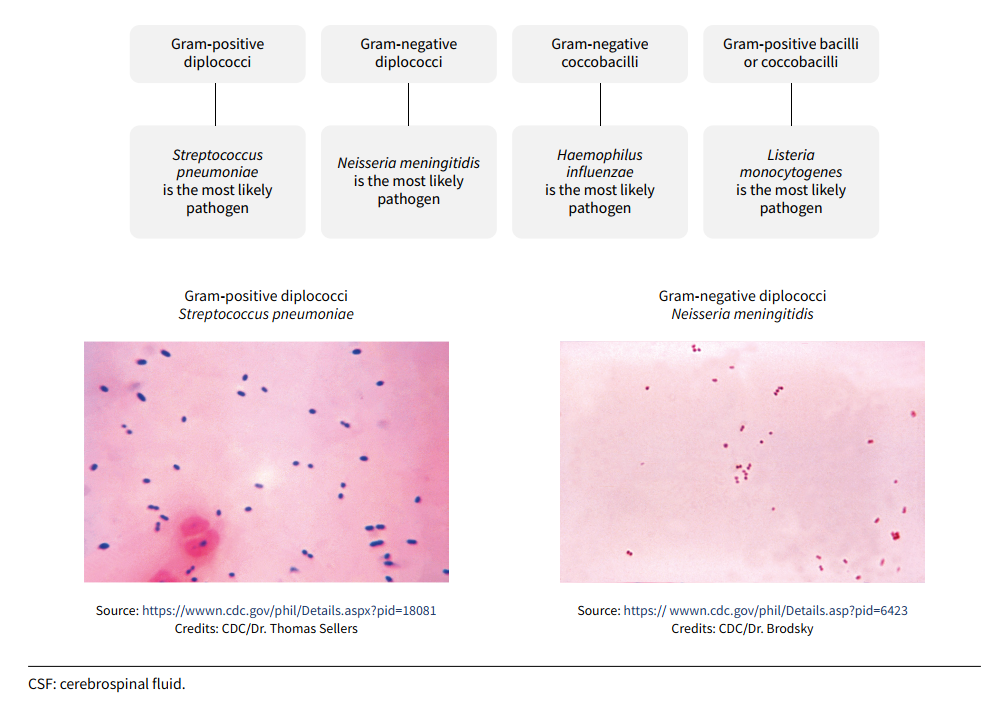

# Điều trị viêm màng não do vi khuẩn 

## Giới thiệu 

Viêm màng não do vi khuẩn là một cấp cứu nội khoa với tỷ lệ tử vong và di chứng thần kinh đáng kể nếu không được chẩn đoán và điều trị kịp thời. Tác nhân gây bệnh thay đổi theo nhóm tuổi, đòi hỏi lựa chọn kháng sinh kinh nghiệm phù hợp trước khi có kết quả vi sinh, trong khi việc chậm khởi động kháng sinh làm tăng nguy cơ tử vong và di chứng (World Health Organization [WHO], 2026; Tunkel et al., 2004). Bài giảng này trình bày cách tiếp cận toàn diện trong điều trị viêm màng não do vi khuẩn ở trẻ em, bao gồm: 

- Tác nhân gây bệnh theo nhóm tuổi
- Chỉ định và chống chỉ định chọc dò thắt lưng
- Chỉ định và thời điểm khởi động kháng sinh
- Lựa chọn và liều lượng kháng sinh theo tuổi và tác nhân
- Theo dõi độc tính của kháng sinh
- Đánh giá đáp ứng điều trị trên lâm sàng, dịch não tủy và hình ảnh học sọ não
- Xử trí thất bại điều trị
- Vai trò của vancomycin và corticoid hỗ trợ
- Quản lý dịch truyền
- Xử trí biến chứng cấp
- Tiên lượng và di chứng lâu dài

## Tác nhân gây bệnh theo nhóm tuổi 

Tác nhân gây bệnh viêm màng não do vi khuẩn ở trẻ em thay đổi theo nhóm tuổi, tùy thuộc vào hệ miễn dịch, tình trạng chủng ngừa và nguy cơ phơi nhiễm. Vì kháng sinh kinh nghiệm được chọn dựa trên xác suất tác nhân khả dĩ theo tuổi (chứ không chờ kết quả vi sinh), việc nắm vững sự phân bố này là nền tảng bắt buộc trước khi bàn đến bất kỳ phác đồ kháng sinh cụ thể nào.

**Bảng 1.** Tác nhân gây viêm màng não do vi khuẩn theo nhóm tuổi

| Nhóm tuổi | Tác nhân thường gặp |
|---|---|
| Dưới 1 tháng | *Streptococcus agalactiae* (liên cầu nhóm B), *Escherichia coli*, *Listeria monocytogenes*, *Klebsiella* spp. |
| 1–23 tháng | *Streptococcus pneumoniae*, *Neisseria meningitidis*, *S. agalactiae*, *Haemophilus influenzae*, *E. coli* |
| 2–50 tuổi | *N. meningitidis*, *S. pneumoniae* |
| Trên 50 tuổi | *S. pneumoniae*, *N. meningitidis*, *L. monocytogenes*, trực khuẩn Gram âm hiếu khí |

<small>*Phỏng theo Tunkel et al. (2004).*</small>

Trẻ sơ sinh và nhũ nhi có hệ miễn dịch chưa trưởng thành, chưa được tiêm chủng đầy đủ, đồng thời phơi nhiễm với hệ vi khuẩn của mẹ trong quá trình sinh. Đây là cơ sở giải thích vì sao liên cầu nhóm B và *E. coli* — hai tác nhân gắn liền với đường sinh dục và đường ruột của mẹ — chiếm ưu thế ở nhóm tuổi sơ sinh, khác hẳn phổ vi khuẩn của trẻ lớn hơn. Điểm đáng lưu ý là *L. monocytogenes* xuất hiện ở cả hai đầu của phổ tuổi nhưng gần như vắng mặt ở nhóm tuổi giữa; đây là lý do các phác đồ kinh nghiệm ở hai nhóm tuổi này đều cần bổ sung ampicillin.

??? info "Sự đa dạng về phân bố tác nhân gây bệnh"

    Tổng quan hệ thống và phân tích gộp của Oordt-Speets và cộng sự (2018) (56 nghiên cứu đủ tiêu chuẩn, sàng lọc từ 3.227 nghiên cứu) đã xác định khuôn mẫu trên ở quy mô toàn cầu và làm rõ sự khác biệt theo khu vực địa lý:

    - *N. meningitidis* và *S. pneumoniae* là hai tác nhân chiếm ưu thế ở mọi nhóm tuổi, với tần suất trung bình dao động lần lượt từ 3,2% đến 47,0%, và từ 9,6% đến 75,2%.
    - *S. pneumoniae* là tác nhân phổ biến nhất trong nhóm "tất cả trẻ em", dao động từ 22,5% (châu Âu) đến 41,1% (châu Phi).
    - Ở trẻ sơ sinh, *E. coli* và *S. pneumoniae* là hai tác nhân phổ biến nhất được ghi nhận (tần suất trung bình lần lượt 17,7% và 20,4%).
    - Ở trẻ 1–5 tuổi, *N. meningitidis* là tác nhân phổ biến nhất; ở trẻ 6–18 tuổi, *S. pneumoniae* chiếm ưu thế.

    Dữ liệu từ các nước thu nhập thấp và trung bình cho thấy bức tranh có phần khác biệt so với các nước thu nhập cao; chủ yếu do sự khác biệt về tỷ lệ tiêm chủng, khả năng tiếp cận xét nghiệm vi sinh và gánh nặng bệnh đồng mắc. Ghia và Rambhad (2021), qua tổng quan hệ thống 51 nghiên cứu tại Ấn Độ (1990–2020), ghi nhận tỷ lệ hiện mắc viêm màng não do vi khuẩn ở trẻ em (0–14 tuổi) dao động rất rộng, từ 0,5% đến 61,8%. *S. pneumoniae* là tác nhân phổ biến nhất trong các nghiên cứu này, chiếm từ 4% đến 61,8% các trường hợp. 

    **Nhiễm trùng thần kinh trung ương liên quan thiết bị/phẫu thuật:** Vallejo và cộng sự (2017), qua nghiên cứu 70 ca nhiễm trùng thần kinh trung ương do *Staphylococcus aureus* ở trẻ em tại một bệnh viện nhi Hoa Kỳ (2001–2013), ghi nhận 70% các ca liên quan đến thiết bị thần kinh trung ương (ví dụ dẫn lưu não thất – ổ bụng), 67,2% do chủng nhạy methicillin (MSSA) và 32,8% do chủng kháng methicillin (MRSA). Đây là minh chứng cho việc *S. aureus* — không nằm trong bốn tác nhân kinh điển theo tuổi — cần được cân nhắc riêng ở nhóm bệnh nhân có yếu tố nguy cơ đặc thù (thiết bị thần kinh trung ương, sau phẫu thuật thần kinh).

    **Tác nhân hiếm nhưng nặng:** Di Meglio và cộng sự (2025), qua tổng quan hệ thống 57 ca viêm màng não do *Streptococcus pyogenes* (liên cầu nhóm A) ở trẻ em, ghi nhận tuổi trung vị chẩn đoán là 4 tuổi, tỷ lệ tử vong 17% và tỷ lệ di chứng 28,07% — cao hơn đáng kể so với các tác nhân kinh điển. Nhóm tác giả nhấn mạnh đây là tác nhân hiếm gặp, hiện chưa có hướng dẫn điều trị riêng, nên đòi hỏi mức độ cảnh giác cao ở bệnh nhân có ổ nhiễm nguyên phát ngoài não hoặc dấu hiệu nhiễm khuẩn huyết nặng.

## Chỉ định và chống chỉ định chọc dò thắt lưng

Theo WHO (2026), chọc dò thắt lưng nên được thực hiện càng sớm càng tốt, tốt nhất là trước khi bắt đầu kháng sinh, vì tỷ lệ cấy dịch não tủy dương tính giảm đáng kể sau khi đã dùng kháng sinh. Tuy nhiên, khi có chống chỉ định (tuyệt đối hoặc tương đối) khiến chọc dò thắt lưng phải trì hoãn, kháng sinh kinh nghiệm vẫn phải được bắt đầu ngay. 

**Chống chỉ định tuyệt đối** (không thực hiện chọc dò thắt lưng trong mọi trường hợp, cho đến khi tình trạng được giải quyết):

- Huyết động không ổn định (cho đến khi ổn định)
- Suy hô hấp đang diễn tiến (cho đến khi ổn định)
- Rối loạn đông máu nặng
- Nhiễm trùng da/mô mềm tại vị trí chọc dò hoặc gần đó, hoặc tật nứt đốt sống (spina bifida) ở trẻ sơ sinh
- Áp xe ngoài màng cứng gần vị trí chọc dò.

**Chống chỉ định tương đối** (là các tiêu chí chỉ định chụp hình ảnh học sọ não trước chọc dò thắt lưng, nhằm loại trừ tổn thương choán chỗ có lệch đường giữa, não úng thủy tắc nghẽn hoặc phù não nặng):

- Điểm hôn mê Glasgow (Glasgow Coma Scale – GCS) < 10
- Dấu thần kinh khu trú
- Tổn thương dây thần kinh sọ
- Phù gai thị
- Co giật mới khởi phát (ở người lớn)
- Suy giảm miễn dịch nặng.

??? info "Quan điểm phản biện về vai trò của chụp hình ảnh học sọ não trước chọc dò thắt lưng" 

    Hiệp hội Bệnh Truyền nhiễm Hoa Kỳ (Infectious Diseases Society of America – IDSA) (Tunkel et al., 2004) đề xuất các tiêu chí áp dụng cho người lớn để xác định bệnh nhân cần chụp cắt lớp vi tính (Computed Tomography – CT) sọ não trước chọc dò thắt lưng:

    **Bảng 2.** Tiêu chí chụp CT sọ não trước chọc dò thắt lưng ở người lớn theo IDSA

    | Tiêu chí | Ghi chú |
    |---|---|
    | Tình trạng suy giảm miễn dịch | Nhiễm HIV/AIDS, đang dùng thuốc ức chế miễn dịch, hoặc sau ghép tạng |
    | Tiền sử bệnh lý thần kinh trung ương | Tổn thương choán chỗ, đột quỵ, hoặc ổ nhiễm khu trú |
    | Co giật mới khởi phát | Trong vòng 1 tuần trước khi đến khám; một số chuyên gia không thực hiện chọc dò thắt lưng ở bệnh nhân co giật kéo dài, hoặc trì hoãn chọc dò thắt lưng 30 phút ở bệnh nhân co giật ngắn dạng co cứng – co giật (tonic-clonic) |
    | Phù gai thị | Có mạch đập tĩnh mạch gợi ý không có tăng áp lực nội sọ |
    | Rối loạn tri giác | — |
    | Dấu thần kinh khu trú | Bao gồm đồng tử giãn không phản xạ, bất thường vận nhãn, bất thường thị trường, liệt vận nhãn phối hợp, yếu tay/chân |

    <small>*Phỏng theo Tunkel et al. (2004).*</small>

    **Quan điểm phản biện của Hội Bệnh lý Nhiễm trùng Pháp ngữ (Société de Pathologie Infectieuse de Langue Française – SPILF).** Nhiều tiêu chí trên có thể làm trễ kháng sinh mà không mang lại lợi ích tương xứng (Hoen et al., 2019):

    - Một nghiên cứu tại Houston (Texas, Hoa Kỳ, 2005–2010) trên 614 ca nghi viêm màng não cho thấy chụp hình ảnh học sọ não được thực hiện ở 89% các trường hợp, nhưng *2/3 trong số đó không có chỉ định* theo đúng tiêu chí IDSA, và chỉ phát hiện được 2 bất thường nhỏ không ảnh hưởng xử trí. Thời gian trung vị đến khi thực hiện chọc dò thắt lưng là 5,5 giờ (không chụp hình trước) so với 8,25 giờ (có chụp hình trước) — chênh lệch gần 3 giờ, rất đáng kể khi đối chiếu với mục tiêu dùng kháng sinh trong vòng 1 giờ.
    - Hướng dẫn Thụy Điển năm 2009 đã loại bỏ 3 tiêu chí "rối loạn tri giác đơn thuần (khi không có dấu hiệu tụt kẹt não)", "co giật gần đây" và "suy giảm miễn dịch" khỏi danh sách chỉ định CT. So sánh hồi cứu giữa giai đoạn áp dụng hướng dẫn cũ (2005–2009) và hướng dẫn mới (2010–2012), mỗi giai đoạn hơn 300 bệnh nhân, cho thấy thời gian đến kháng sinh giảm trung bình 1,12 giờ (giảm 1,6 giờ ở nhóm chọc dò thắt lưng ngay), đồng thời *tỷ lệ tử vong giảm từ 11,7% xuống 6,9%, và tỷ lệ di chứng giảm từ 49% xuống 38%*. <!-- Cần đối chiếu Hoen et al. (2019): thời gian đến kháng sinh giảm 1,12 giờ (ở đây) hay 1,18 giờ (mục Chỉ định khởi động kháng sinh)? -->
    - Một nghiên cứu trên 94 ca áp xe não ghi nhận 55 ca (59%) đã được chọc dò thắt lưng, trong đó 65% có hiệu ứng choán chỗ trên CT; chỉ 1 ca tử vong do tụt kẹt não trong vòng 6 giờ sau chọc dò, và các tác giả không khẳng định được vai trò nhân quả của chọc dò thắt lưng trong ca tử vong này — cho thấy nguy cơ tụt kẹt não sau chọc dò thắt lưng trên thực tế *thấp hơn nhiều* so với lo ngại lý thuyết.

    **Khuyến cáo cụ thể của SPILF.** Chỉ chụp hình ảnh học sọ não trước chọc dò thắt lưng khi có:

    - Dấu hiệu gợi ý tổn thương choán chỗ nội sọ: dấu thần kinh khu trú hoặc co giật khu trú và mới xảy ra (<4 ngày)
    - Dấu hiệu tụt kẹt não: rối loạn tri giác kèm theo ít nhất một trong các dấu hiệu sau: bất thường đồng tử (giãn cố định một hoặc hai bên), rối loạn thần kinh thực vật (tăng huyết áp, nhịp tim chậm, bất thường nhịp thở), cơn co cứng tiểu não (cerebellar tonic seizures), không đáp ứng kích thích, tư thế mất vỏ hoặc mất não
    - Co giật toàn thể kéo dài không cho phép thực hiện chọc dò thắt lưng.

    SPILF nhấn mạnh: *Rối loạn tri giác đơn thuần KHÔNG được xem là chống chỉ định* thực hiện chọc dò thắt lưng ngay. Ở trẻ dưới 5 tuổi, co giật toàn thể do sốt không được xem là chống chỉ định chọc dò thắt lưng; chỉ co giật một bên (gợi ý dấu khu trú) mới cần cân nhắc (Hoen et al., 2019).

## Chỉ định khởi động kháng sinh và thời điểm khởi động

Theo WHO (2026), khi [bệnh nhân nghi viêm màng não](meningitis-bacterial-diagnosis.md#nghi-ngo-vmn-vi-khuan) được nhập viện hoặc chuyển đến cơ sở y tế phù hợp, kháng sinh nên được bắt đầu trong vòng 1 giờ kể từ khi nhập viện (door-to-antibiotic time ≤ 1 giờ). Việc thực hiện chọc dò thắt lưng hoặc chụp hình ảnh học sọ não (khi có chỉ định) không được phép làm trễ thời điểm bắt đầu kháng sinh.

??? info "Bằng chứng thực tế từ các nghiên cứu"

    SPILF tổng hợp nhiều nghiên cứu quan sát ở người lớn cho thấy mối liên quan có ý nghĩa thống kê giữa thời gian khởi động kháng sinh và tiên lượng:

    - Proulx và cộng sự, nghiên cứu 123 bệnh nhân, ghi nhận thời gian trung vị từ lúc đến khoa cấp cứu đến liều kháng sinh đầu tiên là 3,8 giờ; phân tích đa biến cho thấy khoảng thời gian trên 6 giờ liên quan có ý nghĩa với tỷ lệ tử vong cao hơn (tỷ số chênh [odds ratio – OR] hiệu chỉnh = 8,4; khoảng tin cậy [KTC] 95% 1,6–40,9; p < 0,01) (được trích dẫn trong Hoen et al., 2019).
    - Auburtin và cộng sự, nghiên cứu 156 bệnh nhân người lớn viêm màng não do phế cầu tại khoa hồi sức, ghi nhận khoảng thời gian trên 3 giờ từ nhập viện đến liều kháng sinh đầu tiên liên quan có ý nghĩa với nguy cơ tử vong ở tháng thứ 3 (OR hiệu chỉnh = 14,12; KTC 95% 3,93–50,9; p < 10⁻⁴) và tăng nguy cơ di chứng thần kinh ở người sống sót (được trích dẫn trong Hoen et al., 2019).
    - Nghiên cứu tại Đan Mạch (173 bệnh nhân, 2016) ghi nhận nguy cơ tương đối (relative risk – RR) của kết cục xấu (tử vong hoặc di chứng) là 1,5 (KTC 95% 1,0–2,2) khi kháng sinh được cho sau hơn 6 giờ so với trong vòng 2 giờ đầu sau nhập viện (được trích dẫn trong Hoen et al., 2019).
    - Phân tích dữ liệu đăng ký quốc gia Thụy Điển (cùng nghiên cứu đã nêu ở mục chọc dò thắt lưng; 712 hồ sơ, so sánh giai đoạn 2005–2009 và 2010–2012 sau khi hướng dẫn mới rút ngắn tiêu chí chỉ định CT trước chọc dò thắt lưng): thời gian trung bình đến kháng sinh giảm 1,18 giờ giữa hai giai đoạn; tỷ lệ tử vong giảm từ 11,7% xuống 6,9%; và mỗi giờ trì hoãn liều kháng sinh đầu tiên làm **tăng nguy cơ tử vong tương đối 12,6%** (KTC 95% 3,1–23,1%; p < 0,01) (Hoen et al., 2019).

    Từ các bằng chứng này, SPILF đưa ra khuyến cáo: kháng sinh (và dexamethasone khi có chỉ định) nên được bắt đầu *trong vòng 1 giờ kể từ khi nhập viện*, bất kể thời gian ước tính từ lúc khởi phát bệnh; bất kỳ sự trì hoãn nào cũng liên quan đến tiên lượng xấu hơn.

**Khi nào cho kháng sinh TRƯỚC khi thực hiện chọc dò thắt lưng?**

SPILF đưa ra 3 tình huống chỉ định kháng sinh trước chọc dò thắt lưng (nhưng sau khi đã lấy mẫu cấy máu) (Hoen et al., 2019) :

1. Có ban xuất huyết hoại tử tối cấp (purpura fulminans).
2. Bệnh nhân không thể được nhập viện tại cơ sở phù hợp trong vòng 90 phút.
3. Có chống chỉ định thực hiện chọc dò thắt lưng ngay.

Theo WHO (2026), đối với các cơ sở không đủ điều kiện thực hiện chọc dò thắt lưng và xử trí bệnh nặng, cần chuyển bệnh nhân nghi ngờ viêm màng não đến tuyến cao hơn trong vòng 30 phút. Nếu không đảm bảo được điều kiện này, kháng sinh kinh nghiệm nên được bắt đầu ngay.

??? info "Khoảng cách giữa khuyến cáo và thực tế lâm sàng"

    - Ciofi degli Atti và cộng sự (2014), trong một nghiên cứu tiến cứu đa trung tâm tại 19 bệnh viện nhi khoa Ý (85 trẻ viêm màng não do vi khuẩn, 2009–2013), ghi nhận thời gian trung vị từ lúc nghi ngờ đến liều kháng sinh đầu tiên là 1 giờ — cho thấy mốc khuyến cáo hoàn toàn khả thi khi hệ thống y tế được tổ chức tốt.
    - Tadesse và cộng sự (2017), nghiên cứu tại một bệnh viện tuyến trên ở Ethiopia (99 trẻ nhập viện với hội chứng viêm màng não cấp), ghi nhận thời gian có triệu chứng trung bình lên tới 4,9 ngày trước khi nhập viện. Tình trạng trì hoãn này ảnh hưởng đáng kể đến khả năng sống còn của bệnh nhân.

## Những vấn đề cần cân nhắc trước khi khởi động kháng sinh

Theo WHO (2026), ngay khi tiếp nhận bệnh nhân nghi viêm màng não cấp, cần thực hiện đồng thời: 

- Đánh giá và ổn định theo tiếp cận ABCDE (đường thở, hô hấp, tuần hoàn, tình trạng thần kinh, bộc lộ)
- Kiểm tra đường huyết và xử trí các biến chứng cấp đang diễn tiến (hô mê, sốt, co giật, sốc nhiễm trùng)
- [Lấy mẫu máu xét nghiệm](meningitis-bacterial-diagnosis.md#xet-nghiem-mau-vmnvk)
- Đặt bệnh nhân trong điều kiện phòng ngừa lây qua giọt bắn
- Nếu cần bù dịch hồi sức, nên dùng dịch tinh thể cân bằng (ví dụ Ringer lactate), tránh dịch có glucose trừ khi có hạ đường huyết đi kèm.

<!-- TODO: thêm hình minh họa thay cho các đoạn văn bên dưới -->

Về phòng ngừa lây qua giọt bắn, khi nghi ngờ viêm màng não cấp hoặc bệnh não mô cầu xâm lấn, WHO (2026) khuyến cáo đặt bệnh nhân trong điều kiện phòng ngừa lây qua giọt bắn (đeo khẩu trang y tế cho nhân viên y tế trước khi vào phòng, cách ly phòng riêng nếu có thể) cho đến khi loại trừ được não mô cầu hoặc bệnh nhân đã được điều trị kháng sinh hiệu quả ít nhất 24 giờ. 

## Kháng sinh kinh nghiệm theo tuổi

Kháng sinh kinh nghiệm phải bao phủ được các tác nhân thường gặp nhất theo nhóm tuổi, vì kết quả vi sinh (nhuộm Gram, cấy, phản ứng chuỗi polymerase [Polymerase Chain Reaction – PCR]) thường chưa có tại thời điểm cho liều đầu tiên. 

Các hướng dẫn thống nhất dùng cephalosporin thế hệ ba (cefotaxime hoặc ceftriaxone) làm nền, nhưng khác nhau về tiêu chí phối hợp. WHO (2026) thêm ampicillin/amoxicillin khi có yếu tố nguy cơ *Listeria* và thêm vancomycin ở khu vực có tỷ lệ phế cầu kháng thuốc cao. Viện Quốc gia về Sức khỏe và Chăm sóc Xuất sắc Vương quốc Anh (National Institute for Health and Care Excellence – NICE) (Visintin et al., 2010) thêm amoxicillin/ampicillin cho trẻ dưới 3 tháng, và thêm vancomycin khi trẻ mới đi nước ngoài hoặc đã dùng kháng sinh kéo dài/nhiều đợt trong 3 tháng qua. IDSA (Tunkel et al., 2004) đưa vancomycin vào phác đồ mặc định cho mọi bệnh nhân từ 1 tháng tuổi.

**Bảng 3.** Kháng sinh kinh nghiệm theo nhóm tuổi theo WHO

| Nhóm tuổi | Lựa chọn đầu tay | Lựa chọn thứ hai |
|---|---|---|
| Người lớn và trẻ >1 tháng tuổi | Ceftriaxone hoặc cefotaxime TM; thêm ampicillin/amoxicillin TM nếu có yếu tố nguy cơ *Listeria monocytogenes*ᵃ; thêm vancomycin TM nếu khu vực đã ghi nhận tỷ lệ phế cầu kháng penicillin/cephalosporin thế hệ ba cao ở mức quốc gia hoặc dưới quốc gia | Chloramphenicol TM phối hợp với amoxicillin, hoặc ampicillin, hoặc penicillin G (benzylpenicillin) TM |
| Trẻ sơ sinh | Ampicillin TB/TM + gentamicin TB/TM, hoặc cefotaxime TB/TM + gentamicin TB/TM, hoặc ceftriaxone TB/TM + gentamicin TB/TM | Meropenem TM |

<small>*Ghi chú.* Phỏng theo WHO (2026). TM: tĩnh mạch; TB: tiêm bắp.</small>

<small>ᵃ Yếu tố nguy cơ *Listeria* theo WHO: tuổi trên 60, đang mang thai, tình trạng suy giảm miễn dịch.</small>

IDSA (Tunkel et al., 2004) trình bày khuyến cáo tương tự nhưng đưa vancomycin vào phác đồ nền cho mọi nhóm tuổi từ 1 tháng trở lên.

**Bảng 4.** Kháng sinh kinh nghiệm theo nhóm tuổi theo IDSA

| Nhóm tuổi | Tác nhân thường gặp | Kháng sinh kinh nghiệm |
|---|---|---|
| <1 tháng tuổi | *Streptococcus agalactiae*, *Escherichia coli*, *Listeria monocytogenes*, *Klebsiella* spp. | Ampicillin phối hợp cefotaxime, hoặc ampicillin phối hợp aminoglycoside |
| 1–23 tháng tuổi | *S. pneumoniae*, *N. meningitidis*, *S. agalactiae*, *H. influenzae*, *E. coli* | Vancomycin phối hợp cephalosporin thế hệ ba |
| 2–50 tuổi | *N. meningitidis*, *S. pneumoniae* | Vancomycin phối hợp cephalosporin thế hệ ba |
| >50 tuổi | *S. pneumoniae*, *N. meningitidis*, *L. monocytogenes*, trực khuẩn Gram âm hiếu khí | Vancomycin phối hợp ampicillin phối hợp cephalosporin thế hệ ba |

<small>*Phỏng theo Tunkel et al. (2004).*</small>

## Kháng sinh đặc hiệu theo tác nhân và độ nhạy

Khi đã xác định được tác nhân gây bệnh và độ nhạy kháng sinh (MIC), điều trị cần được thu hẹp phổ (de-escalation) theo nguyên tắc chung (WHO, 2026), ngoại trừ não mô cầu không cần thu hẹp do thời gian điều trị vốn đã ngắn (Hoen et al., 2019).

**Bảng 5.** Kháng sinh đặc hiệu và thời gian điều trị theo tác nhân theo WHO

| Tác nhân | Kháng sinh đặc hiệu (tĩnh mạch) | Tổng thời gian |
|---|---|---|
| ***Streptococcus pneumoniae*** | | **10–14 ngày** |
| Nhạy penicillin | Penicillin G (benzylpenicillin) / ampicillin / amoxicillin | |
| Kháng penicillin, nhạy cephalosporin | Ceftriaxone / cefotaxime | |
| Kháng cephalosporin | Vancomycin + ceftriaxone/cefotaxime, **hoặc** vancomycin + levofloxacin/moxifloxacinᵃ, **hoặc** vancomycin + rifampicinᵇ, **hoặc** ceftriaxone/cefotaxime + rifampicinᵇ | |
| ***Neisseria meningitidis*** | | **5–7 ngày** |
| Nhạy penicillin | Penicillin G (benzylpenicillin) / ampicillin / amoxicillin | |
| Kháng penicillin | Ceftriaxone / cefotaxime | |
| ***Haemophilus influenzae*** | | **7–10 ngày** |
| Không sinh beta-lactamase | Ampicillin / amoxicillin | |
| Sinh beta-lactamase | Ceftriaxone / cefotaxime | |
| ***Streptococcus agalactiae*** | Penicillin G (benzylpenicillin) / ampicillin / amoxicillin | **14–21 ngày** |
| ***Listeria monocytogenes*** | Penicillin G (benzylpenicillin) / ampicillin / amoxicillin | **21 ngày** |
| ***Escherichia coli* và trực khuẩn Gram âm khác** | | **14–21 ngày** |
| Nhạy penicillin | Ampicillin (+ gentamicin ở trẻ sơ sinh) | |
| Kháng penicillin, nhạy cephalosporin | Ceftriaxone hoặc cefotaxime (+ gentamicin ở trẻ sơ sinh) | |
| **Virus** | Ngừng kháng sinh kinh nghiệm | |
| **Không xác định được tác nhân** | Tiếp tục kháng sinh kinh nghiệm | 7 ngàyᶜ |

<small>*Phỏng theo WHO (2026).*</small>

<small>ᵃ Phác đồ có fluoroquinolone (levofloxacin, moxifloxacin) nên được cân nhắc như một lựa chọn cho viêm màng não do phế cầu ở người lớn.</small>

<small>ᵇ Tránh phác đồ có rifampicin khi nghi ngờ đồng nhiễm lao.</small>

<small>ᶜ Nếu bệnh nhân đã hồi phục lâm sàng, tức có đủ cả 3 tiêu chí sau trong ít nhất 48 giờ: (1) hết sốt; (2) dấu hiệu sinh tồn trở về bình thường (huyết áp, nhịp tim, nhịp thở, độ bão hòa oxy máu ngoại vi [peripheral oxygen saturation – SpO₂]); (3) hết rối loạn tri giác.</small>

**Bảng 6.** Kháng sinh đặc hiệu theo vi sinh vật phân lập và kết quả kháng sinh đồ theo IDSA

| Vi sinh vật, độ nhạy | Điều trị chuẩn | Điều trị thay thế |
|---|---|---|
| ***Streptococcus pneumoniae*** | | |
| MIC penicillin <0,1 µg/mL | Penicillin G hoặc ampicillin | Cephalosporin thế hệ baᵃ, chloramphenicol |
| MIC penicillin 0,1–1,0 µg/mLᵇ | Cephalosporin thế hệ baᵃ | Cefepime (B-II), meropenem (B-II) |
| MIC penicillin ≥2,0 µg/mL | Vancomycin + cephalosporin thế hệ baᵃ ᶜ | Fluoroquinoloneᵈ (B-II) |
| MIC cefotaxime hoặc ceftriaxone ≥1,0 µg/mL | Vancomycin + cephalosporin thế hệ baᵃ ᶜ | Fluoroquinoloneᵈ (B-II) |
| ***Neisseria meningitidis*** | | |
| MIC penicillin <0,1 µg/mL | Penicillin G hoặc ampicillin | Cephalosporin thế hệ baᵃ, chloramphenicol |
| MIC penicillin 0,1–1,0 µg/mL | Cephalosporin thế hệ baᵃ | Chloramphenicol, fluoroquinolone, meropenem |
| ***Listeria monocytogenes*** | Ampicillin hoặc penicillin Gᵉ | Trimethoprim-sulfamethoxazole, meropenem (B-III) |
| ***Streptococcus agalactiae*** | Ampicillin hoặc penicillin Gᵉ | Cephalosporin thế hệ baᵃ (B-III) |
| ***Escherichia coli* và Enterobacteriaceae khác**ᵍ | Cephalosporin thế hệ ba (A-II) | Aztreonam, fluoroquinolone, meropenem, trimethoprim-sulfamethoxazole, ampicillin |
| ***Pseudomonas aeruginosa***ᵍ | Cefepimeᵉ hoặc ceftazidimeᵉ (A-II) | Aztreonamᵉ, ciprofloxacinᵉ, meropenemᵉ |
| ***Haemophilus influenzae*** | | |
| Không sinh beta-lactamase | Ampicillin | Cephalosporin thế hệ baᵃ, cefepime, chloramphenicol, fluoroquinolone |
| Sinh beta-lactamase | Cephalosporin thế hệ ba (A-I) | Cefepime (A-I), chloramphenicol, fluoroquinolone |
| ***Staphylococcus aureus*** | | |
| Nhạy methicillin | Nafcillin hoặc oxacillin | Vancomycin, meropenem (B-III) |
| Kháng methicillin | Vancomycinᶠ | Trimethoprim-sulfamethoxazole, linezolid (B-III) |
| ***Staphylococcus epidermidis*** | Vancomycinᶠ | Linezolid (B-III) |
| ***Enterococcus* spp.** | | |
| Nhạy ampicillin | Ampicillin + gentamicin | — |
| Kháng ampicillin | Vancomycin + gentamicin | — |
| Kháng cả ampicillin và vancomycin | Linezolid (B-III) | — |

<small>*Phỏng theo Tunkel et al. (2004). Mức bằng chứng của các khuyến cáo là A-III, trừ khi có ghi khác.</small>

<small>ᵃ Ceftriaxone hoặc cefotaxime.</small>

<small>ᵇ Chủng còn nhạy ceftriaxone/cefotaxime.</small>

<small>ᶜ Cân nhắc thêm rifampicin nếu MIC ceftriaxone >2 µg/mL.</small>

<small>ᵈ Gatifloxacin hoặc moxifloxacin.</small>

<small>ᵉ Cân nhắc phối hợp thêm aminoglycoside.</small>

<small>ᶠ Cân nhắc thêm rifampicin.</small>

<small>ᵍ Lựa chọn kháng sinh cụ thể phải dựa vào kết quả kháng sinh đồ.</small>

## Liều lượng kháng sinh cụ thể

WHO (2026) cung cấp bảng liều chi tiết theo nhóm tuổi (sơ sinh phân theo tuần tuổi, trẻ em, người lớn).

**Bảng 7.** Liều kháng sinh trong viêm màng não do vi khuẩn theo WHO

| Kháng sinh | Sơ sinh (TM/TB)ᵃ | Trẻ em >1 tháng (TM)ᵃ | Người lớn (TM)ᵃ | Liều tối đaᵃ (trẻ em và người lớn) | Nhóm AWaRe |
|---|---|---|---|---|---|
| Amoxicillin | <1 tuần: 50 mg/kg mỗi 12 giờ 1–4 tuần: 50 mg/kg mỗi 8 giờ | 50 mg/kg mỗi 4 giờ (tối đa 2 g mỗi 4 giờ) hoặc 75 mg/kg mỗi 6 giờ (tối đa 3 g mỗi 6 giờ) | 2 g mỗi 4 giờ hoặc 3 g mỗi 6 giờ | 12 g/ngày | Access |
| Ampicillin | <1 tuần: 50 mg/kg mỗi 12 giờ 1–4 tuần: 50 mg/kg mỗi 8 giờ | 50 mg/kg mỗi 4 giờ (tối đa 2 g mỗi 4 giờ) hoặc 75 mg/kg mỗi 6 giờ (tối đa 3 g mỗi 6 giờ) | 2 g mỗi 4 giờ hoặc 3 g mỗi 6 giờ | 12 g/ngày | Access |
| Penicillin G (benzylpenicillin) | <1 tuần: 150.000 IU/kg (90 mg/kg) mỗi liều, mỗi 8 giờ 1–4 tuần: 125.000 IU/kg (75 mg/kg) mỗi liều, mỗi 6 giờ | 50.000 IU/kg (30 mg/kg) mỗi 4 giờ hoặc 100.000 IU/kg (60 mg/kg) mỗi 6 giờ (tối đa 4 triệu IU hoặc 2,4 g mỗi liều) | 4 triệu IU (2,4 g) mỗi 4–6 giờ | 24 triệu IU (14,4 g)/ngày | Access |
| Cefotaxime | <1 tuần: 50 mg/kg mỗi liều, mỗi 12 giờ 1–4 tuần: 50 mg/kg mỗi liều, mỗi 6 giờ | 50 mg/kg mỗi 4 giờ (tối đa 2 g mỗi 4 giờ) hoặc 75 mg/kg mỗi 6 giờ (tối đa 3 g mỗi 6 giờ) | 2 g mỗi 4 giờ hoặc 3 g mỗi 6 giờ | 12 g/ngày | Watch |
| Ceftriaxone | 100 mg/kg một lần/ngày | 100 mg/kg một lần/ngày hoặc chia mỗi 12 giờ (tối đa 2 g mỗi 12 giờ)ᵇ | 2 g mỗi 12 giờᵇ | 4 g/ngày | Watch |
| Meropenem | 40 mg/kg (chỉ TM) mỗi 8 giờ | – | – | – | Watch |
| Vancomycinᶜ | – | 15–20 mg/kg mỗi 6–8 giờᵈ | 15–20 mg/kg mỗi 8–12 giờᵈ | 4 g/ngày | Watch |
| Gentamicin | <1 tuần: 5 mg/kg một lần/ngày 1–4 tuần: 7,5 mg/kg một lần/ngày | – | – | – | Access |
| Chloramphenicolᵉ | – | 25 mg/kg mỗi 6 giờ (tối đa 1 g mỗi 6 giờ) | 1 g mỗi 6 giờ | 4 g/ngày | Access |
| Rifampicin | – | 10 mg/kg mỗi 12 giờ (tối đa 300 mg mỗi 12 giờ) | 300 mg mỗi 12 giờ hoặc 600 mg mỗi 24 giờ | – | Watch |
| Levofloxacin | – | – | 750 mg mỗi 24 giờ | 750 mg/ngày | Watch |
| Moxifloxacin | – | – | 400 mg mỗi 24 giờ | 400 mg/ngày | Watch |

<small>*Phỏng theo WHO (2026). TM: tĩnh mạch; TB: tiêm bắp; IU: đơn vị quốc tế. Kháng sinh được xếp theo cơ chế tác dụng. AWaRe: Access (tiếp cận), Watch (theo dõi), Reserve (dự trữ).*</small>

<small>ᵃ Liều áp dụng cho người có chức năng gan, thận bình thường. Khi suy thận, cần chỉnh liều **amoxicillin, ampicillin, cefotaxime, levofloxacin, penicillin G, rifampicin (suy thận giai đoạn cuối) và vancomycin.**</small>

<small>ᵇ Trong trường hợp không thể tiêm 2 lần/ngày, có thể tiêm 1 lần/ngày: trẻ em 100 mg/kg (tối đa 4 g) mỗi 24 giờ; người lớn 4 g mỗi 24 giờ.</small>

<small>ᶜ Nguy cơ độc tính, bao gồm tổn thương thận cấp, tăng theo nồng độ đáy vancomycin, đặc biệt khi nồng độ đáy liên tục trên **15–20 mg/L.** Khi có điều kiện, nên theo dõi định kỳ nồng độ đáy (mục tiêu 15–20 mg/L) và chỉnh liều theo kết quả.</small>

<small>ᵈ Khi không theo dõi được nồng độ đáy, không vượt quá 750 mg mỗi liều ở trẻ em và tổng 3 g/ngày ở người lớn.</small>

<small>ᵉ Chloramphenicol có thể gây rối loạn tạo máu nặng đe dọa tính mạng (thiếu máu bất sản, giảm tiểu cầu, giảm bạch cầu hạt), cần theo dõi chặt chẽ. Có thể giảm liều ban đầu sau khi lâm sàng cải thiện.</small>

??? info "Phân loại kháng sinh AWaRe"

    AWaRe là hệ thống phân loại kháng sinh của WHO (WHO, 2022), dùng để hỗ trợ sử dụng kháng sinh hợp lý, chia thành 3 nhóm theo nguy cơ đề kháng và mức độ nên ưu tiên:

    - Access (màu xanh lá) — kháng sinh phổ hẹp, nguy cơ chọn lọc đề kháng thấp, nên là lựa chọn đầu tay cho các nhiễm khuẩn thường gặp. Ví dụ: amoxicillin, ampicillin, penicillin G, gentamicin, chloramphenicol.
    - Watch (màu vàng) — kháng sinh có nguy cơ chọn lọc đề kháng cao hơn, cần cân nhắc và theo dõi khi sử dụng, thường dùng khi Access không đủ hiệu quả hoặc không phù hợp. Ví dụ: cefotaxime, ceftriaxone, meropenem, vancomycin, rifampicin, levofloxacin, moxifloxacin.
    - Reserve (màu đỏ) — kháng sinh "cứu cánh" dành cho các nhiễm khuẩn đa kháng thuốc, chỉ dùng khi các lựa chọn khác thất bại.

## Theo dõi độc tính và tác dụng phụ của kháng sinh

### Phản ứng quá mẫn với kháng sinh

Theo WHO (2026), phản ứng quá mẫn là tác dụng phụ tương đối thường gặp của kháng sinh, đặc biệt với nhóm beta-lactam và vancomycin, biểu hiện từ phát ban da đến phản vệ. Người có tiền sử phản ứng đe dọa tính mạng với kháng sinh trước đây cần được theo dõi lâm sàng chặt chẽ tại cơ sở y tế phù hợp.

Đối với dị ứng penicillin không nặng, cephalosporin và carbapenem có thể được sử dụng an toàn trong đa số trường hợp, vì *tỷ lệ phản ứng chéo dưới 2%*. Tuy nhiên, nếu có tiền sử dị ứng penicillin nặng, cần tránh mọi beta-lactam khác (WHO, 2026).

SPILF (Hoen et al., 2019) định nghĩa dị ứng beta-lactam nặng là tiền sử phản ứng phản vệ tức thì, bao gồm sốc phản vệ. Sau đây là cách tiếp cận theo mức độ nặng và theo thuốc gây dị ứng.

**Bảng 8.** Tiếp cận bệnh nhân có tiền sử dị ứng beta-lactam theo SPILF

| Tiền sử dị ứng | Xử trí |
|---|---|
| Dị ứng **không nặng** (không có phản vệ tức thì) | Dùng cefotaxime hoặc ceftriaxone như bình thường |
| **Sốc phản vệ do penicillin** | Thảo luận giữa hai hướng: (1) cephalosporin thế hệ ba kèm theo dõi tại hồi sức, hoặc (2) vancomycin + rifampicin. Cân nhắc giữa nguy cơ dị ứng chéo và hiệu quả có thể thấp hơn của phác đồ thay thế |
| **Sốc phản vệ do cephalosporin thế hệ ba** | Chống chỉ định cephalosporin thế hệ ba, trừ khi có ý kiến chuyên gia, dùng phác đồ thay thế bên dưới |

<small>*Phỏng theo Hoen et al. (2019).*</small>

Khi phải dùng phác đồ thay thế, cần hỏi ý kiến chuyên gia truyền nhiễm và theo dõi liên tục trong 24 giờ đầu. Kháng sinh được chọn theo kết quả soi dịch não tủy:

**Bảng 9.** Phác đồ thay thế theo kết quả soi dịch não tủy ở bệnh nhân dị ứng beta-lactam nặng

| Kết quả soi dịch não tủy / PCR | Nghi ngờ | Kháng sinh |
|---|---|---|
| Cầu khuẩn Gram dương | Phế cầu | Vancomycin + rifampicin, hoặc meropenem |
| Cầu khuẩn Gram âm | Não mô cầu | Ciprofloxacin hoặc rifampicin |
| Trực khuẩn Gram dương | *Listeria* | Trimethoprim-sulfamethoxazole |
| Trực khuẩn Gram âm | *H. influenzae* | Ciprofloxacin |
| Âm tính, không nghi *Listeria* | — | Vancomycin + rifampicinᵃ |
| Âm tính, có nghi *Listeria* | — | Vancomycin + rifampicin + trimethoprim-sulfamethoxazole |

<small>*Phỏng theo Hoen et al. (2019). Meropenem dùng được do nguy cơ dị ứng chéo thấp. Vancomycin: liều tải 30 mg/kg trong 1 giờ, sau đó 40–60 mg/kg/ngày, chỉnh liều để đạt nồng độ đáy 15–20 mg/L. Rifampicin ở trẻ em: 10 mg/kg × 2 lần/ngày, tối đa 600 mg/ngày. Trimethoprim-sulfamethoxazole: 10–20 mg/kg/ngày (tính theo trimethoprim), chia 4 lần.*</small>

<!-- Meropenem ở trẻ em: 40 mg/kg × 3 lần/ngày, mỗi lần truyền 3–4 giờ, tối đa 6 g/ngày. --- Ý này có vẻ đúng nhưng không có trogn y văn --- minh hoạ cho sự bất định và vượt quá quyền của LLM khi soạn bài  -->

<small>ᵃ Ở trẻ em, các bác sĩ nhi khuyến cáo phối hợp ciprofloxacin + vancomycin (ý kiến chuyên gia).</small>

<figure markdown="span">
  { .img-lg }
  <figcaption markdown="span">**Hình 1.** Phiên giải kết quả nhuộm soi dịch não tuỷ. 
  <!-- *Ghi chú.* Giải thích mũi tên, chữ viết tắt, kỹ thuật chụp/nhuộm.  -->
  Trích từ *WHO practical manual on meningitis diagnosis, treatment and care*</figcaption>
</figure>
 

### Độc tính trên thận và điều chỉnh liều

Danh sách các kháng sinh cần chỉnh liều khi suy thận theo WHO (2026) đã được nêu ở chú thích ᵃ của Bảng 7.

SPILF (Hoen et al., 2019) trình bày chi tiết hơn cho cefotaxime và ceftriaxone: với cefotaxime, giữ nguyên liều trong 24 giờ đầu, sau đó giảm 25% nếu độ lọc cầu thận (Glomerular Filtration Rate – GFR) 30–60 mL/phút, giảm 50% nếu GFR 15–30 mL/phút, giảm 75% nếu GFR dưới 15 mL/phút; liều cao không cần điều chỉnh ở bệnh nhân đang lọc máu liên tục. Với ceftriaxone, nếu độ thanh thải creatinin dưới 30 mL/phút, giữ nguyên liều trong 24 giờ đầu (2 lần/24 giờ), sau đó giảm 50% liều, dùng một lần; không cần điều chỉnh nếu độ thanh thải creatinin từ 30 mL/phút trở lên.

<!-- *ceftriaxone có chỉnh liều theo mức độ suy thận sao?*  -->

### Theo dõi nồng độ vancomycin

Nguy cơ độc tính của vancomycin, bao gồm tổn thương thận cấp, tăng theo nồng độ đáy trong huyết thanh. Nồng độ đáy mục tiêu và liều tối đa khi không theo dõi được nồng độ đáy đã được nêu ở chú thích ᶜ và ᵈ của Bảng 7 (WHO, 2026).

## Đánh giá hiệu quả điều trị dựa trên đáp ứng lâm sàng 

### Tiêu chí đánh giá đáp ứng lâm sàng

Theo WHO (2026), bệnh nhân được coi là hồi phục khi có đồng thời cả ba yếu tố sau, *duy trì trong ít nhất 48 giờ*:

- Hết sốt
- Hết các bất thường dấu hiệu sinh tồn (huyết áp, nhịp tim, nhịp thở, SpO₂)
- Hết rối loạn tri giác.

Về thời điểm đánh giá đáp ứng lâm sàng, IDSA (Tunkel et al., 2004) dùng mốc 48 giờ và SPILF (Hoen et al., 2019) dùng mốc 48–72 giờ sau khi bắt đầu kháng sinh phù hợp.

### Sốt kéo dài trong quá trình điều trị 

Kaplan và Kim (2025) ghi nhận sốt kéo dài (trên 8 đến 9 ngày) đã được mô tả trong y văn. Trong một nghiên cứu đa trung tâm về viêm màng não do phế cầu, thời gian sốt trung bình là 4,4 ngày (độ lệch chuẩn 3,9 ngày).

Các nguyên nhân gây sốt kéo dài trong quá trình điều trị viêm màng não do vi khuẩn rất đa dạng và cần được phân biệt một cách hệ thống, không chỉ đơn thuần quy về thất bại điều trị (Kaplan & Kim, 2025):

- Biến chứng sinh mủ: tụ mủ dưới màng cứng hoặc màng phổi, viêm khớp nhiễm khuẩn, viêm màng ngoài tim.
- Áp xe não là biến chứng hiếm gặp của viêm màng não do vi khuẩn, cũng có thể gây sốt kéo dài.
- Nhiễm trùng mắc phải trong bệnh viện xảy ra xen kẽ, thường do virus.
- Biến chứng liên quan điều trị: viêm tắc tĩnh mạch sinh mủ, nhiễm khuẩn tiết niệu liên quan đặt ống thông tiểu kéo dài.
- Sốt liên quan mức độ nặng của nhiễm khuẩn ban đầu.
- Đáp ứng điều trị kém, đặc biệt ở các tác nhân đa kháng thuốc; trong tình huống này, cần cân nhắc chọc dò thắt lưng lặp lại tùy từng trường hợp cụ thể.
- Sốt do thuốc là chẩn đoán loại trừ.

### Theo dõi co giật 

Kaplan và Kim (2025) khuyến cáo co giật cần được theo dõi sát và thường được xử trí phối hợp với bác sĩ thần kinh. Điện não đồ được chỉ định khi:

- Có cơn co giật khu trú
- Co giật còn tái diễn sau 72 giờ kể từ khi khởi phát bệnh
- Co giật xuất hiện sau ngày thứ 3 nhập viện
- Rối loạn tri giác kéo dài không giải thích được.

## Theo dõi đáp ứng của dịch não tủy với kháng sinh

### Tốc độ vô khuẩn hóa dịch não tủy theo tác nhân

Theo SPILF (Hoen et al., 2019), mục tiêu chính của xét nghiệm dịch não tủy kiểm tra lại là xác nhận tình trạng vô khuẩn hóa. Tốc độ vô khuẩn hóa khác nhau rõ rệt theo tác nhân:

- *Neisseria meningitidis*: vô khuẩn hóa rất nhanh, dưới 2 giờ sau khi dùng cephalosporin thế hệ ba.
- Các vi khuẩn khác: cấy dịch não tủy thường vô khuẩn sau 24 giờ điều trị kháng sinh phù hợp.

### Chỉ định chọc dò thắt lưng kiểm tra lại

SPILF (Hoen et al., 2019) phân định rõ chỉ định chọc dò thắt lưng kiểm tra lại theo kết cục lâm sàng và tác nhân:

**Bảng 10.** Chỉ định chọc dò thắt lưng kiểm tra lại theo SPILF

| Kết cục lâm sàng | Tác nhân | Chỉ định | Thời điểm |
|---|---|---|---|
| Thuận lợi | *Streptococcus pneumoniae* | Chỉ khi MIC cephalosporin thế hệ ba đang dùng > 0,5 mg/L | Sau 48–72 giờ điều trị |
| Thuận lợi | Vi khuẩn khác *ngoài* các tác nhân sau *S. pneumoniae*, *N. meningitidis*, *Haemophilus*, *Listeria monocytogenes* | Thường quy | Sau 48–72 giờ điều trị |
| Không thuận lợi | Bất kể tác nhân nào | Thường quy | Sau khi đã chụp hình ảnh học sọ não (nếu có chống chỉ định chọc dò ngay) |

Khi chọc dò kiểm tra lại, cần làm đầy đủ xét nghiệm tế bào học, sinh hóa và cấy vi sinh một cách hệ thống; đồng thời nên đo nồng độ kháng sinh trong dịch não tủy và huyết thanh cùng thời điểm.

IDSA (Tunkel et al., 2004) đưa ra nguyên tắc đơn giản hơn: ở bệnh nhân đáp ứng phù hợp với điều trị kháng sinh, xét nghiệm dịch não tủy lặp lại để xác nhận vô khuẩn hóa và cải thiện các thông số dịch não tủy *không được chỉ định thường quy*. Tuy nhiên, xét nghiệm dịch não tủy lặp lại cần được thực hiện ở mọi bệnh nhân chưa đáp ứng lâm sàng sau 48 giờ điều trị kháng sinh phù hợp. Điều này đặc biệt đúng với bệnh nhân viêm màng não do phế cầu kháng penicillin hoặc kháng cephalosporin, nhất là khi đã dùng thêm dexamethasone hỗ trợ. Ở trẻ sơ sinh viêm màng não do trực khuẩn Gram âm, chọc dò kiểm tra là bắt buộc bất kể mức độ đáp ứng lâm sàng.

### Đáp ứng sinh hóa và tế bào học của dịch não tủy với điều trị

Thay đổi có ý nghĩa về mặt tế bào học và sinh hóa của dịch não tủy được quan sát thấy sau 48 giờ điều trị, tuy nhiên hiện chưa có đủ dữ liệu để kết luận liệu những thay đổi này có nên là căn cứ để điều chỉnh điều trị hay không. Nói cách khác, cải thiện sinh hóa/tế bào học là một tín hiệu hỗ trợ, nhưng chưa được xác lập như một tiêu chí quyết định độc lập.

Kaplan và Kim (2025) dẫn dữ liệu từ các nghiên cứu thực hiện vào thập niên 1970, khi chọc dò thắt lưng thường được thực hiện vào thời điểm kết thúc điều trị. Kết quả cho thấy số lượng bạch cầu và nồng độ protein trong dịch não tủy **nhìn chung chưa trở về hoàn toàn bình thường**, dù bệnh nhân đã hoàn tất phác đồ kháng sinh. 

**Bảng 11.** Thành phần dịch não tủy vào cuối đợt điều trị theo tác nhân

| Tác nhân | Tổng số bạch cầu (tế bào/mm³) | Bạch cầu đa nhân trung tính (%) | Protein dịch não tủy (mg/dL) | Glucose dịch não tủy (mg/dL) | Tỷ lệ glucose dịch não tủy/máu (%) |
|---|---|---|---|---|---|
| Toàn bộ nhóm | 41 ± 80 (0–850) | 5,5 ± 12 (0–90) | 46 ± 72 (7–970) | 47 ± 12,7 (21–91) | 55,7 ± 17 (23–156) |
| *H. influenzae* (chung) | 53 ± 98 (0–850) | 5,5 ± 11 (0–90) | 43 ± 37 (10–334) | 47 ± 13 (31–100) | 55 ± 17 (31–100) |
| *H. influenzae* (điều trị ampicillin) | 56 ± 107 (0–850) | 5,9 ± 12 (0–90) | 44 ± 43 (13–334) | 46 ± 14 (21–91) | 53 ± 17 (33–89) |
| *H. influenzae* (điều trị chloramphenicol) | 49 ± 83 (0–325) | 5,1 ± 10,7 (0–50) | 41 ± 26 (7–127) | 48 ± 11 (27–90) | 57 ± 13 (30–100) |
| *S. pneumoniae* | 29 ± 30 (0–110) | 5,5 ± 11,5 (0–45) | 42 ± 39 (7–211) | 48 ± 9 (22–68) | 57 ± 13 (22–91) |
| *N. meningitidis* | 16 ± 27 (0–132) | 3,4 ± 7,9 (0–27) | 39 ± 46 (7–188) | 47 ± 11 (29–77) | 47 ± 19 (23–100) |
| Tác nhân khác | 11 ± 18 (0–77) | 7,3 ± 19 (0–75) | 70 ± 197 (10–970) | 48 ± 18 (37–73) | 70 ± 28 (44–156) |

<small>*Phỏng theo Kaplan & Kim (2025). Số liệu được trình bày ở dạng trung bình ± độ lệch chuẩn (khoảng dữ liệu).*</small>

Như vậy, một số lượng bạch cầu hoặc nồng độ protein dịch não tủy còn cao nhẹ vào cuối đợt điều trị *không nhất thiết* đồng nghĩa với thất bại điều trị hay cần kéo dài kháng sinh, nếu bệnh nhân đã đáp ứng tốt về lâm sàng và cấy dịch não tủy đã âm tính. Đây là lý do quan trọng khiến các nguồn hiện đại (WHO, IDSA, SPILF) không khuyến cáo chọc dò thắt lưng thường quy vào cuối điều trị chỉ để xác nhận bình thường hóa hoàn toàn các thông số sinh hóa/tế bào học.

## Chụp hình ảnh học sọ não trong đánh giá đáp ứng điều trị

### Chỉ định chụp hình ảnh học sọ não

SPILF phân loại chỉ định chụp hình ảnh học sọ não trong quá trình theo dõi bệnh nhân viêm màng não do vi khuẩn thành các nhóm:

**Bảng 12.** Chỉ định chụp hình ảnh học sọ não trong quá trình điều trị theo SPILF

| Tình huống | Chỉ định cụ thể | 
|---|---|
| Nên thực hiện thường quy trong quá trình theo dõi | Viêm màng não do phế cầu kèm viêm tai giữa, viêm xoang, hoặc viêm xương chũm | 
| Nên thực hiện thường quy trong quá trình theo dõi | Viêm màng não do vi khuẩn khác ngoài phế cầu hoặc não mô cầu | 
| Không thường quy, chỉ khi có các dấu hiệu sau | - Xuất hiện dấu hiệu thần kinh mới: co giật, liệt (liệt nửa người, liệt tứ chi, liệt dây thần kinh sọ, trừ liệt đơn độc dây VI), đau đầu tăng nặng, thay đổi thị lực   - Sau 48–72 giờ điều trị vẫn còn các triệu chứng sau mà không giải thích được: sốt >38,5°C, rối loạn tri giác, đau đầu dữ dội   - Vòng đầu tăng nhanh ở trẻ sơ sinh  |
| Tìm ổ nhiễm nguyên phát | Viêm màng não do phế cầu chưa tìm thấy ổ nhiễm nguyên phát. Ở trẻ em viêm màng não do tụ cầu, Enterobacteriaceae hoặc nhiều vi khuẩn phối hợp: chụp hình ảnh học não hoặc cột sống để tìm xoang bì bẩm sinh |
| Tìm đường rò hoặc khiếm khuyết màng não | Viêm màng não do vi khuẩn ở bệnh nhân có tiền sử chấn thương sọ não | 

<small>*Phỏng theo Hoen et al. (2019).*</small>

Xem thêm vai trò của hình ảnh học sọ não ở bài: [Chẩn đoán viêm màng não do vi khuẩn.](meningitis-bacterial-diagnosis.md#vai-tro-hinh-anh-hoc)

## Thất bại điều trị

### Định nghĩa thất bại điều trị

Hiện chưa có định nghĩa thống nhất về thất bại điều trị. SPILF nhấn mạnh mọi trường hợp nghi thất bại cần được xác nhận bằng xét nghiệm vi khuẩn học và khi có thể, đo nồng độ kháng sinh trong dịch não tủy (Hoen et al., 2019). Trong thực hành, nghi ngờ thất bại khi:

- **Thất bại lâm sàng:** Kết cục không thuận lợi sau 48 đến 72 giờ điều trị kháng sinh phù hợp — biểu hiện bằng việc không cải thiện rối loạn tri giác và/hoặc còn dấu hiệu nhiễm khuẩn huyết (sepsis).
- **Thất bại vi sinh:** Cấy dịch não tủy vẫn dương tính sau 48 giờ điều trị kháng sinh phù hợp.

### Quy trình xử trí khi nghi ngờ thất bại điều trị

Khi kết cục lâm sàng không thuận lợi sau 48 đến 72 giờ điều trị, quy trình xử trí gồm các bước được thực hiện tuần tự như sau (Hoen et al., 2019):

1. **Chụp hình ảnh học sọ não** — Luôn được thực hiện đầu tiên, nhằm loại trừ áp xe não, tụ mủ dưới màng cứng hoặc các biến chứng nội sọ khác cần can thiệp ngoại khoa. Nếu không có chống chỉ định, bước tiếp theo là chọc dò thắt lưng kiểm tra lại.
2. **Chọc dò thắt lưng kiểm tra lại** — Nếu kết quả hình ảnh học không giải thích được tình trạng xấu đi, cần lấy dịch não tủy kiểm tra lại, đồng thời lấy thêm mẫu để đo nồng độ kháng sinh (cephalosporin thế hệ ba) trong dịch não tủy. Nếu kết quả xét nghiệm dịch não tủy lần hai vẫn gợi ý viêm màng não do vi khuẩn nhưng không xác định được tác nhân, cần loại trừ *Listeria monocytogenes* hoặc lao màng não, vì cephalosporin thế hệ ba không có tác dụng với hai tác nhân này và chúng khó xác định.
3. **Tối ưu hóa kháng sinh với sự tư vấn chuyên gia** — bao gồm: kiểm tra liều và cách dùng cephalosporin thế hệ ba đã tối ưu chưa (dựa trên tỷ lệ nồng độ/MIC), chọn cephalosporin thế hệ ba có MIC thấp nhất, cân nhắc thêm kháng sinh thứ hai (rifampicin hoặc vancomycin, hoặc phối hợp cả hai) nếu chưa có đề kháng với các thuốc này.

Khi không xác định được tác nhân qua vi sinh (cấy máu và dịch não tủy âm tính sau 48 đến 72 giờ, nhuộm trực tiếp âm tính) và lâm sàng xấu đi, SPILF khuyến cáo mở rộng chẩn đoán phân biệt thay vì chỉ tập trung vào thất bại kháng sinh: 

- Viêm màng não do virus (enterovirus, herpes virus, HIV)
- Viêm màng não do thuốc (thuốc kháng viêm không steroid, kháng sinh, globulin miễn dịch tĩnh mạch)
- Viêm màng não do bệnh viêm hệ thống (lupus ban đỏ hệ thống, bệnh sarcoid [sarcoidosis], bệnh Behçet, bệnh Kawasaki)
- Huyết khối xoang tĩnh mạch não
- Ổ nhiễm cạnh màng não (viêm ngoài màng cứng, viêm đĩa đệm – đốt sống, áp xe não, tụ mủ dưới màng cứng)
- Viêm màng não do xoắn khuẩn (bệnh Lyme, giang mai, leptospirosis): cần xét nghiệm huyết thanh học và/hoặc PCR nếu có nguồn lây nghi ngờ.

## Vai trò của vancomycin trong điều trị viêm màng não do vi khuẩn

Vai trò của vancomycin trong điều trị viêm màng não do vi khuẩn đến nay vẫn chưa được thống nhất giữa các khuyến cáo thực hành, do sự khác biệt về tình trạng phế cầu kháng thuốc giữa các khu vực.  

WHO khuyến cáo thêm vancomycin tĩnh mạch vào phác đồ kinh nghiệm nền tảng (ceftriaxone hoặc cefotaxime) cho người lớn và trẻ trên 1 tháng tuổi, **chỉ khi** khu vực có tỷ lệ phế cầu kháng penicillin hoặc kháng cephalosporin thế hệ ba cao được ghi nhận ở cấp quốc gia hoặc dưới quốc gia. Ở những nơi có gánh nặng lao thấp, rifampicin có thể dùng thay thế vancomycin; ở nơi có gánh nặng lao cao, rifampicin chỉ nên dùng khi vancomycin không sẵn có hoặc có chống chỉ định (WHO, 2026).

Ngược lại, IDSA đưa vancomycin vào phác đồ kinh nghiệm nền tảng, phối hợp với cephalosporin thế hệ ba, cho mọi bệnh nhân từ 1 tháng tuổi trở lên — không giới hạn theo dịch tễ địa phương như WHO (Tunkel et al., 2004) (Xem bảng 4). 

Tương tự, Ủy ban Bệnh Truyền nhiễm của Viện Hàn lâm Nhi khoa Hoa Kỳ (American Academy of Pediatrics – AAP) khuyến cáo thêm vancomycin 60–80 mg/kg/ngày (15-20 mg/kg mỗi 6 giờ, tối đa 4 g/ngày) vào ceftriaxone hoặc cefotaxime trong điều trị kinh nghiệm cho trẻ từ 1 tháng tuổi. Nếu phế cầu không nhạy penicillin (MIC >0,1 µg/mL) và ceftriaxone/cefotaxime (MIC >0,5 µg/mL), tiếp tục vancomycin + cefotaxime hoặc ceftriaxone (có tác dụng hiệp đồng), có hoặc không thêm rifampicin.

<!-- chỗ này cần kiểm tra lại và thêm trích dẫn -->

??? info "Lập luận về vai trò của vancomycin từ SPILF"

    SPILF trình bày một lập luận chi tiết để phân tích vì sao nên ưu tiên cephalosporin thế hệ ba liều cao đơn trị thay vì phối hợp vancomycin thường quy (Hoen et al., 2019):

    - Về dịch tễ, vào năm 2014, không có chủng phế cầu nào kháng cefotaxime hoặc ceftriaxone được phân lập từ người lớn và trẻ em viêm màng não tại Pháp; chỉ có 1 chủng kháng trung gian với cefotaxime (MIC >0,5 và ≤2 mg/L) ở trẻ em trong số 69 chủng, và 3 chủng tương tự ở người lớn trong số 202 chủng.
    - Một nghiên cứu quan sát, đa trung tâm, tiến cứu trên 156 người lớn viêm màng não do phế cầu tại khoa hồi sức tích cực cho thấy phối hợp vancomycin không cải thiện tiên lượng sớm hoặc muộn. Tử vong liên quan đến mức độ nặng lúc nhập viện, phế cầu giảm nhạy penicillin, và thời gian đến kháng sinh > 3 giờ.
    
    Trong khi đó, SPILF tổng hợp các hạn chế của vancomycin trong điều trị viêm màng não do phế cầu mắc phải tại cộng đồng:

    - Vancomycin đơn độc không hiệu quả, dẫn đến chống chỉ định dùng vancomycin đơn trị.
    - Không quan sát thấy hiệu ứng tăng cường tác dụng diệt khuẩn của cephalosporin thế hệ ba khi phối hợp vancomycin trong mô hình thực nghiệm.
    - Lợi ích của việc phối hợp vancomycin trong mô hình thực nghiệm chỉ thấy khi phế cầu kháng cephalosporin thế hệ ba (MIC trên 2 mg/L) — tình huống rất hiếm gặp tại Pháp (không có chủng nào được ghi nhận năm 2014).
    - Thâm nhập vancomycin vào dịch não tủy giảm khi dùng đồng thời dexamethasone (hiện được khuyến cáo dùng rộng rãi). 
    - Nguy cơ độc tính trên thận của vancomycin cao hơn ở người lớn khi dùng liều cao. Do đó, không nên đề xuất thêm vancomycin khi thiếu lợi ích rõ ràng và có nguy cơ độc tính (dữ liệu này chưa có ở trẻ em).

    Về khía cạnh nhi khoa cụ thể: năm 2008, Nhóm Bệnh lý Nhiễm trùng Nhi khoa Pháp (Groupe de Pathologie Infectieuse Pédiatrique – GPIP) từng đề xuất duy trì phối hợp vancomycin thường quy ở giai đoạn đầu điều trị viêm màng não do phế cầu, do tần suất chủng giảm nhạy cảm beta-lactam (chủ yếu serotype 19A) ở trẻ nhũ nhi và trẻ em. Tuy nhiên, sau khi vaccine phế cầu liên hợp 13 giá được sử dụng rộng rãi tại Pháp, đặc điểm dịch tễ và vi sinh của các tác nhân gây viêm màng não đã thay đổi, và *việc phối hợp vancomycin thường quy không còn cần thiết*. SPILF khuyến cáo chỉ giới hạn phối hợp vancomycin cho các trường hợp có MIC cephalosporin thế hệ ba tiêm tĩnh mạch trên 0,5 mg/L (Hoen et al., 2019).

<!-- SPILF (Hoen et al., 2019), mục 12.8.1.1, tr. 425

12.8.1.1. S. pneumoniae suspicion. A monotherapy with cefotaxime 300 mg/kg/day is recommended. The administration is performed intravenously either with a continuous infusion or a discontinuous infusion with a minimum of four infusions (75 mg/kg/6 h). The daily dose for the continuous infusion is initiated immediately after the administration of a loading dose of 50 mg/kg over one hour. Ceftriaxone may be administered at a dosage of 100 mg/kg/day as one or two intravenous infusions. A pharmacokinetic modeling study reported the benefit of ceftriaxone administration as two infusions daily in patients with normal renal function (glomerular filtration rate > 30 ml/min). -->

## Vai trò của corticoid trong điều trị viêm màng não do vi khuẩn

### Cơ sở lý luận và cơ chế tác dụng

Theo Kaplan và Kim (2025), corticoid được đề xuất như liệu pháp hỗ trợ vì 3 cơ chế:

1. Giảm áp lực nội sọ thông qua giảm viêm màng não và giảm phù não.
2. Điều hòa sản xuất cytokine, làm giảm đáp ứng viêm màng não. 
3. Giảm tỷ lệ điếc tiếp nhận (sensorineural hearing loss) hoặc các biến chứng thần kinh khác. 

Dữ liệu thực nghiệm cho thấy dexamethasone dùng 1 giờ trước ceftriaxone (nhưng không phải 1 giờ sau) trong mô hình viêm màng não do *H. influenzae* type b thực nghiệm làm giảm đáng kể nồng độ yếu tố hoại tử u alpha (tumor necrosis factor-α – TNF-α) và các chỉ số viêm trong dịch não tủy. Ở bệnh nhân được điều trị corticoid, nồng độ interleukin-1β (IL-1β), TNF-α, yếu tố hoạt hóa tiểu cầu (platelet-activating factor – PAF) và prostaglandin E2 trong dịch não tủy thấp hơn đáng kể so với nhóm chỉ dùng kháng sinh. Bệnh nhân dùng dexamethasone thường hết sốt sớm hơn, nhưng lại có tỷ lệ sốt tái phát (secondary fever) cao hơn (Kaplan & Kim, 2025).

### Khuyến cáo từ WHO (2026)

WHO (2026) khuyến cáo dùng corticoid toàn thân đường tĩnh mạch sớm (ví dụ dexamethasone) như một phần chiến lược điều trị ban đầu nhằm giảm nguy cơ tử vong và biến chứng thần kinh ở bệnh nhân viêm màng não cấp do vi khuẩn. Tuy nhiên, hiệu quả có lợi của corticoid chủ yếu được ghi nhận ở viêm màng não do *S. pneumoniae* và *H. influenzae* type b; điều này nhấn mạnh vai trò của chọc dò thắt lưng để xác định tác nhân gây bệnh.

Hiệu quả có lợi của corticoid có xu hướng giảm dần khi thời gian trì hoãn dùng thuốc tăng lên. Do đó, corticoid nên được dùng cùng liều kháng sinh đầu tiên hoặc càng sớm càng tốt sau đó, và không trễ hơn 12 giờ sau liều kháng sinh đầu tiên.

**Loại thuốc và liều lượng**

Dexamethasone là thuốc lựa chọn; người lớn 10 mg, trẻ em 0,15 mg/kg (tối đa 10 mg), mỗi 6 giờ. Nếu không có dexamethasone, dùng hydrocortisone hoặc methylprednisolone liều tương đương.

**Các trường hợp đặc biệt (WHO)**

- **Trẻ sơ sinh:** không khuyến cáo dùng corticoid trong viêm màng não sơ sinh do thiếu bằng chứng về lợi ích.
- **Người có bệnh HIV giai đoạn tiến triển:** không khuyến cáo dùng corticoid ở trẻ em hoặc người lớn có HIV tiến triển vì chưa chứng minh giảm tử vong hoặc bệnh tật ở nhóm này và cần loại trừ viêm màng não do *Cryptococcus* trước khi dùng corticoid. Có thể cân nhắc dùng corticoid hỗ trợ theo từng trường hợp ở người nghi viêm màng não do vi khuẩn, đang điều trị thuốc kháng retrovirus (antiretroviral – ARV) và có tải lượng virus không phát hiện được (dưới 50 bản sao/mL).
- **Vùng lưu hành sốt rét:** không nên khởi động corticoid theo kinh nghiệm cho đến khi loại trừ được sốt rét thể não, vì corticoid chưa chứng minh hiệu quả giảm tử vong trong bối cảnh này và còn liên quan đến tăng nguy cơ xuất huyết tiêu hóa, co giật, kéo dài thời gian hồi phục hôn mê.

**Thời gian dùng corticoid**

- Nếu chưa thực hiện chọc dò thắt lưng nhưng corticoid được khởi động do nghi ngờ lâm sàng mạnh: tiếp tục tối đa 4 ngày.
- Nếu đã thực hiện chọc dò thắt lưng và kết quả dịch não tủy phù hợp viêm màng não do vi khuẩn: tiếp tục tối đa 4 ngày dù chưa xác định được tác nhân.
- Tiếp tục tối đa 4 ngày nếu xác định được *S. pneumoniae* hoặc *H. influenzae* type b qua nuôi cấy hoặc xét nghiệm phân tử.
- Ngừng corticoid nếu xác định tác nhân khác (trừ lao màng não).

### Khuyến cáo từ SPILF (2019)

**Bằng chứng nền tảng:** Phân tích gộp Cochrane gần nhất (Brouwer et al., 2015) gồm 25 thử nghiệm ngẫu nhiên (1.517 người lớn và 2.511 trẻ em, tổng 4.121 ca viêm màng não do vi khuẩn) cho thấy: bất kể tác nhân, corticoid không làm giảm tử vong chung nhưng cải thiện bệnh tật về mặt giảm di chứng thần kinh và giảm điếc. Phân tích nhóm nhỏ theo tác nhân hoặc theo tình trạng kinh tế-xã hội cho thấy corticoid giảm tử vong chỉ ở nhóm viêm màng não phế cầu được xác định vi sinh học và chỉ ở các nước công nghiệp hóa (Brouwer et al., 2015).

Phân tích đoàn hệ tiến cứu, quan sát của Hà Lan (1.412 đợt viêm màng não do vi khuẩn trong 8 năm) cho thấy, bất kể tác nhân, dexamethasone liên quan độc lập với giảm nguy cơ kết cục xấu (tử vong hoặc sống với di chứng) ở bệnh nhân viêm màng não phế cầu (OR 0,55; KTC 95% 0,38–0,80) và ở nhóm nhiễm tác nhân khác (OR 0,44; KTC 95% 0,23–0,85). Đoàn hệ Đan Mạch (1.746 người lớn) cũng gợi ý tác động tích cực của corticoid (tỷ lệ tử vong: 10% so với 21%) ở bệnh nhân viêm màng não phế cầu chưa dùng corticoid trước đó. 

**Thời điểm dùng corticoid:** Trong 22 thử nghiệm thuộc phân tích gộp Cochrane 2015, corticoid được dùng trước hoặc cùng lúc với kháng sinh trong 13 thử nghiệm (3.143 bệnh nhân) và sau kháng sinh trong 9 thử nghiệm (797 bệnh nhân) — không có khác biệt có ý nghĩa về lợi ích của dexamethasone giữa hai cách dùng này. Vì phần lớn thử nghiệm dùng corticoid trước hoặc cùng lúc kháng sinh, cách dùng này hiện được khuyến cáo. Tuy nhiên, corticoid vẫn nên được dùng càng sớm càng tốt sau khi khởi động kháng sinh nếu không thể dùng trước hoặc cùng lúc. Chưa có nghiên cứu nào xác định thời gian tối đa cho phép giữa khởi động kháng sinh và dùng corticoid — hướng dẫn châu Âu 2016 khuyến cáo tối đa 4 giờ, hướng dẫn Anh 2016 khuyến cáo tối đa 12 giờ (dựa trên ý kiến chuyên gia). 

**Khuyến cáo cụ thể (SPILF)**

*Trẻ em/nhũ nhi:* Tiêm dexamethasone ngay trước hoặc cùng lúc liều kháng sinh đầu tiên trong các trường hợp:

- Nghi viêm màng não do vi khuẩn chưa xác định vi sinh, nhưng đã quyết định điều trị kháng sinh theo kinh nghiệm ở trẻ 3–12 tháng tuổi — gặp khi: chỉ định chụp hình ảnh học sọ não làm trì hoãn chọc dò thắt lưng, chọc dò thắt lưng bị chống chỉ định vì lý do không thuộc thần kinh, dịch não tủy đục hoặc mủ, nhuộm soi trực tiếp âm tính nhưng các dữ kiện sinh hóa/huyết học khác xác nhận chẩn đoán.
- Chẩn đoán vi sinh ban đầu gợi ý: viêm màng não do phế cầu (cầu khuẩn Gram dương khi soi trực tiếp), viêm màng não do *H. influenzae* (trực khuẩn Gram âm khi soi trực tiếp).
- Liều khởi đầu ở trẻ em: 0,15 mg/kg mỗi 6 giờ, trong 4 ngày. Lợi ích của corticoid khởi động sau kháng sinh chưa được xác nhận ở trẻ em.
- Không khuyến cáo dùng ở trẻ suy giảm miễn dịch và trẻ đã dùng kháng sinh đường tiêm trước đó. Ngừng dexamethasone khi loại trừ được viêm màng não do vi khuẩn hoặc khi xác định viêm màng não do não mô cầu hoặc *Listeria*.

<!-- ??? note "Khuyến cáo tổng hợp của Kaplan & Kim (2025)"

    - Ủy ban Bệnh Nhiễm trùng AAP: nên cân nhắc dexamethasone cho viêm màng não phế cầu ở trẻ nhũ nhi và trẻ em từ 6 tuần tuổi trở lên; khuyến cáo dùng cho viêm màng não do *H. influenzae* type b.
    - Sự e ngại của một số chuyên gia đối với viêm màng não phế cầu dựa trên dữ liệu không cho thấy giảm bệnh tật/tử vong khi tác nhân là *S. pneumoniae* và có dùng dexamethasone.
    - Cần thận trọng khi dùng dexamethasone cùng vancomycin điều trị viêm màng não phế cầu có thể kháng penicillin và cephalosporin thế hệ 3: dexamethasone có thể làm giảm vận chuyển vancomycin vào dịch não tủy trên mô hình động vật thực nghiệm, nhưng điều này không được ghi nhận ở 9 trẻ điều trị vancomycin + dexamethasone (0.6 mg/kg/ngày) trong thực tế lâm sàng. Nồng độ dịch não tủy của vancomycin, ceftriaxone, cefotaxime và rifampicin ở liều khuyến cáo cho viêm màng não, khi dùng cùng dexamethasone, nhìn chung vẫn đủ để điều trị các chủng phế cầu không nhạy phần lớn.
    - Dexamethasone có thể tạo ấn tượng cải thiện lâm sàng "giả" (giảm sốt) dù dịch não tủy chưa được vô trùng hóa — cần lưu ý khi đánh giá đáp ứng điều trị.
    - Không dùng dexamethasone nếu nghi viêm màng não vô khuẩn/không do vi khuẩn; nếu đã dùng mà sau đó xác định viêm màng não không do vi khuẩn, cần ngừng ngay. Không dùng trong viêm màng não "điều trị dở dang" (partially treated). Không có dữ liệu làm cơ sở khuyến cáo dùng dexamethasone ở trẻ dưới 6 tuần tuổi hoặc trẻ có bất thường thần kinh trung ương bẩm sinh/mắc phải (có hoặc không có thiết bị nhân tạo). Một nghiên cứu tiến cứu ở trẻ nhũ nhi kết luận dexamethasone hỗ trợ không cải thiện kết cục viêm màng não sơ sinh.
    - Nếu dùng dexamethasone: nên dùng cho tất cả bệnh nhân bất kể mức độ nặng, dùng càng sớm càng tốt, liều 0.15 mg/kg tiêm tĩnh mạch mỗi 6 giờ, không quá 4 ngày. Một nghiên cứu (309) không thấy khác biệt giữa dùng 2 ngày so với 4 ngày.
    - **Kết luận thận trọng:** Ngoại trừ giảm điếc sau viêm màng não do *H. influenzae* type b, chưa có bằng chứng rõ ràng cho thấy dexamethasone làm giảm đáng kể di chứng lâu dài của viêm màng não, và việc dùng thuốc không phải không có nguy cơ tác dụng phụ. Tần suất viêm màng não do *H. influenzae* type b đã giảm mạnh trong khi tần suất viêm màng não do phế cầu kháng penicillin tăng lên (cần điều trị bằng vancomycin) — điều này gợi ý việc khởi động dexamethasone cần được cân nhắc thận trọng, đánh giá tỷ lệ nguy cơ/lợi ích cho từng bệnh nhân. -->

??? info "Tổng quan Cochrane (Brouwer et al., 2015)"

    Phân tích gộp Cochrane gồm 25 nghiên cứu, 4.121 bệnh nhân (2.511 trẻ em, 1.517 người lớn, 93 thuộc quần thể hỗn hợp); 9 nghiên cứu tại các nước thu nhập thấp, 16 tại các nước thu nhập cao. Kết quả chính:

    - Corticoid liên quan đến giảm tử vong không có ý nghĩa thống kê (17,8% so với 19,9%; RR 0,90; KTC 95% 0,80–1,01; p = 0,07), tương tự ở người lớn (RR 0,74; KTC 95% 0,53–1,05; p = 0,09).
    - Corticoid làm giảm tỷ lệ điếc nặng (RR 0,67; KTC 95% 0,51–0,88), điếc nói chung (RR 0,74; KTC 95% 0,63–0,87) và di chứng thần kinh (RR 0,83; KTC 95% 0,69–1,00).
    - Phân tích nhóm nhỏ theo tác nhân: corticoid giảm tử vong trong viêm màng não do *S. pneumoniae* (RR 0,84; KTC 95% 0,72–0,98), nhưng không giảm tử vong trong viêm màng não do *H. influenzae* hay *N. meningitidis*. Corticoid giảm điếc nặng ở trẻ em viêm màng não *H. influenzae* (RR 0,34; KTC 95% 0,20–0,59), nhưng không có hiệu quả này ở các tác nhân khác ngoài *H. influenzae*.
    - Theo mức thu nhập quốc gia: tại các nước thu nhập cao, corticoid giảm điếc nặng (RR 0,51; KTC 95% 0,35–0,73), điếc nói chung (RR 0,58; KTC 95% 0,45–0,73) và di chứng thần kinh ngắn hạn (RR 0,64; KTC 95% 0,48–0,85). **Không ghi nhận hiệu quả có lợi tại các nước thu nhập thấp.**
    - Corticoid liên quan đến tăng nguy cơ sốt tái phát (RR 1,27; KTC 95% 1,09–1,47), không tăng các biến cố bất lợi khác.
    - **Kết luận của tác giả:** Corticoid làm giảm đáng kể điếc và di chứng thần kinh, nhưng không làm giảm tử vong chung. Dữ liệu ủng hộ việc dùng corticoid ở bệnh nhân viêm màng não do vi khuẩn tại các nước thu nhập cao, không tìm thấy hiệu quả có lợi tại các nước thu nhập thấp.

??? info "Thử nghiệm tại Malawi"

    Thử nghiệm ngẫu nhiên, có đối chứng, đa trung tâm tại Malawi trên 598 trẻ em (307 dexamethasone, 295 giả dược). Tác nhân: *S. pneumoniae* 40%, *H. influenzae* type b 28%, *N. meningitidis* 11%, *Salmonella* spp. 5%, không mọc vi khuẩn 13%. Kết quả: tổng số tử vong không khác biệt giữa hai nhóm (RR 1,00; KTC 95% 0,8–1,25; p = 0,93); di chứng ở kết cục cuối được ghi nhận ở 28% nhóm corticoid và 28% nhóm giả dược (RR 0,99; KTC 95% 0,78–1,27; p = 0,97). Kết luận: corticoid không phải là liệu pháp hỗ trợ hiệu quả ở trẻ em viêm màng não cấp do vi khuẩn tại các nước đang phát triển (Molyneux et al., 2002). <!-- TODO: Kiểm tra lại cỡ mẫu: 307 + 295 = 602, không khớp 598 (đối chiếu Molyneux et al., 2002). -->

    Các tác giả lý giải sự khác biệt so với các nước phát triển: tại các nước đang phát triển, nhiều bệnh viện không đủ khả năng chi trả cephalosporin thế hệ ba và phải dùng chloramphenicol/penicillin làm kháng sinh đầu tay; bệnh nhân thường đến khám muộn, đã dùng kháng sinh trước đó tại cơ sở y tế tuyến đầu hoặc phòng khám tư mà không có chẩn đoán xác định, dẫn đến nhiều mẫu dịch não tủy không xác định được tác nhân qua nhuộm Gram hoặc nuôi cấy. Những yếu tố này góp phần vào tỷ lệ tử vong cao, biến chứng và di chứng nhiều hơn — bối cảnh khác biệt rõ rệt so với các thử nghiệm ở nước thu nhập cao.

## Quản lý dịch truyền trong điều trị viêm màng não do vi khuẩn

Quản lý dịch truyền trong viêm màng não cấp do vi khuẩn là một chủ đề từng gây tranh cãi, xoay quanh việc hạn chế dịch để phòng ngừa phù não/hạ natri máu do hội chứng tiết hormone chống bài niệu không thích hợp (syndrome of inappropriate antidiuretic hormone secretion – SIADH), hay duy trì dịch đủ để bảo đảm tưới máu não. 

Bằng chứng hiện có còn ở mức thấp đến rất thấp và chủ yếu từ trẻ em. Tổng quan Cochrane kết luận chưa đủ bằng chứng để chọn giữa dịch duy trì và hạn chế dịch, dù một số kết cục thần kinh nghiêng về dịch duy trì (Maconochie & Bhaumik, 2016). Các hướng dẫn hiện hành đều không khuyến cáo hạn chế dịch thường quy.

Theo WHO (2026), sau khi bệnh nhân đã được đánh giá và điều trị đầy đủ tình trạng sốc hoặc mất nước (nếu có), nên khởi động dịch duy trì, tránh cả hạn chế dịch và bù dịch quá mức. Đường dùng dịch ưu tiên ở trẻ em và người lớn là đường uống hoặc qua ống thông tiêu hóa (ví dụ ống thông mũi-dạ dày); ở trẻ sơ sinh và nhũ nhi nhỏ, bú mẹ là phương pháp bù nước lý tưởng. Khi không thể dùng đường tiêu hóa, nên dùng dung dịch tinh thể cân bằng (ví dụ Ringer lactate) làm dịch duy trì tĩnh mạch; tránh dùng dung dịch có glucose trừ khi có tình trạng hạ đường huyết đồng thời.

Có thể cân nhắc hạn chế dịch ở mức độ vừa phải ở người không có giảm thể tích tuần hoàn và nghi ngờ SIADH, có hỗ trợ bởi các xét nghiệm gợi ý (ví dụ nồng độ natri huyết thanh dưới 130 mEq/L).

NICE đưa ra khuyến cáo không hạn chế dịch trừ khi có bằng chứng tăng áp lực nội sọ hoặc SIADH (Visintin et al., 2010).

SPILF (Hoen et al., 2019) ghi nhận hạn chế dịch không mang lại lợi ích mà còn liên quan đến tăng nguy cơ di chứng thần kinh sau 3 tháng; khuyến cáo cung cấp natri và nước ở mức thông thường, kèm theo dõi natri máu và lượng nước tiểu hằng ngày để phát hiện và điều trị SIADH thực sự.

??? info "Bù dịch ở trường hợp nhiễm khuẩn huyết do não mô cầu (Visintin et al., 2010)"

    - Nếu có dấu hiệu sốc: bù ngay bolus dịch 20 mL/kg natri clorua 0,9%, truyền tĩnh mạch hoặc qua đường trong xương, trong 5–10 phút, sau đó đánh giá lại ngay.
    - Nếu dấu hiệu sốc còn tồn tại: bù ngay bolus thứ hai 20 mL/kg natri clorua 0,9% tĩnh mạch/trong xương trong 5–10 phút.
    - Nếu dấu hiệu sốc vẫn còn tồn tại sau tổng cộng 40 mL/kg dịch đầu: bù ngay bolus thứ ba 20 mL/kg dịch tương tự, gọi hỗ trợ gây mê để đặt nội khí quản cấp cứu và thở máy, khởi động thuốc vận mạch. Lưu ý: một số trẻ có thể cần lượng dịch lớn trong thời gian ngắn để phục hồi thể tích tuần hoàn. 

??? info "Phân tích gộp Cochrane (Maconochie & Bhaumik, 2016)"

    Phân tích gộp bao gồm 3 thử nghiệm với tổng cộng 420 trẻ em, không có thử nghiệm nào trên người lớn. Nghiên cứu lớn nhất được thực hiện tại các cơ sở có tỷ lệ tử vong cao và có nguy cơ sai lệch thấp ở hầu hết các lĩnh vực, ngoại trừ nguy cơ sai lệch về hiệu suất (performance bias) ở mức cao. Hai thử nghiệm còn lại có chất lượng không cao.

    **Kết quả chính:**

    - Không có khác biệt có ý nghĩa thống kê giữa nhóm dịch duy trì và nhóm hạn chế dịch về số ca tử vong (RR 0,82; KTC 95% 0,53–1,27; 407 người tham gia; chất lượng bằng chứng thấp).
    - Không có khác biệt có ý nghĩa về di chứng thần kinh cấp tính nặng (RR 0,67; KTC 95% 0,41–1,08; 407 người tham gia; chất lượng bằng chứng thấp).
    - Tuy nhiên, khi phân tích chi tiết theo từng loại di chứng thần kinh, có sự khác biệt có ý nghĩa thống kê **có lợi cho nhóm dịch duy trì**: giảm co cứng (spasticity) (RR 0,50; KTC 95% 0,27–0,93; 357 người tham gia); giảm co giật ở thời điểm 72 giờ (RR 0,59; KTC 95% 0,42–0,83; 357 người tham gia) và ở 14 ngày (RR 0,19; KTC 95% 0,04–0,88; 357 người tham gia).
    - Có bằng chứng chất lượng rất thấp cho thấy nhóm dịch duy trì có lợi hơn nhóm dịch hạn chế về di chứng thần kinh nặng mạn tính ở thời điểm theo dõi 3 tháng (RR 0,42; KTC 95% 0,20–0,89; 351 người tham gia).

    **Kết luận của tác giả:** chất lượng bằng chứng về liệu pháp dịch truyền ở trẻ em viêm màng não cấp do vi khuẩn ở mức thấp đến rất thấp, cần thêm các thử nghiệm ngẫu nhiên có đối chứng. Hiện chưa đủ bằng chứng để hướng dẫn thực hành lâm sàng về việc nên chọn dịch duy trì hay dịch hạn chế trong điều trị viêm màng não cấp do vi khuẩn.

## Xử trí biến chứng cấp

### Tăng áp lực nội sọ 

Tăng áp lực nội sọ (intracranial pressure – ICP) là biến chứng có khả năng đe dọa tính mạng và là một cấp cứu y khoa. ICP được coi là tăng khi ≥ 20 cm H₂O ở người lớn, nhưng ngưỡng này có thể thấp hơn ở trẻ em và trẻ nhũ nhi (WHO, 2026). <!-- TODO: Đối chiếu đơn vị ngưỡng tăng ICP (cm H₂O hay mmHg) với WHO (2026). --> Tăng ICP ở bệnh nhân viêm màng não do vi khuẩn có thể do phù não, não úng thủy hoặc tổn thương choán chỗ (ví dụ áp xe não, tụ mủ dưới màng cứng). Dấu hiệu và triệu chứng của tăng ICP bao gồm: đau đầu dữ dội, nôn, thay đổi tri giác, khiếm khuyết thần kinh sọ và phù gai thị. Bộ ba nhịp tim chậm, tăng huyết áp và suy hô hấp (tam chứng Cushing) thường xuất hiện ở giai đoạn muộn của bệnh, có độ đặc hiệu rất cao nhưng độ nhạy thấp.

Những xử trí cơ bản về tăng ICP tại cơ sở không có sẵn điều kiện hồi sức tích cực và theo dõi ICP bao gồm (WHO, 2026):

- Đánh giá đường thở, thông khí, tuần hoàn để bảo đảm đường thở thông thoáng, hô hấp tốt và mạch ổn định.
- Tránh hạ huyết áp vì có thể làm giảm tưới máu não; nếu cần, điều trị bằng thuốc vận mạch (ví dụ norepinephrine) khi phù hợp.
- Tránh thiếu oxy máu bằng cách duy trì SpO₂ > 94% để hạn chế tổn thương não thứ phát.
- Theo dõi tần số hô hấp để phát hiện hô hấp không đều, ngưng thở và nhu cầu thở máy/đặt nội khí quản.
- Duy trì thân nhiệt bình thường (< 37,5°C) bằng thuốc hạ sốt hoặc chăn làm mát.
- Khởi động các can thiệp thúc đẩy dẫn lưu tĩnh mạch não (ví dụ nâng đầu 15–30° và giữ đầu ở vị trí trung tính).
- Tăng thông khí nếu bệnh nhân đang thở máy (mục tiêu pCO₂: 26–30 mmHg).

Có thể cân nhắc liệu pháp thẩm thấu bằng mannitol hoặc dung dịch muối ưu trương, mặc dù phần lớn bằng chứng đến từ các nghiên cứu về chấn thương sọ não, xuất huyết dưới nhện, xuất huyết trong não và đột quỵ (không phải nghiên cứu chuyên biệt trên viêm màng não do vi khuẩn).

### Co giật

*Xem thêm triệu chứng co giật ở bài: [Chẩn đoán viêm màng não do vi khuẩn.](meningitis-bacterial-diagnosis.md#co-giat-vmnvk)*

??? info "Phác đồ xử trí ban đầu (WHO, 2026)"

    1. Đánh giá và ổn định hô hấp, huyết động: đặt bệnh nhân nằm nghiêng, nới lỏng quần áo, không đặt vật gì vào miệng.
    2. Kiểm tra đường huyết và điều trị hạ đường huyết nếu cần.
    3. Kiểm tra natri huyết thanh (và điều trị hạ natri nếu cần) nếu có dấu hiệu mất nước nặng hoặc tiêu chảy.
    4. Nếu chưa có đường truyền tĩnh mạch: dùng benzodiazepine đường không tiêm tùy khả năng và tính sẵn có — diazepam đường trực tràng (người lớn 10 mg, trẻ em 1 mg/năm tuổi) hoặc midazolam đường mũi/niêm mạc miệng (người lớn 10 mg, trẻ em 0,2 mg/kg).
    5. Nếu đã có đường truyền tĩnh mạch: dùng thuốc cấp cứu — diazepam tĩnh mạch (người lớn 10 mg, trẻ em 1 mg/năm tuổi) hoặc lorazepam tĩnh mạch (người lớn 4 mg, trẻ em 0,1 mg/kg); truyền natri clorua đẳng trương tĩnh mạch chậm (30 giọt/phút); truyền glucose tĩnh mạch (người lớn 25–50 mL dung dịch 50%; trẻ em 2–5 mL/kg dung dịch 10%).
    6. Nếu co giật kéo dài quá 10 phút, dùng liều benzodiazepine thứ hai. Không dùng quá 2 liều thuốc cấp cứu.
    7. Nếu co giật vẫn tiếp diễn sau 2 liều benzodiazepine, nhiều khả năng là trạng thái động kinh liên tục (status epilepticus). Dùng một trong các thuốc sau: acid valproic (20 mg/kg tĩnh mạch một lần, tối đa 1 g, truyền trong 30 phút); phenobarbital (15–20 mg/kg tĩnh mạch hoặc tiêm bắp, tối đa 1 g, truyền trong 10 phút); phenytoin (15–20 mg/kg tĩnh mạch, tối đa 1 g, truyền trong 60 phút — cần đường truyền tĩnh mạch riêng biệt với đường diazepam, bảo đảm cố định tốt vì phenytoin có thể gây tổn thương mô nếu thoát mạch); fosphenytoin (khởi đầu 20 mg đương lượng phenytoin/kg, truyền tĩnh mạch tốc độ 100–150 mg đương lượng phenytoin/phút, sau đó 4–5 mg đương lượng phenytoin/kg/ngày chia 1–2 lần); levetiracetam (2 g tĩnh mạch trong 100 mL natri clorua 0,9%, truyền trong 10 phút, sau đó tráng đường truyền bằng 20 mL natri clorua 0,9%). Nếu co giật vẫn tiếp diễn, có thể dùng thuốc khác (nếu có sẵn) hoặc, nếu đã dùng phenytoin, có thể thêm 10 mg/kg phenytoin bổ sung (truyền trong 30 phút).
    8. Theo dõi suy hô hấp, hạ huyết áp và loạn nhịp tim trong suốt quá trình dùng thuốc.
    9. Nếu co giật vẫn tiếp diễn, cần hội chẩn chuyên khoa để đánh giá chẩn đoán chuyên sâu hơn.

### Tụ dịch dưới màng cứng (subdural effusion)

Theo Kaplan & Kim (2025), tụ dịch trong khoang dưới màng cứng có thể được phát hiện ở 50% trẻ nhũ nhi và trẻ em trong giai đoạn bệnh cấp tính. Trong một nghiên cứu tiến cứu trên trẻ nhũ nhi 1–18 tháng tuổi bị viêm màng não do vi khuẩn, tụ dịch dưới màng cứng được ghi nhận ở 43% trẻ viêm màng não do *H. influenzae*, 30% trẻ viêm màng não do phế cầu, và 22% trẻ viêm màng não do não mô cầu. 

Không có sự khác biệt về tỷ lệ di chứng thần kinh hoặc chậm phát triển khi theo dõi dài hạn giữa nhóm bệnh nhân có tụ dịch và nhóm không có tụ dịch. Tụ dịch dưới màng cứng có thể gây tăng vòng đầu hoặc dấu hiệu soi đèn xuyên sọ (transillumination) bất thường, và đôi khi có thể ghi nhận nôn, co giật, thóp phồng, dấu hiệu thần kinh khu trú, hoặc sốt kéo dài.

Về chỉ định can thiệp, chọc dịch dưới màng cứng (subdural paracentesis) chỉ nên thực hiện khi nghi ngờ tụ dịch là nguyên nhân gây co giật hoặc sốt kéo dài do tụ mủ dưới màng cứng (subdural empyema). Chọc dịch cũng có thể hữu ích nếu tụ dịch gây triệu chứng tăng ICP hoặc là nguyên nhân của dấu hiệu thần kinh khu trú. Trong phần lớn trường hợp, không cần chọc dịch dưới màng cứng.

### Sốc

Theo NICE (Visintin et al., 2010), dấu hiệu sốc bao gồm: 

- Rối loạn tri giác
- Vẻ mặt nhiễm độc hoặc tình trạng nguy kịch (toxic/moribund) 
- Thời gian đổ đầy mao mạch trên 2 giây
- Màu sắc da bất thường
- Nhịp tim nhanh hoặc hạ huyết áp
- Triệu chứng hô hấp hoặc khó thở
- Đau chân
- Tay chân lạnh
- Tiểu ít.

Phác đồ bù dịch cụ thể cho trẻ em và thanh thiếu niên khi có sốc, đặc biệt nếu nghi ngờ hoặc xác định nhiễm khuẩn huyết do não mô cầu đã được nêu ở phần Quản lý dịch truyền ở trên.

## Tiên lượng và di chứng của viêm màng não do vi khuẩn

Kháng sinh hiện đại đã giảm tỷ lệ tử vong của viêm màng não do vi khuẩn ở trẻ ngoài giai đoạn sơ sinh xuống còn 1–5%, nhưng gánh nặng di chứng ở người sống sót vẫn cao, lên đến 50% người sống sót có ít nhất một di chứng (Kaplan & Kim, 2025). Điếc là di chứng thường gặp nhất, tiếp theo là co giật, khiếm khuyết vận động, suy giảm nhận thức, não úng thủy và rối loạn thị giác. Tiên lượng phụ thuộc vào:

- Tuổi
- Diễn tiến bệnh trước khi có kháng sinh hiệu quả
- Tác nhân
- Số lượng vi khuẩn hoặc lượng kháng nguyên vỏ trong dịch não tủy lúc chẩn đoán
- Tốc độ vô khuẩn hóa dịch não tủy
- Bệnh lý làm suy giảm đáp ứng của cơ thể
- Vị trí địa lý (nước thu nhập thấp).

Tổng quan hệ thống của de Jonge và cộng sự (2010) xác định các yếu tố tiên lượng quan trọng nhất đối với tử vong và di chứng của bệnh:

- **Dự báo tử vong:** hôn mê, co giật, sốc, suy hô hấp, bạch cầu ngoại vi thấp, protein dịch não tủy cao.
- **Dự báo di chứng thần kinh nói chung:** hôn mê, co giật, sốt kéo dài trên 7 ngày, bạch cầu dịch não tủy thấp.
- **Dự báo điếc riêng:** *S. pneumoniae* là tác nhân gây bệnh, glucose dịch não tủy thấp.

Điếc tiếp nhận là di chứng thường gặp nhất, xảy ra ở 22–30% người sống sót sau viêm màng não do phế cầu (so với 1–8% sau não mô cầu), thường xuất hiện sớm và độc lập với loại kháng sinh sử dụng (Kaplan & Kim, 2025). Do tần suất cao, khuyến cáo đánh giá thính lực thường quy (đo đáp ứng thính giác thân não [auditory brainstem response – ABR] ở trẻ nhỏ) ngay sau xuất viện, lặp lại nếu kết quả ban đầu bất thường; điếc nặng cần được xem xét đặt ốc tai điện tử sớm để tránh khó khăn phẫu thuật do viêm mê đạo cốt hóa (labyrinthitis ossificans) thứ phát.

Khi tư vấn gia đình, cần giữ thái độ lạc quan một cách thận trọng. Nhiều khiếm khuyết thần kinh cải thiện theo thời gian một cách khó dự đoán: trong một đoàn hệ tiến cứu, liệt nửa người hoặc tứ chi gặp ở 30/235 bệnh nhân (12,4%) <!-- TODO: 30/235 = 12,8%, đối chiếu lại Kaplan & Kim (2025). --> ngay sau xuất viện nhưng chỉ còn 5 bệnh nhân sau 1 năm; tỷ lệ bất thường thần kinh giảm từ 32,8% lúc xuất viện xuống 11,1% sau 5 năm. Tuy nhiên, tỷ lệ này tăng lại lên 14% sau 15 năm do co giật xuất hiện muộn. Một đoàn hệ khác đánh giá lại sau 12 năm cho thấy trẻ từng bị viêm màng não có nhu cầu hỗ trợ giáo dục đặc biệt cao gấp hơn 2 lần nhóm chứng (Kaplan & Kim, 2025). Vì vậy, cải thiện sớm không đồng nghĩa với khỏi hoàn toàn, và cần theo dõi lâu dài.

## TÀI LIỆU THAM KHẢO

Brouwer, M. C., McIntyre, P., Prasad, K., & van de Beek, D. (2015). Corticosteroids for acute bacterial meningitis. *Cochrane Database of Systematic Reviews, 2015*(9), Article CD004405. https://doi.org/10.1002/14651858.CD004405.pub5

Ciofi degli Atti, M., Esposito, S., Parola, L., Ravà, L., Gargantini, G., & Longhi, R. (2014). In-hospital management of children with bacterial meningitis in Italy. *Italian Journal of Pediatrics, 40*, Article 87. https://doi.org/10.1186/s13052-014-0087-1

Di Meglio, L., De Luca, M., Cursi, L., Romani, L., Pisani, M., Musolino, A. M., Mercadante, S., Cortazzo, V., Vrenna, G., Bernaschi, P., Bianchi, R., & Lancella, L. (2025). Unraveling pediatric group A *Streptococcus* meningitis: Lessons from two case reports and a systematic review. *Microorganisms, 13*(5), Article 1100. https://doi.org/10.3390/microorganisms13051100

Ghia, C. J., & Rambhad, G. S. (2021). A systematic literature review on the prevalence and etiology of meningitis among critically ill and hospitalized patients in India. *Therapeutic Advances in Infectious Disease, 8*, Article 20499361211046453. https://doi.org/10.1177/20499361211046453

Hoen, B., Varon, E., de Debroucker, T., Fantin, B., Grimprel, E., Wolff, M., & Duval, X. (2019). Management of acute community-acquired bacterial meningitis (excluding newborns). Long version with arguments. *Médecine et Maladies Infectieuses, 49*(6), 405–441. https://doi.org/10.1016/j.medmal.2019.03.009

de Jonge, R. C., van Furth, A. M., Wassenaar, M., Gemke, R. J., & Terwee, C. B. (2010). Predicting sequelae and death after bacterial meningitis in childhood: A systematic review of prognostic studies. *BMC Infectious Diseases, 10*, Article 232. https://doi.org/10.1186/1471-2334-10-232

Kaplan, S. L., & Kim, K. S. (2025). Bacterial meningitis beyond the neonatal period. In J. D. Cherry, S. L. Kaplan, G. J. Demmler-Harrison, W. J. Steinbach, P. J. Hotez, & J. V. Williams (Eds.), *Feigin and Cherry's textbook of pediatric infectious diseases* (9th ed., Vol. 1, pp. 314–338.e7). Elsevier. https://doi.org/10.1016/B978-0-323-82763-8.00031-5

Maconochie, I. K., & Bhaumik, S. (2016). Fluid therapy for acute bacterial meningitis. *Cochrane Database of Systematic Reviews, 2016*(11), Article CD004786. https://doi.org/10.1002/14651858.CD004786.pub5

Molyneux, E. M., Walsh, A. L., Forsyth, H., Tembo, M., Mwenechanya, J., Kayira, K., Bwanaisa, L., Njobvu, A., Rogerson, S., & Malenga, G. (2002). Dexamethasone treatment in childhood bacterial meningitis in Malawi: A randomised controlled trial. *The Lancet, 360*(9328), 211–218. https://doi.org/10.1016/S0140-6736(02)09458-8

Oordt-Speets, A. M., Bolijn, R., van Hoorn, R. C., Bhavsar, A., & Kyaw, M. H. (2018). Global etiology of bacterial meningitis: A systematic review and meta-analysis. *PLOS ONE, 13*(6), Article e0198772. https://doi.org/10.1371/journal.pone.0198772

Tadesse, B. T., Foster, B. A., Shibeshi, M. S., & Dangiso, H. T. (2017). Empiric treatment of acute meningitis syndrome in a resource-limited setting: Clinical outcomes and predictors of survival or death. *Ethiopian Journal of Health Sciences, 27*(6), 581–588. https://doi.org/10.4314/ejhs.v27i6.3

Tunkel, A. R., Hartman, B. J., Kaplan, S. L., Kaufman, B. A., Roos, K. L., Scheld, W. M., & Whitley, R. J. (2004). Practice guidelines for the management of bacterial meningitis. *Clinical Infectious Diseases, 39*(9), 1267–1284. https://doi.org/10.1086/425368

Vallejo, J. G., Cain, A. N., Mason, E. O., Kaplan, S. L., & Hultén, K. G. (2017). *Staphylococcus aureus* central nervous system infections in children. *Pediatric Infectious Disease Journal, 36*(10), 947–951. https://doi.org/10.1097/INF.0000000000001603

Visintin, C., Mugglestone, M. A., Fields, E. J., Jacklin, P., Murphy, M. S., & Pollard, A. J. (2010). Management of bacterial meningitis and meningococcal septicaemia in children and young people: Summary of NICE guidance. *BMJ, 340*, Article c3209. https://doi.org/10.1136/bmj.c3209

World Health Organization. (2022). *The WHO AWaRe (Access, Watch, Reserve) antibiotic book*. https://www.who.int/publications/i/item/9789240062382

World Health Organization. (2026). *WHO practical manual on meningitis diagnosis, treatment and care*. https://www.who.int/publications/i/item/9789240121027

